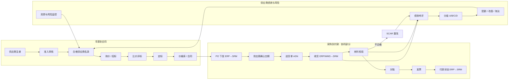

# 01 · 需求分析

> 所属：[SRM 设计总览](./README.md)　·　下一篇：[02 领域模型](./02-domain-model.md)

## 1. 业务背景与痛点

典型制造企业在没有 SRM 时，供应商相关工作散落在 ERP、Excel、邮件和即时通讯里。
调研中最常见的 8 个痛点，以及它们各自的业务代价：

| # | 痛点 | 业务代价 |
|---|---|---|
| T1 | 供应商资料散落在 Excel、邮件和 ERP，信息不全、不一致 | 下单找不到联系人；同一家供应商在 ERP 里被建成两条 |
| T2 | 资质证书（营业执照、ISO、生产许可）到期无人提醒 | 资质过期的供应商还在供货，审核和客户审厂时被开不符合项 |
| T3 | 准入靠纸质表或邮件审批，进度不透明、不可追溯 | 准入周期 4–8 周，紧急寻源时被迫「先用后补」 |
| T4 | 询价比价在线下完成，报价靠邮件或微信发送 | 价格没有沉淀，无法审计；存在提前泄露报价的廉洁风险 |
| T5 | 订单确认、交期答复靠电话和微信 | 交期不透明，缺料时才发现供应商没排产 |
| T6 | 来料不合格后的整改靠邮件往来 | 问题重复发生，整改不闭环，索赔没有依据 |
| T7 | 对账靠 Excel 来回核对 | 对账周期 2–3 周，发票差异多，付款延迟，供应商满意度低 |
| T8 | 供应商绩效靠主观印象 | 分级、配额、淘汰缺少数据支撑，好供应商得不到激励 |

## 2. 建设目标与度量指标

每个目标都对应一个可以从系统数据直接算出来的指标，上线后按月复盘。基线值在
v0.2 存量数据导入时实测填写。

| 目标 | 指标（口径） | 一年目标值 | 对应痛点 |
|---|---|---|---|
| G1 主数据可信 | 活跃供应商主数据完整率（必填项齐全 ÷ 活跃供应商数） | ≥ 98% | T1 |
| G2 资质合规 | 资质过期仍处于「合格」状态的供应商数 | 0 | T2 |
| G3 准入提速 | 准入申请从提交到批准的中位用时 | ≤ 10 个工作日 | T3 |
| G4 寻源线上化 | 线上询价定标金额 ÷ 新增定价总金额 | ≥ 90% | T4 |
| G5 寻源降本 | 寻源节约额 =（预算价或上次价格 − 定标价）× 数量 | 按年度目标 | T4 |
| G6 订单协同 | PO 下发后 24 小时内被供应商确认的比例（ERP 集成后，[ADR-0008](../adr/0008-order-to-pay-stays-in-erp.md)） | ≥ 95% | T5 |
| G7 交付可见 | 交付准时率（OTD）按月出数（由导入的交付记录计算） | 100% 覆盖 | T5、T8 |
| G8 质量闭环 | SCAR 按期关闭率 | ≥ 90% | T6 |
| G9 结算提速 | 对账单从生成到双方确认的中位用时（ERP 集成后） | 缩短 50% | T7 |
| G10 绩效客观 | 季度绩效中由系统数据自动计算的分值占比 | ≥ 60% | T8 |

## 3. 干系人与角色

### 3.1 内部角色

| 角色 | 职责 | 在 SRM 中的主要动作 |
|---|---|---|
| 采购总监 | 采购战略、大额定标、供应商淘汰决策 | 审批定标和淘汰，看全局看板 |
| 品类经理 / 寻源工程师 | 负责某几个品类的寻源、供应商开发与准入 | 发起准入和询价，评标，提出定标建议 |
| 采购员 / 计划员 | 订单跟进、交期催办、日常沟通 | 跟进 PO 确认，处理交期异常，发起对账 |
| SQE（供应商质量工程师） | 准入审核、质量整改、质量绩效 | 资质审核、现场审核、SCAR 跟进与验证 |
| IQC 检验员 | 来料检验（在 ERP / QMS 中执行） | 按月导入检验结论到交付记录，或逐条录入 |
| 仓库收货员 | 收货（在 ERP / WMS 中执行） | 不使用 SRM；收货结果随交付记录导入 |
| 应付会计 | 银行账户复核；对账与付款在 ERP | 复核银行账户变更（对账单确认、发票校验待 ERP 集成） |
| 需求部门申请人 | 提出非生产性采购需求 | 提交采购申请，参与技术评分 |
| 内控 / 审计 | 合规检查 | 只读查看审批历史、价格和寻源记录 |
| 系统管理员 | 配置和用户管理 | 维护品类、编码规则、权限，邀请供应商账号 |

### 3.2 外部角色（供应商侧）

| 角色 | 主要动作 |
|---|---|
| 供应商管理员（主账号） | 维护公司资料和联系人，管理本公司的门户账号 |
| 商务 / 销售 | 响应询价、提交报价，确认订单和交期 |
| 物流 / 计划 | 创建送货单（ASN），打印送货标签 |
| 质量 | 回复 SCAR，上传整改证据 |
| 财务 | 确认对账单，上传发票，查看付款状态 |

## 4. 业务范围

### 4.1 价值链全景

### 4.2 范围内（按模块）

版本号见 [07 §1](./07-delivery-plan.md#1-分期路线图)；「ERP 集成后」的模块现阶段不做（[ADR-0008](../adr/0008-order-to-pay-stays-in-erp.md)）。

| 模块 | 编号 | 内容 | 版本 |
|---|---|---|---|
| 供应商主数据 | M1 | 基本信息、联系人、资质证书、供货范围（品类）；银行账户、物料只读副本、存量导入 | v0.1（银行账户、物料、导入在 v0.2） |
| 供应商生命周期 | M2 | 内部登记与准入（资料 / 现场审核 / 样品）、合格名录、信息变更、冻结 / 淘汰 / 黑名单 | v0.1（变更 v0.2，处置 v0.3） |
| 寻源管理 | M3 | 询价单、邀请、报价、封标开标、比价评标、定标审批、价格库 | v0.7（竞价、招标增强、配额为客户驱动主题） |
| 合同与协议 | M4 | 框架协议、价格协议、质量协议、廉洁协议；审批、签署、到期提醒 | v0.3 |
| 订单协同 | M5 | PO 下发、供应商确认 / 交期答复、变更重确认、送货单、收货回传 | ERP 集成后（门户镜像） |
| 质量协同 | M6 | 交付记录导入（含检验结论）、SCAR / 8D 整改、索赔金额登记、供应商审核 | v0.4 |
| 绩效管理 | M7 | 指标库、按物资类别周期考评、自动算分 + 人工评分、分级、结果应用 | v0.5 |
| 对账结算 | M8 | 对账单生成与确认、发票登记与匹配、付款状态 | 不做，留在 ERP；付款进度在 ERP 集成后作为门户镜像 |
| 风险与合规 | M9 | 资质到期、风险事件（手工登记）、黑名单；工商数据接口 | v0.1（资质）、v0.5（风险事件）；外部数据为客户驱动主题 |
| 供应商门户 | M10 | 以上各模块的供应商侧功能 | v0.6（依赖 objectstack#25233） |
| 分析与看板 | M11 | 寻源节约、OTD、质量、绩效、风险看板 | 随各模块同版本 |
| 集成与管理 | M12 | 通知模板、编码规则、审计；ERP 集成 | v0.1 起；ERP 集成为客户驱动主题 |

### 4.3 范围外（明确不做）

| 不做的事 | 原因 / 归属 |
|---|---|
| 物料主数据的创建与维护 | ERP 是物料的记账系统，SRM 只保存只读镜像 |
| 库存、入库记账、总账与应付凭证、付款执行 | ERP / 财务系统负责；SRM 只同步结果 |
| 依法必须招标项目的电子招投标 | 需要符合《电子招标投标办法》的专业平台，必要时只做集成 |
| 电子签章本身 | 集成第三方电子签服务，SRM 只发起签署并保存结果 |
| 发票真伪查验本身 | 集成税务查验服务商，SRM 只保存查验结果 |
| 采购计划与 MRP 运算 | ERP / APS 负责 |
| 采购订单、收货入库、对账、发票、付款（ADR-0008） | ERP 是记账系统；SRM 只记结论：交付记录（导入）、SCAR 上的索赔金额；订单确认、送货通知、付款进度在 ERP 集成后作为门户镜像 |
| 采购申请、货源清单与配额 | 生产性需求在 ERP / MRP；非生产性申请多在 OA，客户明确要求时再评估 |

## 5. 功能需求

优先级：**P0** 必须（所在期次不可缺）、**P1** 应该（所在期次内尽量做）、**P2** 可以
（可后移）。验收标准写成可以直接转成测试用例的形式。

### 5.1 M1 供应商主数据

| 编号 | 用户故事 | 验收标准 | 优先级 |
|---|---|---|---|
| FR-101 | 作为品类经理，我要在一个页面看到供应商的全部信息（基本信息、联系人、银行账户、资质、供货品类、历史单据） | 供应商详情页按页签展示 6 类子信息；每个页签可直接新增子记录 | P0 |
| FR-102 | 作为系统，我要阻止同一家公司被重复建档 | 身份标识唯一（BR-01）：中国供应商按统一社会信用代码，境外供应商按「国家 / 地区 + 注册号」；重复时提示已存在的供应商编号及当前状态 | P0 |
| FR-103 | 作为供应商管理员，我要在门户里维护本公司联系人 | 只能看到、编辑本公司联系人；新增联系人默认无门户账号 | P0 |
| FR-104 | 作为应付会计，我要确认供应商的收款账户真实有效 | 新账户状态为「待核验」；只有应付会计能把它改成「有效」；未核验账户不推送 ERP | P0 |
| FR-105 | 作为 SQE，我要登记供应商资质证书并上传扫描件 | 证书有类型、编号、有效期、附件；有效期止早于起时拒绝保存 | P0 |
| FR-106 | 作为品类经理，我要维护供应商可供货的品类及其资格状态 | 同一供应商同一品类只有一条记录；状态为试供 / 合格 / 暂停 | P0 |
| FR-107 | 作为管理员，我要把存量供应商从 Excel 导入 | 使用对象列表的导入功能，支持列映射、试运行预览和撤销 | P0 |

### 5.2 M2 供应商生命周期

| 编号 | 用户故事 | 验收标准 | 优先级 |
|---|---|---|---|
| FR-200 | 作为品类经理，我要在门户上线前自己登记潜在供应商并发起准入 | 内部新建准入申请，来源记为「内部登记」；跳过门户补资料，初审人默认为创建人所在品类的品类经理 | P0（v0.1） |
| FR-201 | 作为潜在供应商，我要不登录就能在线提交注册申请 | 公开注册表单可匿名提交，只收文字信息、不收附件（2026-10-24 决定：营业执照、证书等附件由供应商注册账户、登录门户后上传）；提交后生成「已提交」的准入申请，申请人收到受理通知。多组织托管云上公开表单落入部署默认组织（objectstack ADR-0138 D4），待 07 §6 V1 实测与 objectstack#25447 后启用 | P2（待平台） |
| FR-202 | 作为品类经理，我要邀请指定供应商注册 | 填写公司名和联系人邮箱即可发出邀请；供应商以受邀成员身份进门户后填申请，来源记为「邀请」。v0.6 的默认注册方式 | P0（v0.6） |
| FR-203 | 作为采购初审人，我要在受理时自动看到重复和黑名单检查结果 | 身份标识命中已有供应商或黑名单时，申请页醒目提示并禁止进入下一步 | P0 |
| FR-204 | 作为 SQE，我要按品类风险等级决定是否需要现场审核和样品验证 | 高风险品类的申请必须有通过（或有条件通过）的现场审核记录才能提交准入评审 | P0 |
| FR-205 | 作为准入评审人，我要在一个审批里看到资料、审核报告和样品结论 | 审批页展示申请摘要、证书清单、审核得分；批准后供应商状态变为「合格」，对应品类资格变为「合格」或「试供」 | P0 |
| FR-206 | 作为采购员，我要查到某品类的合格供应商名录 | 名录视图按品类筛选，只列资格为「合格」且供应商状态为「合格」的记录 | P0 |
| FR-207 | 作为供应商，我要提交关键信息变更（名称、地址、银行账户） | 变更单记录变更前后值，审批通过后自动写回供应商档案；银行账户变更需采购与财务双人审批。门户上线前由采购员代供应商发起 | P1（v0.2） |
| FR-208 | 作为品类经理，我要冻结、解冻、淘汰供应商或拉入黑名单 | 处置单需写明原因并经审批；冻结后不能被邀请询价；淘汰后不能直接恢复，只能重新走准入（受理时命中淘汰供应商不视为重复，见 03 §3）；黑名单不能重新准入，解除黑名单需单独审批 | P1（v0.3） |

### 5.3 M3 寻源管理（v0.7）

| 编号 | 用户故事 | 验收标准 | 优先级 |
|---|---|---|---|
| FR-301 | 作为寻源工程师，我要创建询价单，列出物料、数量、需求日期和报价截止时间 | 询价单至少 1 行明细；截止时间必须晚于发布时间 | P0 |
| FR-302 | 作为寻源工程师，我要从合格名录中选择邀请的供应商 | 只能选择供应商状态为「合格」且该品类资格不为「暂停」的供应商；冻结的供应商不可选 | P0 |
| FR-303 | 作为供应商，我要在门户里看到给我的询价并在线报价 | 只看到邀请了本公司的询价；可填单价、交期、税率、附件；截止前可多次修改并重新提交 | P0 |
| FR-304 | 作为内控，我要求截止前任何内部人员都看不到报价内容 | 截止前内部用户查询报价返回空；能看到「已报价 N 家」这一数量 | P0 |
| FR-305 | 作为寻源工程师，我要在截止后统一开标并看到比价表 | 到截止时间系统自动截标；开标后报价可见，比价视图按明细行横向对比各家价格 | P0 |
| FR-306 | 作为评标小组，我要按综合评分法打技术分和商务分 | 支持最低价法和综合评分法；综合评分 = 技术分 × 技术权重 + 商务分 × 商务权重 | P1 |
| FR-307 | 作为寻源工程师，我要发起多轮报价（议价） | 可对选定供应商开启下一轮；历史轮次报价只读保留 | P1 |
| FR-308 | 作为采购总监，我要按金额分级审批定标结果 | 审批人按金额档自动确定；有效报价少于 3 家时必须填写原因，并升级一级审批 | P0 |
| FR-309 | 作为系统，我要在定标后自动生成价格记录并通知结果 | 每个中标明细生成一条价格记录（生效日、失效日、来源询价单）；中标与未中标的供应商分别收到通知 | P0 |
| FR-310 | 作为采购员，我要查询某物料当前有效的协议价格 | 价格库按物料、供应商、有效期查询；同一供应商 × 物料 × 工厂的有效期不重叠 | P0 |
| FR-311 | 作为寻源工程师，我要用反向竞价拿到更低的价格 | 竞价期内供应商只看到自己的排名（不看到他人价格）；每次出价必须低于自己上一次出价 | P2（客户驱动） |

### 5.4 M4 合同与协议（v0.3）

| 编号 | 用户故事 | 验收标准 | 优先级 |
|---|---|---|---|
| FR-401 | 作为品类经理，我要从定标结果生成合同草稿 | 合同自动带出供应商、金额、来源询价单 | P1 |
| FR-402 | 作为法务和采购总监，我要审批合同 | 金额与合同类型决定审批路径；审批中合同只读 | P0 |
| FR-403 | 作为采购员，我要上传双方签署的合同或发起电子签 | 上传盖章扫描件后状态为「生效」并保存签署文件；电子签只预留签章单号字段，接入为客户驱动主题 | P0 |
| FR-404 | 作为品类经理，我要在合同到期前收到提醒 | 到期前 60 / 30 / 7 天各提醒一次；到期后自动变为「已到期」 | P0 |
| FR-405 | 作为 SQE，我要确认每家合格供应商都签了质量协议和廉洁协议 | 供应商详情显示协议签署状态；缺失时在名录中标记 | P1 |

### 5.5 M5 订单协同（ERP 集成后的门户镜像，现阶段不做）

以下需求的记录系统是 ERP，只在 ERP 集成落地后作为门户镜像实现（[ADR-0008](../adr/0008-order-to-pay-stays-in-erp.md) 第 5 条）；保留在此作为集成立项时的需求基线。

| 编号 | 用户故事 | 验收标准 | 优先级 |
|---|---|---|---|
| FR-501 | 作为系统，我要接收 ERP 下达的 PO 并通知供应商 | 按 ERP 订单号幂等写入；供应商联系人收到待确认通知 | P0 |
| FR-502 | 作为供应商，我要逐行确认订单并答复交期和数量 | 可整单确认或逐行答复；答复交期晚于需求日期时必须填写原因 | P0 |
| FR-503 | 作为采购员，我要第一时间知道交期风险 | 答复交期晚于需求日期的行被标记「交期风险」，并通知采购员 | P0 |
| FR-504 | 作为采购员，我要催办未确认的订单 | 下发 24 小时未确认自动提醒供应商；48 小时未确认升级到采购主管 | P0 |
| FR-505 | 作为系统，我要在 ERP 变更 PO 后让供应商重新确认 | 订单版本号加一，状态变为「变更待确认」，保留变更前后差异 | P1 |
| FR-506 | 作为供应商，我要按未交数量创建送货单并打印送货标签 | 送货数量不超过订单行的未交数量；送货单带二维码 | P1 |
| FR-507 | 作为采购员，我要看到收货结果并据此计算准时交付 | ERP / WMS 收货结果同步后，订单行自动累计已收数量并判定是否准时 | P0 |

### 5.6 M6 质量协同（v0.4）

| 编号 | 用户故事 | 验收标准 | 优先级 |
|---|---|---|---|
| FR-601 | 作为 SQE，我要把每月的交付与检验结果落到供应商头上 | 交付记录按月从 ERP 导出表格导入（按订单号 + 行号幂等），没有质量系统时由质检员逐条录入；记录应到 / 实到日期、订单 / 实收数量、检验结论、不合格数 | P0 |
| FR-602 | 作为 SQE，我要在交付记录判定不合格后得到一张整改单 | 检验结论为不合格且严重度为「严重」或「主要」时自动生成 SCAR，指派给该品类 SQE；门户上线前由 SQE 代供应商填写回复 | P0 |
| FR-603 | 作为供应商质量，我要在门户里按 8D 节奏回复整改 | 72 小时内提交临时围堵措施（D3）；30 天内提交根因与永久措施（D4–D7）；可上传证据 | P0 |
| FR-604 | 作为 SQE，我要审核供应商的回复，必要时退回 | 审核可通过或退回；退回时必须填写意见，单据回到供应商待办 | P0 |
| FR-605 | 作为 SQE，我要在整改逾期时自动升级 | 超期未回复时提醒供应商并抄送 SQE 主管；整改单标记「逾期」 | P1 |
| FR-606 | 作为 SQE，我要登记质量索赔并让供应商确认 | 索赔金额与结论记录在整改单上，供财务在 ERP 扣款时参考；SRM 不生成扣款 | P1 |
| FR-607 | 作为 SQE，我要安排和记录供应商现场审核 | 审核记录有计划、检查表、问题项与结论；问题项可转为整改单 | P0 |

### 5.7 M7 绩效管理（v0.5）

| 编号 | 用户故事 | 验收标准 | 优先级 |
|---|---|---|---|
| FR-701 | 作为采购总监，我要维护绩效指标库和权重 | 指标属于 QCDS 某一维度，标明自动或人工；同一考评方案内权重合计 100% | P0 |
| FR-702 | 作为系统，我要按物资类别的周期自动为活跃供应商生成考评单并计算自动指标 | 周期按供应商所供最高物资类别取参数 `perf_cycle`（示例 A 类每月、B 类每季、C 类每年）；期初生成上期考评单；OTD、批次合格率、PPM 由交付记录计算（订单响应及时率待 ERP 集成） | P0 |
| FR-703 | 作为 SQE 和采购员，我要为人工指标打分 | 评分人只看到分配给自己的评分项；评分截止后未评项按规则处理（默认取 60 分并标记「未评」，可配置） | P0 |
| FR-704 | 作为采购总监，我要审定考评结果并发布 | 总分与等级自动算出；发布后供应商可在门户查看本公司结果与扣分项 | P0 |
| FR-705 | 作为品类经理，我要让绩效结果驱动后续动作 | C 级自动生成改善要求；连续两期 D 级自动发起淘汰评审 | P1 |
| FR-706 | 作为供应商，我要对考评结果提出申诉 | 发布后 7 天内可申诉一次；申诉由采购总监处理，结果留痕 | P2 |

### 5.8 M8 对账结算（不做，留在 ERP）

对账、发票、付款的记录系统是 ERP（[ADR-0008](../adr/0008-order-to-pay-stays-in-erp.md)）。以下需求不实现；
供应商侧的付款进度查询在 ERP 集成后作为门户镜像另行设计。保留在此作为剥离项的记录。

| 编号 | 用户故事 | 验收标准 | 优先级 |
|---|---|---|---|
| FR-801 | 作为系统，我要每月自动生成对账单 | 每月 1 日按「供应商 × 法人」汇总上月已收货未对账的明细、退货、索赔扣款 | P0 |
| FR-802 | 作为供应商财务，我要在门户确认或对账单提出差异 | 确认后对账单锁定；提出差异必须写明差异行与原因 | P0 |
| FR-803 | 作为应付会计，我要处理差异并确认对账单 | 差异处理后重新发给供应商确认；双方确认后才能开票 | P0 |
| FR-804 | 作为供应商财务，我要上传发票并关联对账单 | 发票不含税金额、税额与对账单的差异在容差内（默认 ±1 元）才能提交 | P0 |
| FR-805 | 作为系统，我要把确认的对账和发票推给 ERP 并回写付款状态 | 推送成功后记录 ERP 凭证号；ERP 付款后回写已付金额与日期，供应商在门户可见 | P1 |

### 5.9 M9 风险与合规

| 编号 | 用户故事 | 验收标准 | 优先级 |
|---|---|---|---|
| FR-901 | 作为 SQE，我要在资质到期前收到提醒 | 到期前 30 / 15 / 7 天提醒 SQE 和供应商；到期当天证书变为「已过期」 | P0 |
| FR-902 | 作为系统，我要阻止关键资质过期的供应商参与新业务 | 必备资质过期时供应商被标记「资质异常」，不能被邀请询价，现有订单不受影响 | P0 |
| FR-903 | 作为风控，我要登记并处理供应商的工商与司法风险 | 风险事件可手工登记（类型、来源、处理结论），高风险生成处置单草稿；外部企业信息服务的自动拉取为客户驱动主题 | P1（v0.5） |
| FR-904 | 作为内控，我要求供应商申报与我司员工的关联关系 | 注册与年审时填写关联申报；存在关联的供应商在寻源时提示评标人回避 | P1 |

### 5.10 M10 供应商门户（汇总）

门户不是一套独立功能，而是上述模块的供应商侧入口。门户首页是一张**待办清单**：

| 待办 | 来源 |
|---|---|
| 待回复 / 被退回的整改单 | M6（v0.6） |
| 即将到期的资质证书、准入申请进度 | M9、M2（v0.6） |
| 最新一期绩效结果 | M7（v0.6） |
| 待响应的询价、即将截止的报价 | M3（v0.7） |
| 待确认的订单、变更待确认的订单；付款进度 | M5（ERP 集成后的门户镜像） |

门户的通用要求：手机浏览器可用；中英文界面；所有列表只含本公司数据（见
[04 §3](./04-security-and-portal.md#3-供应商门户的数据隔离)）。

### 5.11 M11 分析与 M12 集成

指标定义与看板见 [05 §4](./05-experience-and-analytics.md#4-仪表盘与指标口径)，集成需求见
[06 §1](./06-integration-and-ai.md#1-预留的-erp-集成点)。

## 6. 关键业务规则

业务规则单独编号，便于在流程、校验规则和测试中引用。「落地方式」说明它在平台
上靠什么机制保证。

| 编号 | 规则 | 落地方式 |
|---|---|---|
| BR-01 | 供应商身份标识唯一：中国供应商的统一社会信用代码唯一；境外供应商的「国家 / 地区 + 注册号」唯一（[ADR-0007](../adr/0007-china-first-with-overseas-seams.md)） | `credit_code` 字段唯一约束；`country` + `registration_no` 组合唯一索引 |
| BR-02 | 黑名单供应商（按 BR-01 的身份标识）不得重新注册或准入 | 准入受理 flow 查询黑名单，命中则自动驳回 |
| BR-03 | 只有「合格」且品类资格未暂停的供应商可被邀请询价 | 「邀请供应商」screen flow 内校验（内部角色无直接创建邀请的权限）+ 邀请对象上一跳读取供应商状态的校验规则兜底 + 选择器筛选条件 |
| BR-04 | 必备资质过期的供应商不得被邀请询价 | 扫描 flow 维护「资质异常」标志，BR-03 的校验同时检查该标志 |
| BR-05 | 报价截止前内部不可见报价内容（封标） | 报价对象的内部 RLS 只放行 `bid_opened == true` |
| BR-06 | 截止后供应商不得修改报价 | 报价上冗余截止时间，校验规则用 `now()` 比较，截止后拒绝写入 |
| BR-07 | 有效报价少于 3 家时，定标须说明理由并升级一级审批 | 定标提交前的校验规则 + 审批 flow 的判断分支 |
| BR-08 | 定标金额分级审批（默认 < 10 万 / 10–100 万 / ≥ 100 万） | 审批 flow 的判断节点，阈值放在可配置的常量里 |
| BR-09 | 寻源发起人不得审批自己发起的定标（职责分离） | 发起岗与审批岗分离 + 审批 flow 在审批人等于发起人时改走上一级（见 [04 §6](./04-security-and-portal.md#6-职责分离sod)） |
| BR-10 | 同一供应商 × 物料 × 工厂的价格有效期不得重叠 | 定标 flow 写新价格前把旧价格的失效日截断到新价格生效日前一天 |
| BR-11 | 银行账户变更须采购与财务两人分别审批，生效前不推送 ERP | 变更单的两级审批，审批人不得为同一人 |
| BR-12 | PO 下发 24 小时未确认提醒供应商，48 小时升级采购主管（ERP 集成后） | 每小时的追赶式扫描 + 外部心跳（相对日期触发器按天计，精度不够） |
| BR-13 | 答复交期晚于需求日期的订单行标记交期风险 | 订单行写入后的记录触发 flow |
| BR-14 | 送货数量不得超过订单行「未交数量 − 已发未收数量」（ERP 集成后） | 「创建送货单」screen flow 内校验（门户无直接创建送货明细的权限） |
| BR-15 | 严重 / 主要不合格自动生成 SCAR | 交付记录写入后的记录触发 flow |
| BR-16 | 对账单经供应商确认后锁定，只能通过差异流程修改（不做，留在 ERP） | — |
| BR-17 | 发票金额与对账单差异超过容差不得提交（不做，留在 ERP） | — |
| BR-18 | 连续两期 D 级自动发起淘汰评审 | 考评发布后的记录触发 flow |
| BR-19 | 供应商只能看到本公司数据 | 每家供应商一个门户岗位 + 门户 RLS |
| BR-20 | 银行账号等敏感字段仅对应付会计和采购管理员可见 | 字段级权限（FLS） |

## 7. 非功能需求

| 类别 | 需求 | 验收方式 |
|---|---|---|
| 安全 · 隔离 | 任一供应商用户通过界面、REST API、AI 助手都不能读到其他供应商的任何记录 | 双供应商交叉越权测试（每个门户对象 × 读 / 改 / 删） |
| 安全 · 封标 | 截止前内部用户（含 AI 助手）读不到报价行 | 截止前后各测一次查询、导出、仪表盘、AI 提问 |
| 安全 · 审计 | 关键字段变更、审批、价格变化可追溯到人和时间 | 主数据对象开启字段历史；审批历史由平台保存，不可篡改 |
| 安全 · 敏感数据 | 银行账号、联系人手机号按字段权限控制；个人信息有处理依据 | FLS 测试；注册表单含个人信息告知与同意 |
| 性能 | 常用列表（≤ 10 万行）首屏 ≤ 2 秒；比价视图（≤ 20 家 × 200 行）≤ 3 秒 | 压测脚本 |
| 并发 | 报价截止前 30 分钟高峰，门户 200 并发用户 | 压测脚本 |
| 可用性 | 门户月可用率 ≥ 99.5%；截标、开标定时任务失败可重跑且结果幂等 | 监控 + 演练 |
| 导入幂等 | 物料、交付记录、存量供应商的表格导入可重复执行，结果一致；按外部编号匹配 | 样例表格在 CI 跑两遍 |
| 集成可靠性（ERP 集成后） | ERP 推送失败自动重试，失败记录可见可重发；重复消息不产生重复单据 | 外部编号幂等测试 |
| 易用性 | 供应商无需培训即可完成「确认订单」「提交报价」；手机浏览器可完成 | 可用性测试（5 家供应商） |
| 国际化 | 全部界面中英文（[ADR-0007](../adr/0007-china-first-with-overseas-seams.md)）；金额支持多币种与汇率换算；境外供应商按「国家 / 地区 + 注册号」建档 | `os i18n check --strict` 无缺失词条；境外供应商注册与查重用例 |
| 可配置性 | 新增字段、调整审批阈值、增加证书类型无需改核心发版 | 参数、Studio 覆盖层或客户私有包完成（[ADR-0009](../adr/0009-core-first-pack-criteria-and-customer-layer.md)）；核心字段只隐藏不删除 |
| 数据迁移 | 存量供应商、联系人、证书、有效价格可批量导入 | 迁移演练两轮，抽检准确率 ≥ 99% |
