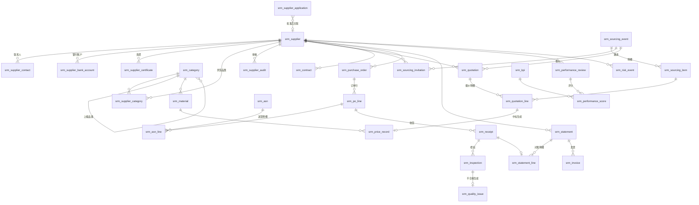

# 02 · 领域模型与数据设计

> 所属：[SRM 设计总览](./README.md)　·　上一篇：[01 需求分析](./01-requirements.md)　·　下一篇：[03 流程与自动化](./03-processes-and-automation.md)

## 1. 建模原则

这些原则来自平台契约（`@objectstack/spec`）和平台的建模约定，违反它们的元数据
会在发布或 lint 阶段被拒收，或者能发布但运行时行为不对。

1. **命名空间 `srm`**：所有对象以 `srm_` 开头；字段名、选项值一律 snake_case，
   不以数字开头（`p1_49` 而不是 `1_49`）。
2. **不手工加「负责人」字段**：`owner_id`、`created_by`、`organization_id` 等
   是平台注入的系统字段。业务上需要的**其他**人员角色（审批人、SQE、评分人）
   才用 `user` 类型字段，并且默认非必填。
3. **状态是主对象上的 `select` 字段**：每个单据有一个 `status` 作为对象的
   `stageField`，每个选项标注 `kind`：途中步骤为 `open`，成功终点为 `won`，
   失败终点或异常为 `lost`，顺序为 open → won → lost。合法跳转由 `state_machine`
   校验规则约束，并且声明 `initialStates`，防止记录一创建就是「已批准」。
4. **审批是 flow，不是表**：不建「审批记录」「审批步骤」对象。审批历史由平台
   保存。
5. **汇总字段在设计时就声明聚合方式**：`summary` 字段写明
   `summaryOperations { object, field, function, filter }`；带条件的汇总
   （「已收货数量」「有效报价数」）必须写 `filter`（与查询 `where` 相同的对象式
   条件，如 `{ status: 'submitted' }`），否则会把所有子记录都算进去。下文字段表里
   「条件 `x == 'y'`」的写法都对应一个 `filter`。
6. **看板要用的数字必须是存储字段**：仪表盘的求和 / 平均只能落在存储的数值字段
   上，`formula` 读时计算、不落库。所以 OTD、合格率这类要上看板的比率，由 flow
   计算后写入 `number` / `percent` 字段，而不是做成公式字段。
7. **复选框不设必填**：`boolean` 字段一律给 `defaultValue: false`，「必须勾选」
   用校验规则表达。
8. **ERP 来源数据带外部编号**：每个从 ERP 同步的对象有唯一的 `erp_*_id` 字段，
   集成按它幂等 upsert。反过来，SRM 要推给 ERP 的对象（供应商、银行账户、处置单、价格记录、
   采购订单〔确认交期回写〕、送货单、对账单、发票）带 `erp_sync_status` /
   `erp_sync_error` / `erp_synced_at` 三个同步字段，推送失败可见，由重推扫描补发（见
   [06 §1.1](./06-integration-and-ai.md#11-原则)）。
9. **每个对象显式声明 OWD**（`sharingModel`），这是平台 lint 的强制项；门户相关
   对象的 OWD 和 RLS 设计见 [04](./04-security-and-portal.md)。
10. **金额用 `currency`，比例用 `percent`，附件用 `file`，地址用 `address`**。
11. **面向供应商的单据冗余门户岗位**：每张供应商要看的**顶层**单据都带一个
    `portal_position`（text，只读）字段，在创建时由 flow 从供应商档案复制过来，
    门户 RLS 只认它（见 [04 §3](./04-security-and-portal.md#3-供应商门户的数据隔离)）。
    带这个字段的对象：准入申请、变更单、寻源邀请、报价单、价格记录、合同、采购
    订单、送货单、收货记录、来料检验、整改单、考评单、对账单、发票。它们的
    `master_detail` 子对象（报价明细、订单行、送货明细、评分明细、对账明细）用
    `controlled_by_parent` 跟随父记录，不重复冗余。注意 `controlled_by_parent` 的
    **写**同样跟随父记录：改子记录要求对父记录有编辑权。所以凡是门户要改子记录的
    地方（订单行答复、证书维护），门户对父记录授予编辑权，再用字段级权限把父记录
    的字段全部设为只读（见 [04 §3.2](./04-security-and-portal.md#32-各对象的门户策略)）。
12. **校验规则最多读一跳**：`script` / `cross_field` 校验规则能读本记录，也能经一个
    引用字段读关联记录（如邀请上的 `record.supplier.status`），该读取以系统身份进行、
    读不到时拒绝写入。两跳以上或需要汇总的判断依据，要么在创建时由 flow 冗余到本
    记录并设为只读（如把寻源单的截止时间复制到报价单，报价明细再经一跳读取），
    要么改走以系统身份运行的 screen flow。
13. **为扩展包预留接口**：扩展包不修改核心，只能给核心对象加字段与校验
    （`objectExtensions`）、给共享选项列表追加选项（`picklistExtensions`）、往核心
    应用的导航分组里挂菜单（见[扩展包 §3.2](../packs/README.md#32-扩展包怎么接入核心)）。
    所以可能被扩展包追加选项的枚举，在核心里做成**共享选项列表**（picklist），不直接写在
    字段上：`srm_sourcing_event.sourcing_type`、`srm_contract.contract_type`、`srm_supplier_certificate.cert_type`、
    `srm_quality_issue.source`、`srm_kpi.dimension`、`srm_risk_event.risk_type`、
    `srm_statement_line.line_type`、`srm_receipt.settlement_mode`。状态字段（stageField）
    不做成可扩展的，状态机只由核心定义。

## 2. 对象总览

「来源」列：**SRM** 表示在 SRM 内产生；**ERP** 表示从 ERP 同步、SRM 内只读；
**门户** 表示主要由供应商在门户里填写。

| # | 对象 | 中文名 | 领域 | 父对象（master_detail） | 来源 | 期次 |
|---|---|---|---|---|---|---|
| 1 | `srm_category` | 采购品类 | 基础数据 | — | SRM | 一期 |
| 2 | `srm_material` | 物料 | 基础数据 | — | ERP | 一期 |
| 3 | `srm_plant` | 工厂 / 收货地点 | 基础数据 | — | ERP | 一期 |
| 4 | `srm_supplier` | 供应商 | 供应商主数据 | — | SRM | 一期 |
| 5 | `srm_supplier_contact` | 供应商联系人 | 供应商主数据 | 供应商 | SRM / 门户 | 一期 |
| 6 | `srm_supplier_bank_account` | 银行账户 | 供应商主数据 | 供应商 | 门户 | 一期 |
| 7 | `srm_supplier_certificate` | 资质证书 | 供应商主数据 | 供应商 | 门户 | 一期 |
| 8 | `srm_supplier_category` | 供货品类资格 | 供应商主数据 | 供应商 | SRM | 一期 |
| 9 | `srm_supplier_application` | 准入申请 | 生命周期 | — | 门户（公开表单） | 一期 |
| 10 | `srm_supplier_audit` | 供应商审核 | 生命周期 | — | SRM | 一期 |
| 11 | `srm_supplier_change_request` | 信息变更单 | 生命周期 | — | 门户 | 二期 |
| 12 | `srm_supplier_disposition` | 供应商处置单（冻结 / 解冻 / 淘汰 / 黑名单） | 生命周期 | — | SRM | 二期 |
| 13 | `srm_sourcing_event` | 寻源单（询价 / 招标 / 竞价） | 寻源 | — | SRM | 一期 |
| 14 | `srm_sourcing_item` | 寻源明细 | 寻源 | 寻源单 | SRM | 一期 |
| 15 | `srm_sourcing_invitation` | 寻源邀请 | 寻源 | —（lookup 寻源单） | SRM | 一期 |
| 16 | `srm_quotation` | 报价单 | 寻源 | — | 门户 | 一期 |
| 17 | `srm_quotation_line` | 报价明细 | 寻源 | 报价单 | 门户 | 一期 |
| 18 | `srm_price_record` | 价格记录（价格库） | 寻源 | — | SRM | 一期 |
| 19 | `srm_purchase_request` | 采购申请 | 寻源 | — | SRM / ERP | 二期 |
| 20 | `srm_source_list` | 货源清单与配额 | 寻源 | — | SRM | 五期 |
| 21 | `srm_contract` | 合同 / 协议 | 合同 | — | SRM | 二期 |
| 22 | `srm_purchase_order` | 采购订单 | 订单协同 | — | ERP | 二期 |
| 23 | `srm_po_line` | 订单行 | 订单协同 | 采购订单 | ERP / 门户 | 二期 |
| 24 | `srm_asn` | 送货单 | 订单协同 | — | 门户 | 二期 |
| 25 | `srm_asn_line` | 送货明细 | 订单协同 | 送货单 | 门户 | 二期 |
| 26 | `srm_receipt` | 收货记录（行级） | 订单协同 | — | ERP | 二期 |
| 27 | `srm_inspection` | 来料检验 | 质量 | — | ERP / QMS | 三期 |
| 28 | `srm_quality_issue` | 质量整改单（SCAR） | 质量 | — | SRM / 门户 | 三期 |
| 29 | `srm_kpi` | 绩效指标 | 绩效 | — | SRM | 三期 |
| 30 | `srm_performance_review` | 绩效考评单 | 绩效 | — | SRM | 三期 |
| 31 | `srm_performance_score` | 评分明细 | 绩效 | 考评单 | SRM | 三期 |
| 32 | `srm_statement` | 对账单 | 结算 | — | SRM | 四期 |
| 33 | `srm_statement_line` | 对账明细 | 结算 | 对账单 | SRM | 四期 |
| 34 | `srm_invoice` | 发票 | 结算 | — | 门户 | 四期 |
| 35 | `srm_risk_event` | 风险事件 | 风险 | — | SRM / 外部服务 | 四期 |

**刻意没有建的对象**：审批记录、审批步骤、流程节点（平台 flow 提供）；评标结果表
（定标结果直接写在报价明细的中标字段上）；通知记录（平台通知提供）；操作日志
（平台字段历史与审计提供）。

## 3. 关系图



**master_detail 与 lookup 的取舍**：子记录离开父记录没有意义、权限应跟随父记录时
用 `master_detail`（联系人、证书、订单行、报价明细）。报价单**刻意**对寻源单用
`lookup` 而不是 `master_detail`：报价单的可见性要按供应商隔离，不能跟随寻源单
（`controlled_by_parent` 会让能看寻源单的人看到全部报价）。寻源邀请同理——被邀请的
供应商都能看到寻源单，如果邀请跟随寻源单，每家供应商就能看到还邀请了谁。寻源明细
跟随寻源单即可：门户根本不读寻源单和寻源明细，供应商需要的明细信息在发布时快照到
报价明细上（见 §4.3），目标价、预算从源头上就不会进入门户。收货记录对订单行用
`lookup`，因为它来自 ERP、有独立的生命周期。

## 4. 核心对象字段设计

只列业务字段；系统字段（`id`、`owner_id`、`created_by`、`created_at`、
`updated_at`、`organization_id`）由平台注入，不再重复。类型列使用平台字段类型
名。「必填」只用于业务上确实不能缺的字段，人员字段一律非必填。

### 4.1 供应商主数据

**`srm_supplier` 供应商**（OWD `public_read`；开启字段历史）

| 字段 | 类型 | 说明 / 约束 |
|---|---|---|
| `supplier_no` | autonumber | 格式 `SUP{0000000}`，全局流水 |
| `name` | text | 必填，可搜索；公司全称 |
| `short_name` | text | 简称 |
| `credit_code` | text | 统一社会信用代码，必填、唯一（BR-01），18 位格式校验 |
| `supplier_type` | select | `manufacturer` 生产商 / `distributor` 代理分销 / `service` 服务商 / `logistics` 物流商 |
| `status` | select（stageField） | 见 §5.1 生命周期状态机 |
| `grade` | select | `a` / `b` / `c` / `d`，最近一期绩效发布时写入 |
| `latest_score` | number | 最近一期绩效总分（存储字段，供看板使用） |
| `qualification_alert` | boolean | 默认 false；任一必备资质类型没有「有效且已核验」的证书时由 flow 置为 true（BR-04），补齐并经 SQE 核验后才恢复为 false |
| `risk_level` | select | `low` / `medium` / `high` |
| `registered_capital` | currency | 注册资本 |
| `established_date` | date | 成立日期 |
| `legal_representative` | text | 法定代表人 |
| `taxpayer_type` | select | `general` 一般纳税人 / `small_scale` 小规模纳税人 / `overseas` 境外 |
| `address` | address | 注册地址 |
| `website` | url | |
| `is_related_party` | boolean | 默认 false；存在关联关系申报时为 true（FR-904） |
| `quality_agreement_signed` / `integrity_agreement_signed` | boolean | 默认 false；协议生效时由合同 flow 置为 true |
| `erp_vendor_code` | text | ERP 供应商编码，唯一；准入批准并推送 ERP 后回写 |
| `portal_position` | text | 门户岗位标识，如 `srm_vendor_sup0000128`；开通门户时写入，只读。校验规则：非空时必须以 `srm_vendor_` 开头（没开通门户的供应商为空） |
| `contact_count` | summary | `count` 联系人 |
| `expired_certificate_count` | summary | `count` 资质证书，条件 `status == 'expired'` |

**`srm_supplier_contact` 供应商联系人**（master_detail → 供应商；OWD `controlled_by_parent`）

| 字段 | 类型 | 说明 |
|---|---|---|
| `name` | text | 必填 |
| `contact_role` | multiselect | `admin` 主账号 / `sales` 商务 / `logistics` 物流 / `quality` 质量 / `finance` 财务 |
| `mobile` / `email` | phone / email | email 必填（门户邀请与通知用） |
| `portal_user` | user | 已开通门户账号时关联的平台用户；该用户同时被任命到供应商的门户岗位（见 [04 §3](./04-security-and-portal.md#3-供应商门户的数据隔离)） |
| `is_primary` | boolean | 默认 false；每家供应商至多一位主联系人（校验规则） |
| `active` | boolean | 默认 true |

**`srm_supplier_bank_account` 银行账户**（master_detail → 供应商）

| 字段 | 类型 | 说明 |
|---|---|---|
| `bank_name` / `branch_name` | text | 开户行 / 支行 |
| `account_name` | text | 必须与供应商名称一致（校验规则，境外供应商除外） |
| `account_no` | text | 字段级权限：仅应付会计、采购管理员可读（BR-20） |
| `swift_code` | text | 境外账户 |
| `currency` | select | `cny` / `usd` / `eur` / … |
| `status` | select | `pending_verify` 待核验 / `active` 有效 / `inactive` 停用 |
| `verified_by` | user | 核验人（应付会计） |
| `is_default` | boolean | 默认 false |

**`srm_supplier_certificate` 资质证书**（master_detail → 供应商）

| 字段 | 类型 | 说明 |
|---|---|---|
| `cert_type` | select | `business_license` 营业执照 / `iso9001` / `iatf16949` / `iso14001` / `iso45001` / `production_license` 生产许可 / `ccc` 3C 认证 / `other` |
| `is_mandatory` | boolean | 默认 false；由 flow 按供货品类的必备资质清单写入，门户只读 |
| `cert_no` / `issuer` | text | |
| `valid_from` / `valid_to` | date | `valid_to >= valid_from`（跨字段校验） |
| `attachment` | file | 扫描件，必填 |
| `status` | select | `valid` 有效 / `expiring` 即将到期 / `expired` 已过期，由 flow 按 `valid_to` 维护，门户只读 |
| `verified` | boolean | 默认 false；SQE 经「核验证书」screen flow 置为 true；供应商修改编号、有效期或附件后由 flow 重置为 false，门户只读 |

**`srm_category` 采购品类**（OWD `public_read`）：`code`、`name`、`parent`（`tree`，
上级品类）、`category_manager`（user）、`sqe`（user）、`is_direct`（boolean，直接
物料）、`risk_class`（`high` / `medium` / `low`，决定准入是否需要现场审核与样品）、
`mandatory_cert_types`（multiselect，必备资质类型）。

**`srm_supplier_category` 供货品类资格**（master_detail → 供应商）：`category`
（lookup）、`status`（`trial` 试供 / `qualified` 合格 / `suspended` 暂停）、
`approved_date`、`source_application`（lookup 准入申请）。同一供应商同一品类唯一。

**`srm_material` 物料**（ERP 镜像，OWD `public_read`，内部只读）：`erp_material_id`
（唯一）、`material_code`、`name`、`specification`、`uom`、`category`（lookup）、
`active`。

**`srm_plant` 工厂 / 收货地点**（ERP 镜像）：`erp_plant_id`、`code`、`name`、
`legal_entity`（法人名称或组织节点）、`address`。

### 4.2 生命周期

**`srm_supplier_application` 准入申请**（OWD `private`；公开表单匿名提交）

| 字段 | 类型 | 说明 |
|---|---|---|
| `application_no` | autonumber | `APP{YYYY}{00000}`，按年重置 |
| `source` | select | `self_registered` 自助注册 / `invited` 邀请 |
| `company_name` / `credit_code` | text | 必填 |
| `contact_name` / `contact_email` / `contact_mobile` | text / email / phone | 必填 |
| `applied_categories` | multiselect | 申请供货的一级品类。用 multiselect 而不是 lookup：匿名的公开表单读不到品类对象，选项集按一级品类维护在元数据里 |
| `company_profile` | composite | 规模、员工数、年营业额、主要客户、产能 |
| `license_file` | file | 营业执照，必填 |
| `privacy_consent` | boolean | 默认 false；「必须勾选」由校验规则保证 |
| `related_party_declaration` | textarea | 关联关系申报 |
| `status` | select（stageField） | 见 §5.2 |
| `duplicate_check` | select | `pass` / `duplicate` / `blacklisted`，受理 flow 写入 |
| `risk_class` | select | 受理时从申请品类复制的最高风险等级，只读；决定是否需要现场审核 |
| `audit_passed` | boolean | 默认 false；现场审核结果为通过或有条件通过时由 flow 置为 true |
| `reviewer` | user | 初审人（品类经理） |
| `sqe` | user | 负责审核的 SQE |
| `supplier` | lookup → 供应商 | 批准时关联或新建的供应商 |
| `reject_reason` | textarea | |
| `cycle_days` | number | 从提交到批准的天数，批准时由 flow 写入（准入周期指标） |

**`srm_supplier_audit` 供应商审核**（OWD `private`）：`audit_no`、`supplier`
（lookup）、`application`（lookup，可空）、`audit_type`（`admission` 准入 / `annual`
年度 / `special` 专项）、`audit_date`、`auditors`（user，多选）、`checklist_score`
（number）、`result`（`pass` / `conditional` 有条件通过 / `fail`）、`findings`
（richtext）、`report`（file）、`sample_result`（`not_required` / `pass` / `fail`）。

**`srm_supplier_change_request` 信息变更单**（二期）：`supplier`、`change_type`
（`basic` 基本信息 / `bank_account` 银行账户 / `address` 地址 / `contact` 联系人）、
`before_value` / `after_value`（json，变更前后快照）、`reason`、`status`、
`purchase_approver` / `finance_approver`（user）、`applied_at`（审批通过后写回档案
的时间）。

**`srm_supplier_disposition` 供应商处置单**（二期）：`supplier`、`action`
（`freeze` / `unfreeze` / `eliminate` / `blacklist` / `remove_blacklist`）、
`scope`（`all` 全部品类 / `category` 指定品类）、`categories`、`reason`（必填）、
`effective_date`、`status`。

### 4.3 寻源

**`srm_sourcing_event` 寻源单**（OWD `private`，按品类共享给品类团队，见 04）

| 字段 | 类型 | 说明 |
|---|---|---|
| `event_no` | autonumber | `RFQ{YYYY}{00000}` |
| `title` | text | 必填 |
| `sourcing_type` | select | `rfq` 询价 / `tender` 邀请招标 / `reverse_auction` 反向竞价（五期）/ `single_source` 单一来源 |
| `category` | lookup → 品类 | 必填，决定可邀请的合格名录与审批路径 |
| `plant` | lookup → 工厂 | 交货地点 |
| `currency` | select | 报价币种 |
| `publish_at` / `quote_deadline` | datetime | `quote_deadline > publish_at`；草稿阶段填写 |
| `locked_deadline` | datetime | 发布时由 flow 从 `quote_deadline` 复制，只读；延期只能经「延期截止」screen flow（同时更新报价单上的副本并通知供应商）。校验规则：非草稿状态下 `quote_deadline` 必须等于 `locked_deadline`；状态为 `bid_closed` 及以后时 `now()` 必须晚于 `locked_deadline` |
| `sealed` | boolean | 默认 true；关闭后报价实时可见（仅限单一来源议价场景） |
| `evaluation_method` | select | `lowest_price` 最低价法 / `weighted_score` 综合评分法 |
| `technical_weight` / `commercial_weight` | percent | 综合评分法时两者之和为 100% |
| `budget_amount` | currency | 预算金额；门户不可见 |
| `status` | select（stageField） | 见 §5.3；用户不可直接改（FLS 只读），只经发布、开标、下一轮、提交定标、取消等 screen flow 推进 |
| `round` | number | 当前报价轮次，默认 1 |
| `invited_count` | summary | `count` 邀请 |
| `submitted_quote_count` | summary | `count` 报价单，条件 `status == 'submitted'`；进入下一轮时上一轮报价变为 `superseded`，所以只计当前轮（封标期间内部也能看到「已报价 N 家」） |
| `awarded_amount` | currency | 定标总金额，定标 flow 计算后写入 |
| `savings_amount` | currency | 节约额 =（预算或上次价格 − 定标价）× 数量，定标 flow 写入 |
| `low_competition_reason` | textarea | 有效报价少于 3 家时必填（BR-07） |
| `award_summary` | richtext | 定标说明 |

**`srm_sourcing_item` 寻源明细**（master_detail → 寻源单）：`line_no`、`material`
（lookup，可空，允许描述型需求）、`description`、`quantity`、`uom`、
`required_date`、`target_price`（currency，门户不可见）、`last_price`（currency，
上次采购价，门户不可见）。

**`srm_sourcing_invitation` 寻源邀请**（lookup → 寻源单）：`event`、`supplier`、
`contact`（lookup 联系人）、`status`（`invited` / `accepted` / `declined` / `quoted`）、
`decline_reason`、`responded_at`、`shortlisted`（boolean，默认 false；评标时勾选进入
下一轮的供应商）。同一寻源单同一供应商唯一，只能经「邀请供应商」screen flow 创建；
另有校验规则一跳读取 `record.supplier.status` 与 `record.supplier.qualification_alert`
作为兜底（BR-03 / BR-04）。

供应商在门户里**不直接读寻源单和寻源明细**：一张寻源单要被多家供应商看到，
无法用单值的门户岗位字段表达。所以发布时由 flow 把供应商需要的信息快照到邀请和
报价明细上——邀请上冗余 `event_title`、`quote_deadline`、`plant`、`currency`、
`event_notes`、`event_attachments`（file），报价明细上冗余物料、描述、数量、单位、
需求日期。目标价、预算、上次价格不快照，从源头上就不会进入门户。

**`srm_quotation` 报价单**（lookup → 寻源单；每家供应商每轮一张）

| 字段 | 类型 | 说明 |
|---|---|---|
| `quotation_no` | autonumber | `QT{YYYY}{000000}` |
| `event` / `supplier` | lookup | 必填 |
| `round` | number | 报价轮次 |
| `status` | select（stageField） | `draft` 草稿 / `submitted` 已提交 / `withdrawn` 已撤回 / `expired` 截止未提交 / `superseded` 已被下一轮替代 / `disqualified` 废标 |
| `bid_opened` | boolean | 默认 false；开标 flow 统一置为 true。**封标的开关**（BR-05） |
| `quote_deadline` | datetime | 发布时从寻源单复制，只读；截止后锁价的判断依据（BR-06） |
| `submitted_at` | datetime | |
| `total_amount` | summary | `sum` 报价明细 `amount` |
| `valid_until` | date | 报价有效期 |
| `payment_terms` | select | `net30` / `net60` / `net90` / … |
| `delivery_lead_days` | number | 整体交期天数 |
| `technical_score` / `commercial_score` / `total_score` | number | 评标时填写或由评标 flow 计算 |
| `rank` | number | 名次，开标后计算 |
| `attachments` | file | 技术方案、报价说明 |

**`srm_quotation_line` 报价明细**（master_detail → 报价单）：`sourcing_item`（lookup）、
`event` / `supplier`（lookup，发布时冗余，供比价表与比价矩阵按寻源单过滤、按供应商分列）、
发布时快照的 `material` / `item_description` / `quantity` / `uom` / `required_date`、
`unit_price`（currency，提交时必填）、`amount`（currency，由 flow 计算为单价 × 数量后
存储）、`tax_rate`（percent）、`lead_time_days`、`moq`（最小起订量）、`remark`、
`is_awarded`（boolean，默认 false）、`award_quantity`、`award_ratio`（percent）。锁价
校验经一跳读报价单：`now() > record.quotation.quote_deadline && record.quotation.bid_opened == false`
时拒绝写入。门户对快照字段、金额与中标字段只读（FLS）。

**`srm_price_record` 价格记录**（OWD `public_read`，门户仅见本公司）：`supplier`、
`material`、`plant`、`unit_price`、`currency`、`price_unit`（每多少单位）、`uom`、
`tax_rate`、`valid_from` / `valid_to`、`moq`、`lead_time_days`、`source_event`
（lookup）、`source_contract`（lookup）、`status`（`active` / `expired` /
`superseded` 被替代）、`erp_info_record_id`（推送 ERP 后回写）。

### 4.4 合同

**`srm_contract` 合同 / 协议**：`contract_no`（`CT{YYYY}{00000}`）、`title`、
`contract_type`（`framework` 框架协议 / `price_agreement` 价格协议 / `purchase`
采购合同 / `quality_agreement` 质量协议 / `integrity` 廉洁协议 / `nda` 保密协议）、
`supplier`、`legal_entity`、`amount`、`start_date` / `end_date`、`auto_renew`
（boolean）、`source_event`、`status`（见 §5.5）、`signed_file`（file）、
`esign_request_id`（电子签流水号）、`legal_reviewer`（user）。

### 4.5 订单协同

**`srm_purchase_order` 采购订单**（ERP 来源；OWD `private`，内部按工厂共享）

| 字段 | 类型 | 说明 |
|---|---|---|
| `erp_po_id` | text | 唯一，幂等键 |
| `po_no` | text | ERP 订单号 |
| `supplier` / `plant` | lookup | |
| `buyer` | user | ERP 中的采购员，映射为平台用户 |
| `order_date` | date | |
| `currency` | select | |
| `total_amount` | summary | `sum` 订单行 `amount` |
| `status` | select（stageField） | 见 §5.4 |
| `change_version` | number | ERP 每次变更加一 |
| `released_at` / `confirmed_at` | datetime | 下发 / 供应商确认时间（OTD 与响应及时率口径） |
| `risk_line_count` | summary | `count` 订单行，条件 `delivery_risk == true` |
| `ack_reminded` / `ack_escalated` | boolean | 默认 false；催办扫描发出 24 小时提醒 / 48 小时升级后置为 true，避免重复发送 |

**`srm_po_line` 订单行**（master_detail → 订单）：`line_no`、`material`、`quantity`、
`uom`、`unit_price`（不含税）、`tax_rate`（percent）、`amount`、`required_date`（需求日期）、`promised_date` /
`promised_quantity`（供应商答复）、`delay_reason`、`delivery_risk`（boolean，默认
false，BR-13）、`received_quantity`（summary：`sum` 收货记录 `accepted_quantity`，条件
`movement_type == 'receipt'`）、`returned_quantity`（同上，条件 `movement_type == 'return'`）、
`open_quantity`（number，由收货 flow 维护为订购数 − 已收数）、`in_transit_quantity`
（summary：`sum` 送货明细 `ship_quantity`，条件 `line_status == 'shipped'`，已发未收）、
`line_status`（`open` / `confirmed` / `partially_received` / `received` / `closed` / `cancelled`）。

**`srm_asn` 送货单**（门户创建）：`asn_no`（`ASN{YYYYMMDD}{0000}`，按天流水）、
`supplier`、`plant`、`ship_date`、`eta`、`carrier`、`tracking_no`、`label_code`
（qrcode）、`status`（`draft` / `shipped` / `partially_received` / `received` / `cancelled`）。

**`srm_asn_line` 送货明细**（master_detail → 送货单）：`po_line`（lookup）、
`ship_quantity`（≤ 订单行 `open_quantity − in_transit_quantity`，BR-14）、`batch_no`、
`production_date`、`line_status`（`shipped` / `received` / `cancelled`，收货 flow 维护）。

**`srm_receipt` 收货记录**（ERP / WMS 来源，行级）：`erp_receipt_id`（唯一）、
`po_line`、`asn_line`（可空）、`supplier`、`material`、`plant`、`receipt_date`、
`received_quantity`、`accepted_quantity`、`rejected_quantity`、`movement_type`
（`receipt` 收货 / `return` 退货）、`amount`（currency，数量 × 订单行单价，flow 写入，
采购支出口径）、`on_time`（boolean，收货 flow 按
`receipt_date <= promised_date` 判定）、`reconciled`（boolean，是否已进对账单）、
`settlement_mode`（共享选项列表，核心只有 `standard` 一项，默认 `standard`；扩展包可以追加
自己的结算方式，例如大宗物料包的 `bulk`，核心的月度对账只处理 `standard` 的收货）。

### 4.6 质量

**`srm_inspection` 来料检验**（ERP / QMS 来源或 IQC 录入）：`erp_inspection_id`
（唯一）、`inspection_no`、`receipt`（lookup）、`supplier`、`material`、`lot_quantity`、
`sample_quantity`、`defect_quantity`、`result`（`pass` 合格 / `fail` 不合格 /
`concession` 让步接收）、`severity`（`critical` 严重 / `major` 主要 / `minor` 次要）、
`defect_description`、`inspector`（user）、`inspection_date`、`photos`（image）。

**`srm_quality_issue` 质量整改单 SCAR**

| 字段 | 类型 | 说明 |
|---|---|---|
| `issue_no` | autonumber | `SCAR{YYYY}{00000}` |
| `supplier` / `material` | lookup | |
| `inspection` | lookup | 来源检验（可空） |
| `source` | select | `iqc` 来料 / `production` 制程 / `customer` 客户投诉 / `audit` 审核发现 |
| `severity` | select | 同检验 |
| `problem_description` | richtext | D2 问题描述，必填 |
| `status` | select（stageField） | 见 §5.6 |
| `sqe` | user | 负责 SQE |
| `containment_due` / `final_due` | datetime / date | 创建时按严重度计算：临时措施 72 小时，最终回复 30 天 |
| `containment_action` | richtext | D3，供应商填写 |
| `root_cause` | richtext | D4 |
| `corrective_action` / `preventive_action` | richtext | D5–D7 |
| `evidence` | file | 整改证据 |
| `sqe_comment` | textarea | 审核意见，退回时必填 |
| `is_overdue` | boolean | 默认 false，逾期 flow 维护 |
| `claim_amount` | currency | 索赔金额 |
| `claim_status` | select | `none` / `proposed` / `supplier_accepted` / `disputed` / `settled`（已计入对账单扣款，由对账生成 flow 写入，防止重复扣款） |

### 4.7 绩效

**`srm_kpi` 绩效指标**：`code`、`name`、`dimension`（`quality` / `cost` / `delivery` /
`service`）、`method`（`auto` 自动 / `manual` 人工）、`weight`（percent）、
`scoring_rule`（textarea，评分规则说明，例如「OTD ≥ 98% 得满分，每低 1% 扣 5 分」）、
`active`。

**`srm_performance_review` 绩效考评单**：`review_no`、`supplier`、`period`（text，
如 `2026Q3`）、`period_start` / `period_end`（date）、`quality_score` /
`cost_score` / `delivery_score` / `service_score` / `total_score`（number，存储字段，
由算分 flow 写入，供看板使用）、`grade`（`a` / `b` / `c` / `d`）、`status`（见 §5.7）、
`otd_rate` / `lot_pass_rate`（percent）、`ppm`（number）、`ack_on_time_rate`（percent）、
`reviewer`（user）、`appeal_reason`、`appeal_result`。

**`srm_performance_score` 评分明细**（master_detail → 考评单）：`kpi`（lookup）、
`raw_value`（number，自动指标的原始值）、`score`（number，0–100）、`weight`
（percent，快照）、`scorer`（user，人工指标的评分人）、`comment`、`scored`
（boolean，默认 false）。

### 4.8 结算

**`srm_statement` 对账单**：`statement_no`（`ST{YYYY}{MM}{0000}`，按月流水）、
`supplier`、`legal_entity`、`period_start` / `period_end`、`currency`、
`receipt_amount` / `return_amount` / `deduction_amount`（summary，按明细类型带条件
求和）、`net_amount`（currency，不含税，由 flow 计算为收货 − 退货 − 扣款后存储）、
`tax_amount`（currency，flow 按明细税率计算）、`invoiced_amount`（summary：`sum` 发票
`amount_excl_tax`，条件 `verify_status != 'mismatch'`）、`status`（见 §5.8）、
`supplier_confirmed_at`、`dispute_reason`、`erp_doc_no`。

**`srm_statement_line` 对账明细**（master_detail → 对账单）：`line_type`（`receipt` /
`return` / `deduction` 质量索赔或其他扣款）、`receipt`（lookup，可空）、
`quality_issue`（lookup，扣款来源，可空）、`po_no`、`material`、`quantity`、
`unit_price`、`tax_rate`、`amount`、`disputed`（boolean，默认 false）、`dispute_note`。

**`srm_invoice` 发票**：`invoice_type`（`vat_special` 专票 / `vat_normal` 普票 /
`e_invoice` 数电票 / `overseas` 境外发票）、`invoice_code` / `invoice_no`、`supplier`、
`statement`（lookup）、`invoice_date`、`amount_excl_tax` / `tax_amount` / `total_amount`
（currency）、`file`、`verify_status`（`pending` / `verified` / `mismatch`）、
`erp_ap_doc_no`、`payment_status`（`unpaid` / `partially_paid` / `paid`）、`paid_amount`、
`paid_date`（后两项由 ERP 回写）。发票代码 + 号码唯一。

### 4.9 风险

**`srm_risk_event` 风险事件**：`supplier`、`risk_type`（`qualification` 资质 /
`legal` 司法诉讼 / `operation` 经营异常 / `financial` 财务 / `delivery` 交付 /
`quality` 质量 / `esg` 环境社会治理 / `sanction` 制裁名单）、`severity`、`source`
（`system` / `external_api` / `manual`）、`external_ref`（外部服务的事件编号，去重用）、
`description`、`status`（`open` / `mitigating` / `closed`）、`mitigation_plan`、`owner_note`。

## 5. 状态机

每个状态字段都是所在对象的 `stageField`。表中「kind」列即选项的 `kind`；「允许
跳转到」就是 `state_machine` 规则的 `transitions`；带 ★ 的是 `initialStates`。
大多数跳转由 flow 执行（审批结果、定时任务），用户手工能做的跳转用权限和按钮
进一步收窄。

### 5.1 供应商 `srm_supplier.status`

| 值 | 标签 | kind | 允许跳转到 |
|---|---|---|---|
| `potential` ★ | 潜在 | open | `qualifying`、`eliminated` |
| `qualifying` | 准入中（准入申请进入资料审核时） | open | `qualified`、`potential`（准入未通过） |
| `qualified` | 合格 | won | `frozen`、`eliminated`、`blacklisted` |
| `frozen` | 冻结 | lost | `qualified`、`eliminated`、`blacklisted` |
| `eliminated` | 淘汰 | lost | `qualifying`（只能经新的准入申请重新走全流程，不能直接恢复）、`blacklisted` |
| `blacklisted` | 黑名单 | lost | `eliminated`（解除黑名单，需单独审批） |

「资质异常」不是状态，而是 `qualification_alert` 标志：它不改变供应商是否合格，
只阻止新的寻源邀请（BR-04），资质更新后自动解除。

### 5.2 准入申请 `srm_supplier_application.status`

| 值 | 标签 | kind | 允许跳转到 |
|---|---|---|---|
| `submitted` ★ | 已提交 | open | `doc_review`、`rejected` |
| `doc_review` | 资料审核 | open | `onsite_audit`、`admission_review`、`returned`、`rejected` |
| `returned` | 退回补充 | open | `doc_review` |
| `onsite_audit` | 现场审核 / 样品验证 | open | `admission_review`、`rejected` |
| `admission_review` | 准入评审 | open | `approved`、`rejected`、`doc_review` |
| `approved` | 准入通过 | won | — |
| `rejected` | 未通过 | lost | — |

### 5.3 寻源单 `srm_sourcing_event.status`

| 值 | 标签 | kind | 允许跳转到 |
|---|---|---|---|
| `draft` ★ | 草稿 | open | `published`、`approval_pending`、`cancelled` |
| `approval_pending` | 单一来源审批中 | open | `published`（审批通过）、`draft`（驳回） |
| `published` | 报价中 | open | `bid_closed`、`cancelled` |
| `bid_closed` | 已截标 | open | `evaluating` |
| `evaluating` | 评标中（已开标） | open | `published`（下一轮报价）、`award_review`、`cancelled` |
| `award_review` | 定标审批中 | open | `awarded`、`evaluating`（审批驳回） |
| `awarded` | 已定标 | won | — |
| `cancelled` | 已取消 / 流标 | lost | — |

### 5.4 采购订单 `srm_purchase_order.status`

| 值 | 标签 | kind | 允许跳转到 |
|---|---|---|---|
| `released` ★ | 待供应商确认 | open | `confirmed`、`partially_confirmed`、`rejected_by_supplier`、`change_pending`、`in_delivery`、`received`、`cancelled` |
| `partially_confirmed` | 部分确认（有交期异议） | open | `confirmed`、`change_pending`、`in_delivery`、`received`、`cancelled` |
| `change_pending` | 变更待确认 | open | `confirmed`、`partially_confirmed`、`in_delivery`、`received`、`cancelled` |
| `confirmed` | 已确认 | open | `in_delivery`、`received`、`change_pending`、`cancelled` |
| `in_delivery` | 交货中 | open | `received`、`change_pending` |
| `received` | 已收齐 | won | `closed` |
| `closed` | 已关闭 | won | — |
| `rejected_by_supplier` | 供应商拒绝 | lost | `change_pending`、`cancelled` |
| `cancelled` | 已取消 | lost | — |

### 5.5 合同 `srm_contract.status`

`draft` ★（open）→ `in_review` 审批中（open）→ `signing` 签署中（open）→ `active`
生效（won）→ `expired` 已到期（lost）/ `terminated` 已终止（lost）；`in_review` 可退回
`draft`，`rejected` 审批未通过（lost）。

### 5.6 质量整改单 `srm_quality_issue.status`

| 值 | 标签 | kind | 允许跳转到 |
|---|---|---|---|
| `open` ★ | 待供应商响应 | open | `containment_submitted`、`cancelled` |
| `containment_submitted` | 已提交临时措施（D3） | open | `action_submitted`、`open`（退回） |
| `action_submitted` | 已提交根因与措施（D4–D7） | open | `verifying`、`containment_submitted`（退回） |
| `verifying` | SQE 效果验证 | open | `closed`、`action_submitted`（验证不通过） |
| `closed` | 已关闭（D8） | won | `open`（问题复发，重新打开） |
| `cancelled` | 已撤销（误判） | lost | — |

### 5.7 绩效考评单 `srm_performance_review.status`

`calculating` ★ 自动算分（open）→ `scoring` 人工评分（open）→ `reviewing` 审定中
（open）→ `published` 已发布（won）→ `appealed` 申诉中（open）→ `published`；
作废为 `void`（lost）。

### 5.8 对账单 `srm_statement.status`

| 值 | 标签 | kind | 允许跳转到 |
|---|---|---|---|
| `draft` ★ | 草稿 | open | `sent` |
| `sent` | 待供应商确认 | open | `supplier_confirmed`、`disputed` |
| `disputed` | 有差异 | open | `sent`（处理后重发） |
| `supplier_confirmed` | 供应商已确认 | open | `finance_confirmed`、`disputed` |
| `finance_confirmed` | 双方已确认 | open | `invoiced` |
| `invoiced` | 已开票 | open | `paid` |
| `paid` | 已付款 | won | — |

## 6. 编码规则

自动编号由平台的 `autonumber` 字段生成，`{YYYY}` 等日期占位符同时决定计数器的重置
周期（按年 / 月 / 日），无需额外配置。

| 单据 | 格式 | 示例 | 重置 |
|---|---|---|---|
| 供应商 | `SUP{0000000}` | SUP0000128 | 不重置 |
| 准入申请 | `APP{YYYY}{00000}` | APP202600042 | 按年 |
| 寻源单 | `RFQ{YYYY}{00000}` | RFQ202600317 | 按年 |
| 报价单 | `QT{YYYY}{000000}` | QT2026001024 | 按年 |
| 合同 | `CT{YYYY}{00000}` | CT202600088 | 按年 |
| 送货单 | `ASN{YYYYMMDD}{0000}` | ASN202610220015 | 按日 |
| 整改单 | `SCAR{YYYY}{00000}` | SCAR202600007 | 按年 |
| 对账单 | `ST{YYYY}{MM}{0000}` | ST2026100031 | 按月 |

采购订单、收货、检验、物料、工厂沿用 ERP 编号，不在 SRM 内另行编号。

## 7. 元数据示例

下面是 `srm_supplier` 落到应用包里的写法（节选），用来说明以上原则在代码里长什么
样。完整对象在实现阶段按 §4 补齐。

```ts
import { ObjectSchema, Field } from '@objectstack/spec/data';

export const Supplier = ObjectSchema.create({
  name: 'srm_supplier',
  label: '供应商',
  pluralLabel: '供应商',
  icon: 'factory',
  sharingModel: 'public_read',          // 内部全员可读，编辑走权限集；门户另有 RLS
  enable: { trackHistory: true },       // 主数据变更可追溯
  stageField: 'status',

  fields: {
    supplier_no: Field.autonumber({ label: '供应商编号', autonumberFormat: 'SUP{0000000}' }),
    name: Field.text({ label: '公司全称', required: true, searchable: true, maxLength: 200 }),
    credit_code: Field.text({ label: '统一社会信用代码', required: true, unique: true, maxLength: 18 }),
    status: Field.select({
      label: '状态',
      defaultValue: 'potential',
      options: [
        { label: '潜在', value: 'potential', kind: 'open' },
        { label: '准入中', value: 'qualifying', kind: 'open' },
        { label: '合格', value: 'qualified', kind: 'won' },
        { label: '冻结', value: 'frozen', kind: 'lost' },
        { label: '淘汰', value: 'eliminated', kind: 'lost' },
        { label: '黑名单', value: 'blacklisted', kind: 'lost' },
      ],
    }),
    qualification_alert: Field.boolean({ label: '资质异常', defaultValue: false }),
    expired_certificate_count: Field.summary({
      label: '过期证书数',
      summaryOperations: {
        object: 'srm_supplier_certificate',
        field: 'id',
        function: 'count',
        filter: { status: 'expired' },
      },
    }),
    // …其余字段见 §4.1
  },

  validations: [
    {
      name: 'supplier_status_flow',
      type: 'state_machine',
      field: 'status',
      message: '供应商状态不允许这样变更',
      initialStates: ['potential'],
      transitions: {
        potential: ['qualifying', 'eliminated'],
        qualifying: ['qualified', 'potential'],
        qualified: ['frozen', 'eliminated', 'blacklisted'],
        frozen: ['qualified', 'eliminated', 'blacklisted'],
        eliminated: ['qualifying', 'blacklisted'],
        blacklisted: ['eliminated'],
      },
    },
  ],
});
```

> 实现提示：`unique: true` 在按组织隔离的对象上落成「组织内唯一」的复合约束；
> 供应商主数据在集团内共享，按 [04 §5](./04-security-and-portal.md#5-多法人与多工厂) 的推荐（单组织 + 业务单元树）
> 这正是需要的语义。若采用多组织隔离，需改为 `unique: 'global'` 并评估跨组织可见性。
