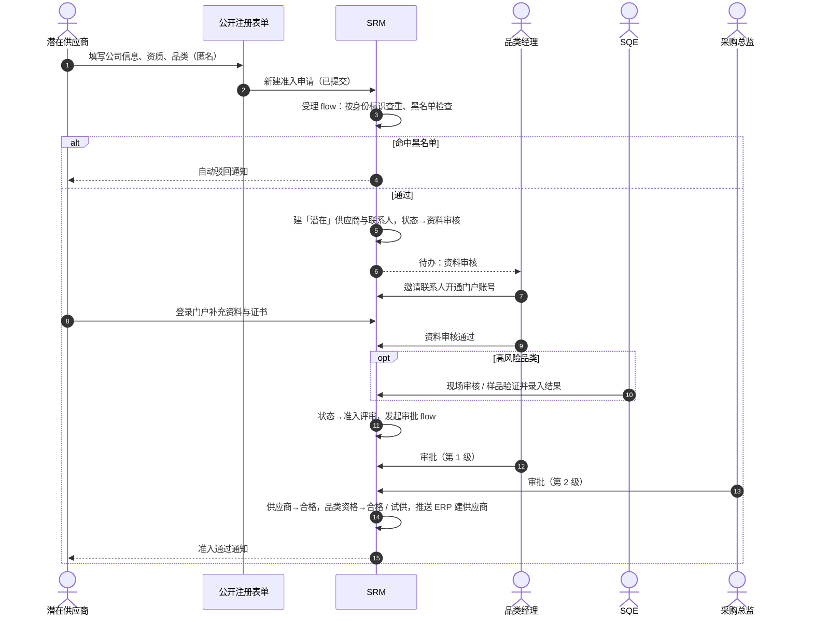
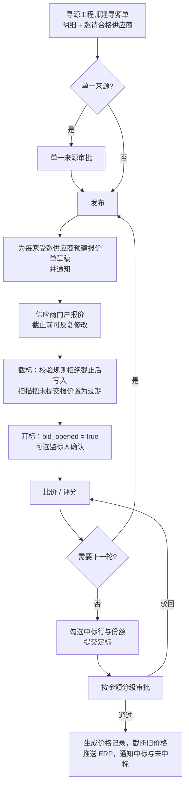
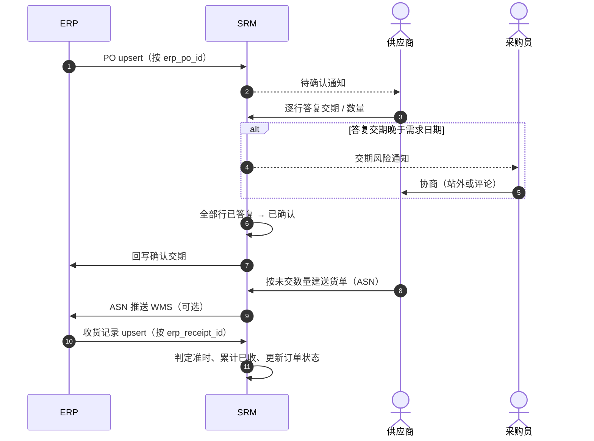
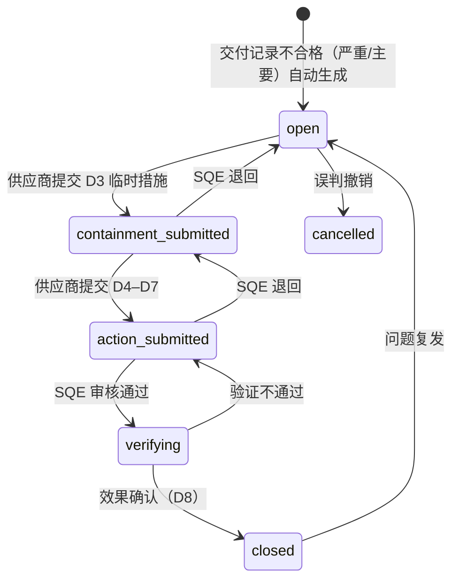

# 03 · 业务流程与自动化

> 所属：[SRM 设计总览](./README.md)　·　上一篇：[02 领域模型](./02-domain-model.md)　·　下一篇：[04 权限与门户](./04-security-and-portal.md)

## 1. 流程总览

版本号见 [07 §1](./07-delivery-plan.md#1-分期路线图)。P5、P6、P8 的记录系统是 ERP，按
[ADR-0008](../adr/0008-order-to-pay-stays-in-erp.md) 不在核心实现；P5、P6 在 ERP 集成后作为门户镜像，P8 不做。

| 编号 | 流程 | 起点 → 终点 | 涉及对象 | 版本 |
|---|---|---|---|---|
| P1 | 供应商登记与准入 | 内部登记 / 邀请注册 → 合格供应商 | 准入申请、审核、供应商、品类资格 | v0.1（门户侧 v0.6，审核对象 v0.4） |
| P2 | 信息变更与供应商处置 | 变更 / 处置申请 → 档案更新 | 变更单、处置单、供应商、银行账户 | v0.2（变更）、v0.3（处置） |
| P3 | 寻源：询价 → 比价 → 定标 | 寻源单草稿 → 价格记录 | 寻源单、邀请、报价、价格记录 | v0.7 |
| P4 | 合同审批、签署与到期 | 合同草稿 → 生效 → 到期 | 合同、合同明细 | v0.3 |
| P5 | 订单协同 | ERP 下发 PO → 供应商确认 | 订单、订单行 | ERP 集成后（门户镜像） |
| P6 | 送货与收货 | 送货单 → 收货回传 | 送货单、交付记录 | ERP 集成后（门户镜像） |
| P7 | 交付记录导入与质量整改 | 交付记录不合格 → SCAR 关闭 | 交付记录、整改单、审核 | v0.4 |
| P8 | 对账与结算 | 月度对账单 → 付款回写 | — | 不做，留在 ERP |
| P9 | 绩效评估 | 自动生成考评 → 发布与应用 | 考评单、评分明细、供应商 | v0.5 |
| P10 | 资质与风险监控 | 到期 / 风险事件 → 预警与处置 | 证书、风险事件、供应商 | v0.1（资质）、v0.5（风险事件） |

## 2. 平台机制与本设计的用法

### 2.1 用到的平台能力

| 能力 | 平台机制 | 在 SRM 中的典型用法 |
|---|---|---|
| 记录触发 | flow 类型 `record_change`，在开始节点上声明对象、触发时机与 CEL 条件 | 状态变为「准入评审」时发起审批；检验不合格时生成 SCAR |
| 定时任务 | `schedule` 触发（cron） | 截标扫描、月度对账、季度绩效 |
| 相对日期 | `time_relative` 触发：按某个日期字段，在提前 / 逾期若干天时对每条记录各启动一次 | 证书到期 30 / 15 / 7 天提醒、合同到期提醒 |
| 外部调用入口 | `api` 触发 | ERP 回调、外部调度器触发关键扫描（见 §2.3） |
| 审批 | flow 的 `approval` 节点：审批人类型 `user` / `field` / `manager` / `position` / `expression` 等；会签方式 `first_response` / `unanimous`；可退回修改；超时可升级 | 准入、定标、合同、变更、处置、绩效发布 |
| 数据节点 | `get_record` / `create_record` / `update_record` / `loop` / `decision` / `assignment` | 定标后批量生成价格记录 |
| 通知 | `notify` 节点（站内 / 邮件等通道） | 邀请、待办、提醒、升级 |
| 外部系统 | `http` 节点、webhook | 推送 ERP、电子签、企业信息查询 |
| 状态约束 | `state_machine` 校验规则（`transitions` + `initialStates`） | 所有单据的状态跳转 |
| 记录校验 | `script` / `cross_field` 校验规则（CEL，可用 `now()` / `today()`，`script` 规则可经一个引用字段读关联记录）；字段谓词（`requiredWhen` 等）只能读本记录 | 截止后锁价、开标时限、邀请供应商的状态兜底、条件必填 |
| 受控写入口 | `screen` 类型的 flow，以系统身份运行，用户对目标对象**没有**直接创建权限 | 邀请供应商、建送货单、提交发票等需要跨对象判断的写操作 |

三条贯穿全文的取舍：

- **全部用元数据表达，托管云今天就能运行**。平台本身有沙箱钩子，但托管云可以关闭
  应用包代码（[ADR-0001](../adr/0001-declarative-only.md) 补充说明）。因此本设计不依赖
  任何应用代码；需要代码的增强只在自托管部署中启用，并单独标注。
- **只有 `script` 校验规则能读一跳关联记录**（如 `record.supplier.status`）；字段谓词、
  `previous`、`parent` 只读本记录（02 §1 第 12 条）。更远或需要汇总的判断用两种声明式办法强制：
  1. **冗余 + 校验**：把判断所需的值在创建时冗余到本记录（例如把寻源单的截止时间
     复制到报价单，报价明细再经一跳读取），再用校验规则判断；
  2. **受控写入口**：敏感的创建动作只开放为 `screen` flow（以系统身份运行，flow 里
     查询、判断、再写入），用户对目标对象本身不授予创建权限。
- **界面过滤只是体验，不是强制**：选择器上的 `lookupFilters`（例如只列合格供应商）
  能减少误操作，但绕过界面直接调 API 时它不起作用，所以每条强制规则都必须落在上面
  两种办法之一。

### 2.2 审批能力的使用范围

本设计的审批只用基础能力：单人 / 串行多级、`user` / `field` / `manager` /
`position` 审批人、简单并行（`unanimous` / `first_response`）、撤回、锁记录和
不可篡改的审批历史。

按部门树递归找审批人、按比例会签（quorum）、运行时加签、委派与离岗改派、审批
分析看板等更高级的能力，都标为「可选增强」，不作为任何流程成立的前提。

审批超时（`timeoutHours`）按**日历小时**计算，夜间、周末、节假日都计入。「3 个
工作日」这类要求写成 72 小时会在长假前后失真，因此本设计把「工作日」口径的时限
放在业务字段（如 `containment_due`）里计算，由扫描任务判断逾期，而不是依赖审批
超时。

### 2.3 定时任务的可靠性设计

定时类 flow（`schedule` / `time_relative`）的触发可能因为部署环境的原因延迟或
漏掉一次，SRM 的业务规则不能建立在「计时器一定准时」的假设上。另外，生产环境要
确认所用的部署方式和套餐支持定时任务。

本设计遵守三条规则：

| 规则 | 做法 |
|---|---|
| R1 强制性规则不依赖计时器 | 「截止后不能改报价」由校验规则在**写入时**用 `now()` 比较冗余在报价上的截止时间；「截止前不能开标」由寻源单的校验规则比较 `locked_deadline`。计时器失灵也不会放过一次越界写入 |
| R2 扫描任务是追赶式且幂等的 | 每次扫描处理「所有已到期而尚未处理」的记录，而不是「今天到期」的记录；处理后打标记，重复运行不重复处理。漏掉一次，下一次自动补上 |
| R3 关键扫描有外部心跳 | 截标、PO 催办、SCAR 逾期这三个时效敏感的扫描，同时暴露为 `api` 触发的 flow，由外部调度器（ERP 中间件或运维定时任务）每 10 分钟调用一次，保证准时。平台的 `api` flow 只能把签名密钥写死在元数据里，公开仓库不能这么做，心跳 flow 暂不提供、只靠定时任务，等平台支持部署时注入密钥（objectstack#25675） |

## 3. P1 供应商登记与准入

v0.1 只有内部登记：品类经理在工作台新建准入申请（`source = internal`），下图中的公开
表单、开通门户、门户补资料三步跳过，`reviewer` 默认取创建人所在品类的品类经理。v0.6 起
受邀供应商在门户填申请（`source = invited`）；公开表单（`self_registered`）待平台
（01 FR-201），只收文字信息，附件在供应商注册账户、登录门户后上传。现场审核对象随 v0.4 加入，审核结论由 flow 写回申请。

内部登记时申请直接关联已登记的供应商（身份标识已由供应商上的唯一约束查重），所以 v0.3 的受理
flow 按所关联供应商的状态写 `duplicate_check`：`potential` → `pass`；`eliminated` → `reapply`；
`blacklisted` → 申请直接 `rejected` 并通知申请人，供应商状态不动；其他状态在新建申请时就被校验规则
`supplier_admissible` 拦下，不会出现 `duplicate`。步骤 2「建档」与 `srm_application_accept` 随门户申请
（v0.6）加入，之前受理时供应商直接进入 `qualifying`、申请进入 `doc_review`。重新准入批准后按本次申请
品类恢复或新建品类资格，没再申请的品类保持淘汰时的 `suspended`。

**步骤说明**

| 步骤 | 触发 | 自动化 / 人工动作 |
|---|---|---|
| 1 受理 | 申请创建（v0.1 内部登记；v0.6 受邀供应商在门户提交） | flow `srm_application_intake`（record_change，after-create）：按身份标识查供应商（`country == 'cn'` 用 `credit_code`，其他国家 / 地区用 `country` + `registration_no`，BR-01）；命中 `blacklisted` → 申请置 `rejected`、`duplicate_check = blacklisted`，通知申请人；命中 `eliminated` → `reapply`，申请的 `supplier` 指向旧档并允许继续（淘汰后重新准入的唯一路径，FR-208）；命中 `qualified` / `qualifying` / `frozen` / `potential` → `duplicate`，通知品类经理人工判断；未命中 → `pass`。同一 flow 按申请品类找到品类经理和 SQE，写入 `reviewer` / `sqe`，把这些品类中最高的 `risk_class` 和 `material_class` 复制到申请 |
| 2 建档 | 品类经理把申请推进到 `doc_review`（人工确认后，防止灌水污染主数据） | flow `srm_application_accept`：`duplicate_check == 'pass'` 时新建 `potential` 供应商与主联系人并回填 `supplier`；`reapply` 时沿用旧档；供应商 `potential / eliminated → qualifying`；`submitted` 阶段只有申请记录，不建主数据 |
| 3 开通门户 | 品类经理 / 管理员（v0.6） | 邀请主联系人加入组织并开通门户（见 [04 §3.3](./04-security-and-portal.md#33-门户账号的开通与回收)）；v0.1–v0.5 跳过 |
| 4 补充资料 | 供应商 | 门户内补齐公司资料（门户可改的字段见 [04 §4.2](./04-security-and-portal.md#42-字段级权限fls)）、银行账户、证书；品类经理可「退回补充」（申请→`returned`，通知联系人）。应付会计经「核验银行账户」、SQE 经「核验证书」两个 screen flow 完成核验 |
| 5 现场审核 | `risk_class == 'high'` | SQE 建供应商审核记录（`audit_type = admission`，关联本次申请），审核后录入总分、最低审核块得分、结论与问题项（结论按 `audit_score_thresholds` 校验，02 §4.2）。审核完成或改了结论时，flow `srm_audit_admission_apply` 把结论写回申请：`audit_result` 记结论，通过或有条件通过时 `audit_passed = true`，否则为 false，并通知初审人；已批准或已驳回的申请不再写。校验规则 `audit_before_review`：`risk_class == 'high' && audit_passed != true` 时申请不得进入 `admission_review`（FR-204）。申请上的勾选框只由 flow 写，品类经理改不了 |
| 6 准入评审 | 申请→`admission_review` | flow `srm_admission_approval`：第 1 级 `field` 审批人 = `reviewer`（品类经理）；第 2 级 `position` = `srm_procurement_director`；`material_class == 'class_a'` 或 `risk_class == 'high'` 时第 2 级改为采购总监、`srm_quality_manager` 并行会签（`per_group`：两个岗位各一人通过，同岗位多人时任一人即可；任一人驳回即驳回）。校验规则拦截提交人 = 审批人（平台没有「不可自审」选项，objectstack#25446）。驳回 → 申请回 `doc_review` 并通知 |
| 7 批准后 | 审批通过 | 申请→`approved`，写入 `cycle_days`；供应商 `qualifying → qualified`；按申请品类建 `srm_supplier_category`（申请的 `audit_result` 为有条件通过时为 `trial`，否则 `qualified`，WI-01 6.6.2）；通知供应商。ERP 建档与 `erp_vendor_code` 回写为预留集成点（06 §1） |
| 8 未通过 | 终止 | 申请→`rejected`；供应商 `qualifying → potential`（`reapply` 的旧档回 `eliminated`）；v0.6 起回收门户账号 |

## 4. P3 寻源：询价 → 比价 → 定标（v0.7）

**步骤说明**

| 步骤 | 触发 | 自动化 / 人工动作 |
|---|---|---|
| 1 建单 | 寻源工程师 | 建寻源单与明细（草稿）。邀请供应商只能通过「邀请供应商」screen flow：选择器带 `lookupFilters`（`status == 'qualified'`、`qualification_alert == false`），flow 再查一次供应商状态与该品类资格，不满足则拒绝并说明原因（BR-03、BR-04）；邀请对象上另有一跳读取供应商状态的校验规则兜底；内部角色对邀请对象没有直接创建权限 |
| 2 发布 | 「发布」screen flow | 寻源单的 `status` 对用户只读，只经 screen flow 推进。发布前校验：邀请家数 ≥ `min_bidders`（单一来源除外）、综合评分法的技术权重 ≤ `tech_weight_max` 且两权重之和为 100%（参数见 `params/core.yaml`，FR-306）。普通询价直接→`published`；单一来源→`approval_pending`，由 `srm_single_source_approval` 审批（品类经理 → 采购总监，预算金额达到 `award_approval_tiers.high` 档时加总经理，必须填写单一来源理由），通过后→`published`，驳回回到 `draft` |
| 3 发布后 | 状态→`published` | flow `srm_event_publish`：把 `quote_deadline` 复制为 `locked_deadline`；为本轮应报价的供应商（第 1 轮为全部受邀者，之后只取 `shortlisted == true` 的）各建一张 `draft` 报价单，冗余截止时间与门户岗位，再按明细建报价明细并快照物料信息（单价留空）；通知这些供应商 |
| 4 报价 | 供应商门户 | 供应商只填自己报价单上的单价、交期、税率、附件，提交后 `status → submitted`、记录 `submitted_at`；截止前可撤回重改 |
| 5 截标 | 截止时间到 | **强制**（R1）：报价单的校验规则 `now() > record.quote_deadline && record.bid_opened == false && record.status != 'expired'` 为真时拒绝写入；报价明细经一跳读报价单做同样判断。截止到开标之间报价被冻结；开标后门户写策略也不再放行（[04 §3.4](./04-security-and-portal.md#34-rls-示例)）。**扫描**：`srm_bid_close_sweep`（每 10 分钟，追赶式）把已过截止时间的 `published` 寻源单置为 `bid_closed`，其未提交的报价单置为 `expired` |
| 6 开标 | 「开标」screen flow `srm_bid_open`（寻源单所有者、采购总监可用） | 寻源单的校验规则保证状态进入 `bid_closed` 及以后时已过 `locked_deadline`，截止前开标会被拒绝；若截标扫描还没跑到这张单（计时器漏跑），flow 先补做截标；可选「监标」：`approval` 节点，`position = srm_procurement_compliance`，`first_response`。随后以系统身份把本轮报价单的 `bid_opened` 置为 `true`，统一重算一次报价金额，寻源单→`evaluating`，按明细计算名次 |
| 7 评标 | 评标小组 | 最低价法：比价视图直接按单价排序。综合评分法：技术评分人经「技术评分」screen flow 填 `technical_score`，flow 按价格计算 `commercial_score`（最低价得满分，其余按「最低价 ÷ 本家价格 × 100」），再按权重算 `total_score` |
| 8 多轮议价 | 「下一轮」screen flow | 先在邀请上勾选入围供应商（`shortlisted`）；flow 把本轮报价单置为 `superseded`（只读保留，不再计入 `submitted_quote_count`），`round + 1`，同时写入本轮新的 `quote_deadline` 与 `locked_deadline`，寻源单→`published`，回到步骤 3 |
| 9 提交定标 | 「提交定标」screen flow | 在 flow 里勾选中标明细并填写份额，flow 以系统身份写入报价明细的 `is_awarded` / `award_quantity` / `award_ratio`（内部角色对报价明细没有编辑权），汇总 `awarded_amount`、`savings_amount`；`submitted_quote_count < 3` 时要求填写 `low_competition_reason`（BR-07）；寻源单→`award_review` |
| 10 定标审批 | 状态→`award_review` | 见 §12 审批矩阵：按 `awarded_amount` 分档；有效报价少于 3 家时额外升一级 |
| 11 定标后 | 审批通过 | flow `srm_award_apply`：`loop` 中标明细 → 查同供应商 × 物料 × 工厂的有效价格，把它的 `valid_to` 截断到新价生效日前一天并置为 `superseded`（BR-10）→ 新建 `active` 价格记录 → 通知中标与未中标供应商；可选：生成合同草稿。价格记录推送 ERP 为预留集成点，现阶段由采购员按价格库在 ERP 维护价格 |

**封标的完整机制**（BR-05 / BR-06 / FR-304）

| 环节 | 机制 |
|---|---|
| 内部看不到报价 | 报价单与报价明细的内部 RLS 读策略只放行 `bid_opened == true`；封标期间内部查询、列表、导出、仪表盘、AI 助手都拿不到这些行 |
| 内部仍知道「报了几家」 | 寻源单上的汇总字段 `submitted_quote_count` 由平台在报价单写入时重算，内部可见数量但看不到内容 |
| 供应商看不到别家 | 门户 RLS 只放行本公司的报价单（见 04） |
| 截止后不能改 | 写入时校验规则比较冗余的截止时间（R1），不依赖扫描任务准时运行；`quote_deadline`、`bid_opened` 对门户只读（FLS + 字段 `readonly`） |
| 开标后不能改 | 门户写策略要求 `bid_opened == false`；中标与金额字段对门户只读；上一轮报价为 `superseded`，写策略不放行 |
| 截止时间不能被悄悄提前 | 发布时锁定 `locked_deadline`，只能经「延期截止」screen flow 推后；非草稿状态下 `quote_deadline` 必须等于它 |
| 谁能开标 | 「开标」screen flow 只对寻源单的所有者和采购总监开放；寻源单状态对用户只读，校验规则拒绝截止前进入开标 |
| 不可抵赖 | 报价单开启字段历史，`submitted_at` 与每次修改都有记录 |
| 关闭封标 | `sealed == false` 仅允许 `single_source` 寻源单，由校验规则约束 |

## 5. P2 信息变更与供应商处置

**新增银行账户**（v0.2，BR-20）：采购侧（`srm_supplier_admin`）在供应商档案下新建银行账户，
记录为 `pending_verify` 并锁定 → 应付会计在账户上点「核验」，经 screen flow `srm_bank_verify`
按 `params/core.yaml` 的 `bank_change_verification` 核实后确认 → 账户置为 `active`，写入
`verified_by`。flow 拒绝三种情况：启动人不是应付会计、账户不是待核验、启动人就是新建人
（双人原则）。已有账户的修改不直接编辑，走下面的信息变更单。

**信息变更**（v0.2，FR-207）：门户上线前由采购侧代供应商在供应商档案下新建变更单（v0.6 起供应商在门户经
「提交变更申请」screen flow 提交），填写变更后的值 → 审批 flow `srm_change_approval` 新建即触发，先把当前档案
快照到 `before_value` → 第 1 级 `position = srm_buyer_lead`（采购确认）；`change_type == 'bank_account'` 时
增加第 2 级 `position = srm_ap_accountant`（财务复核，核实方式按 `params/core.yaml` 的 `bank_change_verification`）
→ 通过后子 flow `srm_change_apply` 以系统身份写回：基本信息、地址写回供应商（同时写 `last_change_request`，
见 02 §4.1 关键信息锁定），联系人写回联系人；银行账户变更停用原账户（是默认账户的同时取消默认）、按新值建一个
`active` 账户，核验人记为财务复核人，原账户是默认的新账户接着做默认 → 写回后的档案快照到 `after_value`，
变更单为 `applied`，通知发起人。

- **驳回**：不改主记录，审批意见写入 `reject_reason`，通知发起人。
- **退回修改**：第 1 级可以退回（`revise` → `approval_revise`，至多 3 次），记录解锁，发起人改完重新提交，
  从第 1 级重新审批。**临时做法**：第 2 级只能通过或驳回、不能退回——平台 18.0.0 把第 2 个审批节点的提交人记成
  第 1 级审批人，退回后发起人无法重新提交（objectstack#24817 已在主干修复、未发版）；发版后加回退回。
- **职责分离（BR-11）**：发起人不能审批本人的变更单，两级审批人不能是同一人。平台没有「提交人不得审批」开关
  （objectstack#25446），岗位又可能兼任，所以每级通过后 flow 读审批记录比对，撞人时这次通过不算数，通知审批人
  并重新开一轮同级审批。审批人在节点开启时按岗位解析：只有一位采购主管且他就是发起人时，要再任命一位。

ERP 侧的银行账户由财务按 SRM 的审批记录维护（ERP 集成为预留集成点）。

**供应商处置**（v0.3，FR-208）：品类经理发起处置单 → 审批：冻结 / 解冻为品类经理 →
采购总监；淘汰与黑名单再加 `position = srm_general_manager`；解除黑名单单独走同一条
最高级别审批 → 通过后 flow 更新供应商 `status`（或指定品类资格为 `suspended`），
通知供应商。冻结**不影响**在途订单，只阻止新的寻源邀请；ERP 侧的冻结标志由采购员
手工同步（ERP 集成后自动推送）。

实现（flow `srm_disposition_approval` / `srm_disposition_apply`）：

- 品类经理一级就是发起：持 `srm_supplier_admin` 的岗位（品类经理、采购主管）新建处置单即提交审批，
  审批节点依次为采购总监、总经理（淘汰 / 黑名单 / 解除黑名单）、内控 `srm_procurement_compliance`
  （仅拉入黑名单，串行会签）。
- 采购总监可以通过、驳回或退回修改；总经理和内控只能通过或驳回——第 2 个审批节点退回后发起人无法重新提交
  （objectstack#24817 已在主干修复、未发版），发版后加回退回。
- 职责分离同变更单（BR-11）：发起人不能审批本人的处置单，各级审批人不能是同一人；撞人时这次通过不算数，
  通知审批人并重新开一轮同级审批。
- 执行以系统身份改供应商状态和品类资格（结果见 [02 §4.2](./02-domain-model.md#42-生命周期) 处置单），
  处置单置为「已执行」，通知发起人并提醒在 ERP 同步冻结标志；驳回不改供应商，记下驳回意见。
- 通知供应商与门户账号回收随门户（v0.6）；冻结后不能新建合同由合同的校验规则负责（v0.3 C1）。

## 6. P4 合同审批、签署与到期（v0.3）

| 步骤 | 触发 | 动作 |
|---|---|---|
| 1 起草 | 品类经理手工新建（v0.7 起定标后由 flow 生成草稿） | 只能与「合格」供应商建合同（冻结、淘汰、黑名单不能关联新合同）；带明细的，明细金额 = 数量 × 单价，合同汇总明细金额 |
| 2 审批 | 「提交审批」screen flow `srm_contract_submit`（品类经理、采购主管）：`draft` → `in_review`，写入 `submitted_by`；合同金额必填，法务审核人不能是提交人 | `srm_contract_approval`：法务（`field = legal_reviewer`，没填时由法务岗位审批）→ 按金额分档的采购审批（§12）→ `signing`，通知起草人和提交人；审批中合同只读（平台审批锁记录）。细节见下 |
| 3 签署 | 状态→`signing` | 采购员上传双方盖章扫描件、填写 `signed_date`（这两个字段只在签署中可改）；电子签（`http` 发起 + `api` 回调写回 `esign_request_id`）为客户驱动主题，字段已预留 |
| 4 生效 | 「确认生效」screen flow `srm_contract_activate`（采购员、采购主管、品类经理） | 签署件与签署日期齐全、供应商仍为合格时状态→`active`；质量协议 / 廉洁协议进入或离开生效时，`srm_contract_agreement_recalc` 重算供应商对应的布尔字段 |
| 5 到期提醒 | `time_relative`：`end_date`，提前 60 / 30 / 7 天（`contract_reminder_days`），只看生效中的合同 | `srm_contract_expiry_notice` 通知合同所有者和主要品类的品类经理；平台按天扫描，每份合同每个提醒日只发一次 |
| 6 到期 | 追赶式扫描 `srm_contract_expire_sweep`：`end_date < today` 且仍为 `active` | 状态→`expired`；`auto_renew == true` 的合同再经 `srm_contract_renew` 生成续签草稿（期限紧接原合同、长度相同，复制明细，`renewed_from` 指回原合同）；供应商已不合格时不生成续签，通知所有者 |

合同审批（v0.3 C2，flow `srm_contract_approval` / `srm_contract_recalled`）：

- **分档**：金额取合同的 `amount`（框架协议为年度预计金额），档位取 `params/core.yaml` 的 `award_approval_tiers`（示例
  10 万 / 100 万）：不足 `mid` 档为法务 → 品类经理；`mid` 至不足 `high` 档再加采购总监；`high` 档及以上再加总经理。金额按数值
  比较、不按币种换算。
- **起草人、提交人是品类经理**（现在合同只能由品类经理起草，所以是常态）：品类经理一级改由上一级采购总监审批，不足 `mid`
  档的合同为法务 → 采购总监；`mid` 档以上品类经理一级并入采购总监。起草人和提交人都不是品类经理时（例如采购主管提交
  自动续签生成的续签草稿）才走品类经理一级。
- **驳回**：合同 → `rejected`，审批意见写入 `reject_reason`，通知起草人和提交人；需要继续合作的重新起草。
- **退回修改**：法务一级可以退回（`revise` → `approval_revise`，至多 3 次）。合同仍为 `in_review`、审批结论为 `returned`，
  合同信息和明细解锁，提交人改完在审批待办里重新提交，从法务重新审批。**临时做法**：法务之后的各级只能通过或驳回、
  不能退回——平台 18.0.0 把第 2 个起的审批节点的提交人记成上一级审批人，退回后提交人无法重新提交（objectstack#24817
  已在主干修复、未发版）；发版后加回退回。
- **撤回**：提交人在审批中或退回修改期间撤回，审批结论为 `recalled`，`srm_contract_recalled` 把合同改回 `draft`，改完可以
  再次提交。
- **职责分离（BR-11）**：起草人、提交人不能审批本合同，各级审批人不能是同一人；做法同变更单（§5）：每级通过后读审批记录
  比对，撞人时这次通过不算数，通知审批人并重新开一轮同级审批（objectstack#25446）。

## 7. P5 订单协同与 P6 送货收货（预留：ERP 集成后的门户镜像，现阶段不做）

本节保留原设计，作为 ERP 集成立项时的流程基线（[ADR-0008](../adr/0008-order-to-pay-stays-in-erp.md) 第 5 条）。
集成前交付结果按 §8 的交付记录导入。

| 步骤 | 触发 | 动作 |
|---|---|---|
| 1 下发 | ERP 调 REST API upsert 订单与订单行 | 新单 `status = released`、`released_at = now`；flow 通知供应商的 `sales` 联系人 |
| 2 确认 | 供应商在门户答复 | 订单行写入 `promised_date` / `promised_quantity`（门户对订单头有编辑权以满足子记录写入要求，但订单头字段全部 FLS 只读）；flow：`promised_date > required_date` → `delivery_risk = true`、通知采购员（BR-13），并要求 `delay_reason` 非空（校验规则）；全部行答复后订单头→`confirmed`，存在风险行→`partially_confirmed` |
| 3 催办 | 追赶式扫描 `srm_po_ack_sweep`（每小时 + 外部心跳） | `released` 超过 24 小时：提醒供应商；超过 48 小时：通知采购员主管（BR-12）；每级只发一次（以标记字段去重） |
| 4 变更 | ERP 再次 upsert 且 `change_version` 增大 | 订单→`change_pending`，变更前后差异写入订单的评论 / 历史，通知供应商重新确认 |
| 5 回写 | 订单确认后 | `http` 节点把确认交期推回 ERP（ERP 支持时） |
| 6 送货 | 供应商通过「创建送货单」screen flow | flow 列出本公司「未交数量 − 在途数量 > 0」的订单行，校验送货数量 ≤ `open_quantity − in_transit_quantity`（BR-14，扣除已发未收的其他送货单）后以系统身份建送货单与明细（明细 `line_status = shipped`），生成二维码标签；门户对送货明细没有直接创建权限 |
| 7 收货 | ERP / WMS upsert 收货记录 | flow `srm_receipt_apply`：按订单行的 `promised_date`（无答复时取 `required_date`）判定 `on_time`；按订单行单价写 `amount`；重算订单行 `open_quantity` 与 `line_status`；对应送货明细→`received`；更新送货单与订单头状态（未确认的订单也允许直接进入交货中 / 已收齐，见 02 §5.4） |

## 8. P7 交付记录导入与质量整改（SCAR / 8D）（v0.4）

**交付记录导入**：每月从 ERP 导出上月的收货与检验结果表格，SQE 用平台导入按 `erp_receipt_no` +
`erp_order_no` + `erp_line_no` 匹配写入 `srm_delivery_record`（可重复执行，见
[交付记录导入说明](../implementation/delivery-import.md)）；没有质量系统的客户由 IQC 检验员
逐条录入。写入时引擎按字段表达式算出 `on_time`、`period` 和 PPM 用的 `received_quantity_mn`
（[02 §4.6](./02-domain-model.md#46-质量v04)），再按下表生成整改单。

| 步骤 | 触发 | 动作 |
|---|---|---|
| 1 生成 | 交付记录写入（新建或修改，月度导入是 upsert），**变成** `inspection_result == 'fail'` 且 `severity in ['critical','major']`；或审核问题项经「转整改单」screen flow；客户投诉、制程等来源由 SQE 手工新建 | flow `srm_scar_create`：同一条交付记录已有整改单时不再开（重复导入不重复开单）；新建整改单，`sqe` 取物料品类的 SQE，`containment_due = 创建时间 + scar_containment_hours`、`final_due = 创建日期 + scar_final_days`（参数见 `params/core.yaml`，由字段默认值算好）；通知 SQE，品类没有 SQE 时通知质量经理指派（BR-15）；供应商 `quality` 联系人的通知等 objectstack#25444 或 v0.6 门户。`minor` 不合格只计入绩效，不自动开单。审核问题项由 SQE 或质量经理在已完成的审核上点「转整改单」（`srm_audit_finding_to_scar`）：还没转出的严重、一般不符合项各开一张（`source = audit`，严重 → `critical`、一般 → `major`，负责 SQE 为操作人），整改单回填到问题项，重复点击不重复开单；观察项不转。v0.6 前供应商的回复由 SQE 代填 |
| 2 临时措施 | 供应商提交 D3（v0.6 前 SQE 代填 D3 后把状态改为「已提交临时措施」） | 状态→`containment_submitted`；D3 必填。SQE 认为临时措施不够时退回到 `open`，退回意见写入 `sqe_comment`（必填） |
| 3 根因与措施 | 供应商提交 D4–D7（v0.6 前 SQE 代填后改状态） | 状态→`action_submitted`；flow `srm_scar_review` 发起 `approval` 节点：`field` 审批人 = `sqe`（没填时交给质量经理），审批期间锁定记录。SQE 用审批的「驳回」退回：状态回到 `containment_submitted`，审批意见写入 `sqe_comment`（FR-604），改好后再次提交重新审核。平台的「退回修改」窗口只能原样回到审批节点、中间改不了状态，所以退回用驳回表达；驳回时没写意见的不算数，提醒 SQE 后重新审核 |
| 4 效果验证 | SQE 审核通过 | 状态→`verifying`；SQE 跟踪后续批次，确认有效后关闭（D8），或验证不通过退回 `action_submitted` 重新审核 |
| 5 逾期升级 | 追赶式扫描 `srm_scar_overdue_sweep`（每小时；外部心跳见 §2.3 R3） | 超过 `containment_due` 仍为 `open`、或超过 `final_due` 仍未到 `verifying`：`is_overdue = true`，通知负责 SQE 与质量经理（SQE 主管，FR-605）；标志保留到关闭，供「SCAR 按期关闭率」统计；提醒供应商等 objectstack#25444 或 v0.6 |
| 5a 复发重开 | SQE 把已关闭的整改单改回 `open` | flow `srm_scar_reopen`：期限按重开时间重算，逾期标志清掉，通知负责 SQE |
| 6 索赔 | SQE 填写 `claim_amount`，`claim_status → proposed` | 供应商在门户接受或提出异议（v0.6 前线下确认后由 SQE 记录）；接受后（`supplier_accepted`）由财务在 ERP 扣款，应付会计回来标记 `settled`。SRM 不生成扣款 |

**供应商审核与年度审核计划**（v0.4，FR-607；体系文件 WI-01）：准入审核见 §3 第 5 步；年度审核与专项审核由 SQE
建审核记录，审核后录入结论与问题项，不符合项经「转整改单」进入上面的整改流程。年度计划由
`srm_audit_plan_generate` 按供应商所供品类中最高的物资类别（`material_class`，P-D2）定复审频次，
频次取 `annual_audit_frequency`（示例：A 类 12 个月、B 类 24 个月、C 类不定期、不生成）：

| 步骤 | 动作 |
|---|---|
| 1 选供应商 | 先 A 类品类、再 B 类品类，逐个找状态为合格或试供的品类资格；供应商本身不是 `qualified`（冻结、淘汰等）的不排计划。同时供 A、B 两类的按 A 类频次 |
| 2 判到期 | 上次完成的审核（任何类型）日期 + 频次 ≤ 本年 12 月 31 日即本年到期；从没审核过的视为已到期 |
| 3 防重 | 供应商已有「计划中」的审核，或已有本年度（`plan_year`）生成的年度审核（不论完成还是取消）时跳过，重复运行不重复建（§2.3 R2） |
| 4 生成 | 新建 `audit_type = annual`、`status = planned` 的审核，计划日期 = 到期日（已过的取今天），审核员默认品类的 SQE；SQE 按日历视图（05 §2）排程 |
| 5 取消 | 不需要现场复审的（WI-01 6.9 的其他 B 类供应商、经批准以资料审核代替一次复审）由质量部门取消并写明原因，本年度不再生成 |

每月 1 日跑一次，年初那次生成全年计划，之后各次补上漏掉的与年中新到期的。

## 9. P8 对账与结算（不做，留在 ERP）

对账、开票、付款回写的记录系统是 ERP，本流程不在 SRM 实现（[ADR-0008](../adr/0008-order-to-pay-stays-in-erp.md)）。
下表保留为剥离项的记录；付款进度查询在 ERP 集成后作为门户镜像另行设计。

| 步骤 | 触发 | 动作 |
|---|---|---|
| 1 生成 | `schedule`：每月 1 日 02:00（追赶式：处理所有 `reconciled == false`、`settlement_mode == 'standard'` 且收货日期早于本月的记录；其他结算方式的收货由对应扩展包自己生成对账明细） | 按「供应商 × 法人」分组，建对账单与明细：收货行、退货行、`claim_status == 'supplier_accepted'` 的索赔扣款行；把纳入的收货记录置为 `reconciled = true`、纳入的索赔置为 `settled`（防止下月重复扣款）；按明细税率算 `tax_amount`；状态 `draft`（FR-801） |
| 2 内部复核 | 采购员 / 应付会计 | 检查后发送：状态→`sent`，通知供应商 `finance` 联系人 |
| 3 供应商确认 | 门户 | 确认→`supplier_confirmed`（锁定，BR-16）；或标记差异行并填写原因→`disputed`，通知采购员 |
| 4 差异处理 | 采购员 | 调整明细（补录 / 剔除 / 改价须有原因）后重新发送 |
| 5 财务确认 | 应付会计 | →`finance_confirmed`，通知供应商开票 |
| 6 开票 | 供应商通过「提交发票」screen flow | flow 先确认对账单为 `finance_confirmed`（FR-803）；再把「已登记发票不含税金额 `invoiced_amount` + 本张」与 `net_amount` 比较，税额同样与 `tax_amount` 比较，超过容差拒绝并提示差额（BR-17）；发票代码 + 号码唯一，重复登记被拒绝；通过后建发票记录；可选：`http` 调用发票查验服务写 `verify_status` |
| 7 入账 | 发票校验通过 | `http` 推送 ERP 生成应付发票，回写 `erp_ap_doc_no`；对账单→`invoiced` |
| 8 付款回写 | ERP 付款后调 `api` flow | 写发票 `paid_amount` / `paid_date` / `payment_status`；全部付清时对账单→`paid`，供应商门户可见 |

> 数据量提示：月度生成在 flow 里用 `loop` 实现，适合每月数千条收货行的规模。规模
> 更大时有两条路：按法人或品类拆成多个错峰的 `schedule` flow；或在自托管部署中把
> 「分组建单」实现为服务端函数，由 flow 调用（托管云上应用包函数不执行）。

## 10. P9 绩效评估（v0.5）

| 步骤 | 触发 | 动作 |
|---|---|---|
| 1 生成 | `schedule`：每月 1 日 03:00（追赶式） | 按供应商所供最高物资类别取周期参数 `perf_cycle`（示例 A 类每月、B 类每季、C 类每年）；本次运行到期的供应商各建一张上期考评单（`calculating`，`cycle` / `period` 写明），按指标库中启用的指标建评分明细（FR-702）；启用指标的权重合计不是 100% 时本次不生成并通知采购总监；已有同期考评单的跳过 |
| 2 自动算分 | 同一次运行 | 按 [05 §4](./05-experience-and-analytics.md#4-仪表盘与指标口径) 的口径从交付记录计算 OTD、批次合格率、PPM，写入原始值与得分；订单响应及时率在 ERP 集成前在指标库中不启用（不建评分明细），启用时由采购总监调整其余权重。得分按指标的满分值、零分值线性计算（02 §4.7）。由 flow 的查询节点按供应商和 `period` 汇总交付记录上的 `on_time`、`inspection_result`、`defect_quantity` |
| 3 人工评分 | 状态→`scoring` | 按评分明细的 `scorer`（品类经理、SQE、需求部门评分人）通知，评分人经「提交评分」screen flow 只看到并填写分配给自己的评分项；截止 10 天，扫描任务提醒未评项；截止后未评项按「取 60 分并标记未评」处理（可配置） |
| 4 汇总分级 | 全部评分完成或截止 | `total_score = Σ(score × weight)`；等级线取参数 `perf_grade_min`（示例 A ≥ 90、B ≥ 80、C ≥ 70，其余 D）；状态→`reviewing` |
| 5 审定发布 | 审批：采购总监（`position = srm_procurement_director`） | 通过后→`published`；回写供应商 `grade`、`latest_score`；供应商可在门户查看结果与扣分项（FR-704） |
| 6 结果应用 | 发布后的记录触发 | C 级：生成改善要求（整改单，`source = performance`）；D 级：生成处置单草稿（冻结）；连续 `perf_d_exit_periods` 期 D 级：生成淘汰处置单草稿交品类经理评审（BR-18）；A 级：在名录中标记优选，供寻源邀请参考 |
| 7 申诉 | 供应商发布后 7 天内 | 状态→`appealed`，采购总监处理后回到 `published`，结果留痕（FR-706） |

## 11. P10 资质与风险监控（资质 v0.1，风险事件 v0.5）

| 场景 | 触发 | 动作 |
|---|---|---|
| 到期提醒 | `time_relative`：证书 `valid_to`，提前 30 / 15 / 7 天 | 证书 `status → expiring`；通知 SQE 与供应商联系人（FR-901） |
| 到期生效 | 追赶式扫描：`valid_to < today` 且不是 `expired`（定时 flow 在云上默认关闭，部署时打开，objectstack#25442） | 证书→`expired`；`is_mandatory` 的证书过期时供应商 `qualification_alert = true`（FR-902）；v0.5 起同时新建 `qualification` 类风险事件 |
| 供应商修改证书 | 证书的编号、有效期或附件被门户修改 | flow 把 `verified` 重置为 false，通知 SQE 重新核验 |
| 资质恢复 | 证书或品类资格写入后的记录触发（`srm_supplier_qualification_recalc`） | 先按该供应商全部品类的 `mandatory_cert_types` 重算每张证书的 `is_mandatory`；再重新计算：每一种必备资质类型都有 `status == 'valid'` 且 `verified == true` 的证书时，`qualification_alert = false`（v0.5 起关闭对应风险事件）。只上传新证书而未经 SQE 核验，不会解除异常 |
| 风险事件处理 | 手工登记或系统生成（v0.5） | `high` 级事件通知品类经理并生成处置单草稿（冻结）；关闭时填写处理结论 |
| 外部风险 | `schedule`：每周一 04:00（客户驱动主题） | flow 按批 `loop` 合格供应商，`http` 节点调用企业信息服务；新出现的经营异常、失信、重大诉讼、股权变更按 `external_ref` 去重后建风险事件（FR-903）。有客户要求时立项 |

> v0.1 先实现其中的一部分：`srm_certificate_expire_sweep` 每日一次，把证书状态对齐到已过期 / 即将到期（30 天内）/
> 有效（有效期被延长时恢复）；`srm_supplier_qualification_recalc` 在证书状态或「必备」标志变化后重算
> `qualification_alert`。到期提醒通知随 v0.1 收尾加入；`is_mandatory` 按品类必备资质自动写入随 v0.2；「经 SQE 核验才解除」
> 随门户（v0.6）加入：门户上线前证书由 SQE 自己录入，录入即核验，要求再勾一次「已核验」没有意义；门户上线后证书由供应商上传，
> 改证书时 `verified` 复位，经 `srm_certificate_verify` 核验后才解除（2026-10-24 随 v0.4 Q3 核对后改期）。

## 12. 审批矩阵

本表是审批权限的**唯一来源**（2026-10-23 决定，P-D1）：体系文件的 ZC-02、QP-01 附录 C、
GL-02 附录 A 按本表编写，制度里的岗位称谓经 `governance/org.yaml` 的 `position.*` 映射到
下列岗位。审批人一律按**岗位**或**记录上的人员字段**解析，不写死具体的人；换人只改岗位
任命，不改流程。金额档、有效报价家数等阈值取 `params/core.yaml`（`award_approval_tiers`、
`min_valid_quotes`），实施时按企业授权手册在客户参数里替换。

| 单据 | 条件 | 第 1 级 | 第 2 级 | 第 3 级 | 方式 |
|---|---|---|---|---|---|
| 准入申请 | 全部 | 品类经理（`field: reviewer`） | 采购总监 | — | 串行 |
| 准入申请 | A 类物资（`material_class == 'class_a'`）或高风险品类（`risk_class == 'high'`） | 品类经理 | 采购总监 + 质量经理 | — | 第 2 级并行会签 `per_group` |
| 单一来源寻源 | 预算 < `high` 档 | 品类经理 | 采购总监 | — | 串行 |
| 单一来源寻源 | 预算 ≥ `high` 档 | 品类经理 | 采购总监 | 总经理 | 串行 |
| 定标 | `awarded_amount < mid` 档（示例 10 万） | 品类经理 | — | — | — |
| 定标 | `mid ≤ 金额 < high` 档（示例 10–100 万） | 品类经理 | 采购总监 | — | 串行 |
| 定标 | `金额 ≥ high` 档（示例 100 万） | 品类经理 | 采购总监 | 总经理 | 串行 |
| 定标 | 有效报价 < `min_valid_quotes`（按当前轮次） | 在上表基础上增加一级 | | | |
| 合同 | 全部 | 法务（`field: legal_reviewer`） | 按定标同档金额审批（框架协议按年度预计金额）；起草人或提交人是品类经理时，品类经理一级由采购总监审批（§6） | | 串行 |
| 银行账户新增 / 变更 | 全部 | 采购主管 | 应付会计 | — | 串行，两级不同岗位 |
| 其他信息变更 | 全部 | 采购主管 | — | — | — |
| 冻结 / 解冻 | 全部 | 品类经理 | 采购总监 | — | 串行 |
| 淘汰 / 黑名单 / 解除黑名单 | 全部 | 品类经理 | 采购总监 | 总经理 | 串行；黑名单由内控会签 |
| 绩效发布 | 全部 | 采购总监 | — | — | — |
| SCAR 措施审核 | 全部 | SQE（`field: sqe`） | — | — | 可退回修改 |

物资 A / B / C 分类（`srm_category.material_class`，P-D2）在系统里决定三件事：准入是否会签
质量经理、现场审核频次（制度）、绩效周期（`perf_cycle`）。制度原来按类别区分的准入层级和
冻结层级统一为上表，减少一个判断维度。

职责分离：同一张单据的发起人不应出现在审批人中。平台审批服务目前**没有**内置
「提交人不得审批本人单据」的开关（已提需求 objectstack#25446），本设计用两层保证：岗位
设置上，发起岗与审批岗不由同一人兼任；在 flow 中，审批人等于发起人时改用上一级岗位
（`expression` 审批人），并用校验规则拦截提交人 = 审批人。详见 [04 §6](./04-security-and-portal.md#6-职责分离sod)。

## 13. 自动化清单

定时类 flow 在托管云上默认关闭（objectstack#25442），部署时打开开关。标「预留」的
flow 属于 ERP 集成后的门户镜像，现阶段不建。

| flow | 触发 | 对象 | 版本 |
|---|---|---|---|
| `srm_application_intake` | record_change：新建 | 准入申请 | v0.1 |
| `srm_application_accept` | record_change：状态→`doc_review` | 准入申请 → 供应商、联系人 | v0.1 |
| `srm_admission_approval` | record_change：状态→`admission_review` | 准入申请 | v0.1 |
| `srm_certificate_expiry_notice` | time_relative：`valid_to` −30 / −15 / −7 天 | 资质证书 | v0.1 |
| `srm_certificate_expire_sweep` | schedule：每日 01:00（追赶式） | 资质证书 | v0.1 |
| `srm_supplier_qualification_recalc` | record_change：证书、品类资格写入 | 资质证书 → 供应商 | v0.1 |
| `srm_change_approval` / `srm_change_apply` | record_change：变更单新建 / 子 flow | 变更单 → 供应商、银行账户、联系人 | v0.2 |
| `srm_contract_approval` | record_change：状态→`in_review` | 合同 | v0.3 |
| `srm_contract_recalled` | record_change：审批中的合同审批结论→`recalled` | 合同 | v0.3 |
| `srm_contract_expiry_notice` / `srm_contract_expire_sweep` | time_relative：`end_date` −60 / −30 / −7 天 / schedule：每日 01:10（追赶式） | 合同 | v0.3 |
| `srm_contract_renew` | 子 flow：到期扫描调用 | 合同 → 续签草稿、明细 | v0.3 |
| `srm_contract_agreement_recalc` | record_change：质量协议 / 廉洁协议进入或离开 `active` | 合同 → 供应商 | v0.3 |
| `srm_disposition_approval` / `srm_disposition_apply` | record_change | 处置单 | v0.3 |
| `srm_scar_create` | record_change：交付记录不合格 | 交付记录 → 整改单 | v0.4 |
| `srm_scar_review` | record_change：状态→`action_submitted` | 整改单 | v0.4 |
| `srm_scar_reopen` | record_change：状态 `closed`→`open` | 整改单 | v0.4 |
| `srm_scar_overdue_sweep` | schedule：每小时（api 心跳等 objectstack#25675） | 整改单 | v0.4 |
| `srm_audit_admission_apply` | record_change：准入审核完成或改结论 | 供应商审核 → 准入申请 | v0.4 |
| `srm_audit_plan_generate` | schedule：每月 1 日 02:30（追赶式；年初那次生成全年计划） | 供应商审核 | v0.4 |
| `srm_performance_generate` | schedule：每月 1 日（按类别周期） | 考评单 | v0.5 |
| `srm_performance_publish` | record_change：状态→`reviewing` | 考评单 → 供应商 | v0.5 |
| `srm_performance_apply` | record_change：状态→`published` | 考评单 → 整改单、处置单 | v0.5 |
| `srm_risk_event_apply` | record_change：风险事件新建 | 风险事件 → 处置单 | v0.5 |
| `srm_invitation_send` / `srm_invitation_expire_sweep` | record_change / schedule | 门户邀请 | v0.6 |
| `srm_portal_position_backfill` | record_change：供应商 `portal_position` 写入 | 供应商 → 带 `portal_position` 的单据 | v0.6 |
| `srm_single_source_approval` | record_change：状态→`approval_pending` | 寻源单 | v0.7 |
| `srm_event_publish` | record_change：状态→`published` | 寻源单 | v0.7 |
| `srm_bid_close_sweep` | schedule：每 10 分钟 + api 心跳 | 寻源单、报价单 | v0.7 |
| `srm_bid_scoring` | record_change：技术评分写入 | 报价单 | v0.7 |
| `srm_award_approval` | record_change：状态→`award_review` | 寻源单 | v0.7 |
| `srm_award_apply` | record_change：状态→`awarded` | 寻源单 → 价格记录 | v0.7 |
| `srm_po_release_notice`、`srm_po_line_ack`、`srm_po_ack_sweep`、`srm_receipt_apply` | — | 订单、送货单 | 预留（ERP 集成后） |
| `srm_esign_callback`、`srm_erp_push_retry`、`srm_external_risk_scan` | api / schedule | 合同、同步字段、风险事件 | 客户驱动主题 |
| `srm_statement_generate`、`srm_invoice_post`、`srm_payment_callback` | — | — | 不做（ERP） |

用户操作入口的 screen flow（均以系统身份运行，flow 内做校验后再写入）：

| screen flow | 入口 | 使用者 | 版本 |
|---|---|---|---|
| `srm_certificate_verify` 核验证书 | 资质证书 | SQE | v0.1 |
| `srm_primary_contact_set` 设为主联系人 | 供应商联系人 | `srm_supplier_admin` | v0.1 |
| `srm_bank_verify` 核验银行账户 | 银行账户 | 应付会计 | v0.2 |
| `srm_contract_submit` 提交审批 | 合同（草稿） | 品类经理、采购主管 | v0.3 |
| `srm_contract_activate` 确认生效 | 合同（签署中） | 采购员、采购主管、品类经理 | v0.3 |
| `srm_change_submit` 提交变更申请 | 门户：公司资料（v0.6 前内部在供应商档案下直接新建变更单） | 门户管理员 | v0.6 |
| `srm_audit_finding_to_scar` 转整改单 | 供应商审核（已完成） | SQE、质量经理 | v0.4 |
| `srm_score_submit` 提交评分 | 考评单 | 评分人 | v0.5 |
| `srm_appeal_submit` 申诉 | 门户：绩效 | 门户管理员 | v0.6 |
| `srm_portal_enable` 开通门户 | 供应商联系人 | `srm_supplier_admin` | v0.6 |
| `srm_invite_supplier` 邀请供应商 | 寻源单 | 寻源工程师 | v0.7 |
| `srm_event_submit` 发布 | 寻源单 | 寻源工程师 | v0.7 |
| `srm_deadline_extend` 延期截止 | 寻源单 | 寻源工程师 | v0.7 |
| `srm_bid_open` 开标 | 寻源单 | 所有者、采购总监 | v0.7 |
| `srm_technical_score` 技术评分 | 报价单 | 评标小组 | v0.7 |
| `srm_next_round` 下一轮 | 寻源单 | 寻源工程师 | v0.7 |
| `srm_award_submit` 提交定标 | 寻源单 | 寻源工程师 | v0.7 |
| `srm_event_cancel` 取消 / 流标 | 寻源单 | 寻源工程师 | v0.7 |
| `srm_asn_create` 创建送货单 | 门户：订单 | 门户用户 | 预留（ERP 集成后） |
| `srm_invoice_submit` 提交发票 | — | — | 不做（ERP） |

所有写其他用户不可见数据的 flow（例如开标时更新封标中的报价单、受理时创建供应商）
声明以系统身份运行；只改当前用户自己可见数据的 flow 以用户身份运行。
