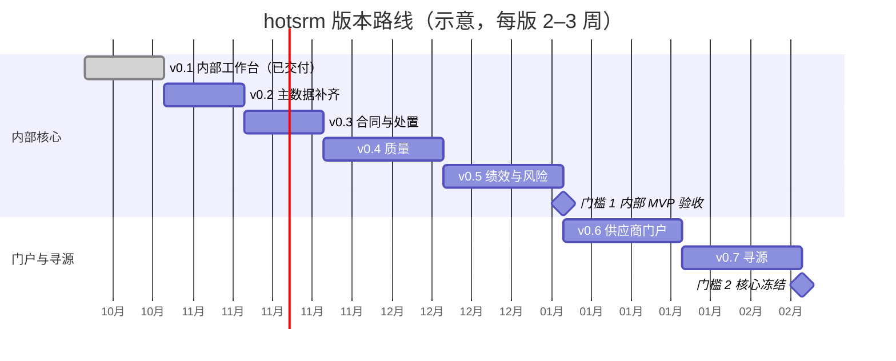

# 07 · 交付计划、风险与待决策事项

> 所属：[SRM 设计总览](./README.md)　·　上一篇：[06 预留集成点与 AI](./06-integration-and-ai.md)

> 版本：2026-10-23 按 [ADR-0008](../adr/0008-order-to-pay-stays-in-erp.md)、[ADR-0009](../adr/0009-core-first-pack-criteria-and-customer-layer.md)
> 重排：先做内部管理核心，再做门户，最后做寻源；ERP 集成与扩展包在 v0.7 之后由客户驱动。
> 旧的「第 0–五期」分期作废。

## 1. 分期路线图

按版本交付，每个版本结束都有一个业务上能独立使用的闭环，对象数累计到核心 28 个（ADR-0008 定为 27 个，v0.4 审核问题项改为子对象后为 28 个）。
工期按 1–2 人加 AI 的开发方式估算，每个版本 2–3 周；两个门槛由田騏确认后才进入下一段。

| 版本 | 范围 | 新增对象（累计） | 本版闭环 | 前置条件 |
|---|---|---|---|---|
| v0.1 内部工作台 | 供应商主数据、两级准入审批、证书到期提醒 | 7：品类、工厂、供应商、联系人、证书、供货品类资格、准入申请 | 供应商从登记到合格；证书到期前有提醒 | 已交付（PR #5） |
| v0.2 主数据补齐 | 银行账户、信息变更申请、法人（业务单元）、物料与存量供应商导入 | +3 = 10：物料、银行账户、信息变更单 | 存量供应商导入后能复核；关键信息变更走审批 | 已交付（PR #13–#18） |
| v0.3 合同与处置 | 合同与合同行、处置单（暂停 / 冻结 / 解除）、供应商自助重新申请 | +3 = 13：合同、合同行、处置单 | 合同到期前提醒；冻结后不能被邀请 | 已交付（PR #29–#33、#41） |
| v0.4 质量 | 交付记录导入、质量问题与整改单、供应商审核与年度审核计划 | +4 = 17：交付记录、质量问题、供应商审核、审核问题项 | 不合格交付能开整改单并闭环；OTD、合格率、PPM 出数 | 已交付（PR #40、#42、#44–#46、#56、#57） |
| v0.5 绩效与风险 | 指标库、按周期考评、风险事件与扫描、黑名单 | +4 = 21：绩效指标、考评单、考评明细、风险事件 | 第一次考评自动生成并发布；D 级进入处置 | 已交付（PR #58、#59、#62–#64、#66–#70）；门槛 1 验收已跑通（2026-10-26，§2.3），待田騏确认 |
| v0.6 供应商门户 | 邀请注册、门户补资料与证书、整改回复、通知 | +1 = 22：供应商邀请 | 供应商自己维护资料并回复整改 | objectstack#25233 已随 18.1.0 修复（2026-10-26 升级，#76）；V1–V5 已实测（2026-11-02，§6.2）：V1、V4、V5 通过，V2 限组织管理员，V3 改由管理员在成员页邀请 |
| v0.7 寻源 | 询价 / 竞价、封标、比价、定标审批、价格记录 | +6 = 28：寻源单、寻源明细、寻源邀请、报价单、报价明细、价格记录 | 封标询价到定标，价格记录生效 | 门槛 2：核心 28 个对象冻结（ADR-0009 第 5 条） |
| 之后（客户驱动） | ERP 连接器与门户镜像（订单确认、送货通知、付款进度）、电子签、工商数据、扩展包 | 镜像对象另计 | — | 客户明确型号或需求 |



**上线策略**：v0.5 验收后先选 **2 个品类、20–30 家供应商**在内部试运行 4 周；v0.6 门户
从这批供应商里挑配合度高的 5 家先开；推广按品类分批，而不是按工厂。

## 2. 验收标准

### 2.1 门槛 1：内部 MVP（v0.5 出口）

按下面的剧本在内部工作台完整走一遍，不涉及门户和 ERP。

1. 品类经理为供应商 X 登记准入申请，选择「电子元器件」品类（A 类物资、高风险），上传
   营业执照；系统查重通过；
2. 采购主管（或品类经理）收齐 ISO9001 证书与银行账户（采购员对证书只读、看不到银行账户，04 §2）；应付会计核验银行账户；
3. SQE 完成现场审核并上传报告，审核通过；
4. 准入审批按矩阵走品类经理、采购总监两级，A 类加质量经理会签；审批人与发起人为同一人
   时自动改派；通过后 X 变为「合格」；
5. 导入上月交付记录表格两遍，结果一致；其中一条不合格记录开出整改单，X 的整改回复由
   SQE 代录（FR-602），SQE 审核退回一次后通过，验证关闭；
6. 月初考评 flow 为 X 生成本期考评单（A 类按月），OTD、合格率、PPM 与导入数据一致；
   采购总监审定发布；
7. X 的考评连续两期为 D 级：第一期发布后自动生成冻结处置单草稿，第二期改为生成淘汰处置单草稿
   （[03 §10](./03-processes-and-automation.md#10-p9-绩效评估v05) 第 6 步）；处置单审批通过后 X 不能再被关联新的合同；
8. 将 X 的 ISO9001 证书有效期改为昨天，次日扫描后 X 被标记「资质异常」，列表上有提示；
9. 为 X 新建合同，到期前 30 天提醒合同所有者、品类经理和采购员。

### 2.2 门槛 2：门户与寻源（v0.7 出口）

在 2.1 的基础上增加：

1. 品类经理邀请 X 的联系人加入门户；X 在门户补齐证书并回复一张整改单；X 看不到其他
   供应商的任何数据（[04 §3.7](./04-security-and-portal.md#37-隔离验收测试)）；
2. 寻源工程师建询价单（3 个物料），邀请 X、Y、Z 三家；截止前内部只能看到「已报价 N 家」；
   Y 在截止后尝试改价被拒绝；
3. 开标，比价矩阵显示三家价格；定标金额 50 万，走两级审批；通过后价格记录生成、旧价格
   被截断，三家收到结果通知。

### 2.3 量化标准

| 项 | 标准 | 门槛 |
|---|---|---|
| 导入幂等 | 物料、存量供应商、交付记录三张样例表格各跑两遍，结果一致 | 1 |
| 数据迁移 | 存量供应商、联系人、证书两轮迁移演练，抽检准确率 ≥ 99% | 1 |
| 审批矩阵 | [03 §12](./03-processes-and-automation.md#12-审批矩阵) 每一行各有一条通过用例，自审被拒一条 | 1 |
| 性能 | 01 §7 的列表视图响应时间达标 | 1 |
| 可用性 | 2 名采购员在无培训的情况下完成「登记申请 → 审批通过」 | 1 |
| 隔离测试 | 04 §3.7 全部用例通过，零例外 | 2 |
| 托管环境隔离复测 | §6.2 V6：托管环境下成员键隔离与 fail-closed（键为空、键不被识别）通过 | v0.6 出口 |
| 封标测试 | 截止前经界面、API、导出、仪表盘、AI 助手五个通道均取不到报价内容 | 2 |
| 可用性 | 5 家试点供应商在无培训的情况下完成「接受邀请 → 提交报价」 | 2 |

门槛 1 验收结果（2026-10-26，main 上的本地演示环境，`pnpm setup:local` 造数）：

- §2.1 九步剧本在浏览器里按岗位走通；第 8 步发现证书「必备资质」没有按品类自动标记、必备证书过期后供应商不进「资质异常」，
  第 9 步到期提醒没有发给采购员，均由 PR #70 修复后重跑通过；第 2、7、9 步的措辞按权限矩阵和 03 §10 校正。
- 导入幂等：物料、存量供应商、联系人、证书、合同与明细、交付记录各导入两遍，第二遍只更新、不新增，业务字段逐条一致。
- 数据迁移：存量供应商、联系人、证书在两个全新环境各演练一轮，逐格核对 164 / 164（100%）。
- 审批矩阵：本阶段适用的 10 行（准入两行、合同、银行账户、其他信息变更、冻结 / 解冻、淘汰、绩效发布、SCAR 审核）各有
  一条通过用例，另有一条「采购主管审批本人发起的变更单不计入、改由另一位采购主管」；寻源与定标 6 行随 v0.7 验收。
  第 4 步「审批人与发起人为同一人时自动改派」验收时发现准入审批没有做到（品类经理能初审本人发起的申请），
  按 03 §3 第 6 步补上：初审人就是发起人时品类经理一级上提采购总监（hotsrm#72），自动化测试覆盖标准与 A 类两种申请。
- 性能：供应商、交付记录各 10 万行时，列表首屏（含页面加载）1.1–1.5 秒，筛选视图同样在 2 秒内（单机 sqlite，
  正式环境上线前按部署数据库复测）。
- 可用性（2 名采购员无培训完成「登记申请 → 审批通过」）需要真实用户，留到试运行时做。

## 3. 应用包结构与工程规范

### 3.1 目录结构

核心的源码放在仓库的 `src/core/`（`type: app`，命名空间 `srm`）；现阶段只有核心，扩展包
目录和桥接模块在第一个包立项时再建（[ADR-0009](../adr/0009-core-first-pack-criteria-and-customer-layer.md)），
组合方式见仓库根目录的 [README](../../README.md) 与 [ADR-0002](../adr/0002-packs-composed-into-one-app.md)。

```
src/core/
├── index.ts                     # defineStack：manifest（type: app，namespace: srm）
├── objects/                     # 每个对象一个文件：supplier.object.ts …
├── picklists/                   # 共享选项列表，供扩展包追加选项（02 §1 第 13 条）
├── flows/                       # 按流程分目录：admission/、quality/、performance/、sourcing/ …
├── security/
│   ├── positions.ts             # 内部岗位
│   ├── permission-sets.ts       # 内部权限集
│   └── portal.ts                # 门户权限集与 RLS（见 04 §3.4）
├── apps/                        # srm_workbench 一个应用（ADR-0019 D3），内部工作台与「供应商门户」导航组（导航按分组）
├── views/                       # 列表、看板、日历、甘特
├── reports/                     # 比价矩阵等（v0.7）
├── dashboards/
├── forms/                       # 公开注册表单（不收附件，登录后上传）
├── notifications/               # 中英文通知模板
├── translations/
└── data/                        # 种子数据：品类、指标库、演示供应商、导入样例表格

test/                            # 仓库根目录
├── import-idempotency.test.ts   # 样例表格跑两遍（v0.2 起）
├── approval-matrix.test.ts      # 03 §12 每一行（v0.1 起）
├── portal-platform.test.ts      # 门户平台实测 V1–V5（§6.2，v0.6 U1）
├── portal-isolation.test.ts     # 04 §3.7 的交叉越权用例（v0.6）
├── portal-self-service.test.ts  # 门户自助维护：补证书与核验、变更申请、退回补充（v0.6 U4）
├── portal-response.test.ts     # 门户整改回复、索赔确认、绩效查看与申诉（v0.6 U5）
├── sealed-bid.test.ts           # 封标与截止锁价（v0.7）
└── flows/*.test.ts              # 每条 flow 的正向与异常路径
```

### 3.2 规范

建模规范、分支与 PR、CI 门禁、测试策略、版本与升级，见 [docs/engineering](../engineering/README.md)。
要点：

- **契约优先**：元数据以 `@objectstack/spec` 为唯一契约，发布前跑平台 lint 与构建校验，
  校验报错一律改元数据，不在运行时打补丁；
- **环境**：开发、预发、生产三套环境，配置与元数据通过应用包版本推进，不在生产环境
  手工改元数据；
- **客户个性化放客户层**：参数、体系文件实例、Studio 覆盖层、客户私有包；不改核心源码。

## 4. 风险与应对

| # | 风险 | 可能性 | 影响 | 应对 |
|---|---|---|---|---|
| R1 | 门户用户可见的用户目录范围不满足隔离要求（04 §3.6） | 低：18.1.0 的组织角色 `external` 已修复（objectstack#25233） | 中：暴露竞争对手与员工联系方式 | 门户用户一律按 `external` 角色邀请，环境成员策略设 `invite-only`（04 §3.3）；V1 已通过（2026-11-02），隔离测试覆盖用户目录 |
| R2 | 同一环境其他应用的默认权限集把数据开放给供应商用户 | 低：`external` 成员不持 `everyone` 锚点，默认权限集不作用到他们（18.1.0） | 高 | V5 已实测通过（2026-11-02）；v0.6 上线前仍逐个审查环境内所有 `isDefault` 权限集，新应用上线纳入同一审查 |
| R3 | 定时任务延迟或漏跑（平台不提供保证，PF1） | 中 | 中：提醒延迟 | 追赶式扫描（03 §2.3）；强制规则不依赖计时器 |
| R4 | `runAs: 'system'` 的 flow 不得写岗位任命和邀请（objectstack#25251），开通门户有手工步骤 | 高 | 低：效率 | 2026-11-02 起门户按成员键隔离（ADR-0010），不再为每家供应商建岗位；开通由组织管理员操作（04 §3.3）：邀请在成员页发，静态岗位任命由 `runAs: 'user'` 的「开通门户」flow 写（V2、V3，2026-11-02） |
| R5 | 供应商不愿用门户，继续用邮件和微信 | 中 | 高：协同价值落空 | 试点选配合度高的供应商；邮件只给链接不给内容；在采购合同中约定门户为正式渠道 |
| R6 | 存量供应商数据质量差（重复、缺信用代码） | 高 | 中 | v0.2 导入前专项清洗；导入时按信用代码（境外按国家 / 地区 + 注册号）匹配，可重复执行；标记「存量导入」进「存量待复核」视图（[导入说明](../implementation/legacy-supplier-import.md)） |
| R7 | ERP 集成推迟后，交付数据靠每月导入，客户不按时导出则绩效断档 | 中 | 中 | 导入模板与操作清单写进实施手册；考评 flow 发现本期无交付记录时标记「数据不全」而不是给零分 |
| R8 | 每版对象与 flow 较多，回归成本上升 | 中 | 中 | 审批矩阵、导入幂等、关键 flow 的自动化测试进 CI（docs/engineering §3） |
| R9 | 考评在 flow 里批量处理，供应商多时运行时间长 | 低 | 中 | 按法人或品类错峰拆分；规模继续增长时评估服务端函数。2026-10-24 实测：200 家供应商 × 30 行交付记录一次生成约 8.6 秒、重跑约 0.6 秒（03 §10），暂不拆分；测试 `test/performance-generate-load.test.ts`（`SRM_LOAD_TEST=1`） |
| R10 | 审批人与发起人为同一人（职责分离失效） | 中 | 中 | 岗位分离 + `expression` 审批人改派（04 §6）；平台开关已在主干（PF5），发版后改用 |
| R11 | 客户落地时要求改核心字段，覆盖层与核心升级冲突（平台目前不检测，objectstack ADR-0005） | 中 | 中 | 客户层规则（ADR-0009 第 4 条）；核心升级前跑「核心 + 客户层」组合构建 |

## 5. 待决策事项（附推荐）

### 5.1 设计决策 D1–D9

「状态」列记录结论和日期；已决的项不再重复讨论，改结论要附 ADR 或更新本表。

| # | 决策 | 推荐 | 理由与其他选项的代价 | 状态 |
|---|---|---|---|---|
| D1 | 部署形态与门户账号模式 | **托管云；供应商用户以受邀组织成员（`external`）身份登录，按联系人名册上的成员键隔离（2026-11-02 起，ADR-0010；原为「每家供应商一个门户岗位」）** | 本设计全部用元数据实现，托管云今天即可运行，运维成本最低。平台只有托管安装（ADR-0131 D6），自托管不是现实选项 | 已决（2026-10-23，ADR-0002 补充） |
| D2 | 多法人是否隔离 | **单组织 + 业务单元树，不开墙** | 供应商主数据集团共享、门户用户只加入一个组织；开墙会让每个法人各有一份供应商档案，并让门户账号成倍增加（04 §5） | 已决（2026-10-23，ADR-0006 补充） |
| D3 | ERP 集成方式 | **现阶段不集成，用表格导入；立项时有中间件走中间件，没有则 SRM 直连 + 同步状态字段** | 见 ADR-0008；直连的可靠性靠追赶式重推保证（06 §1.1） | 已决（2026-10-23，ADR-0008） |
| D4 | 准入是否都要现场审核 | **按品类风险等级：高风险必须，中低风险免** | 一刀切会把准入周期拉长到 6 周以上，与目标 G3 冲突 | 已决（2026-10-23，03 §3 步骤 5） |
| D5 | 定标审批金额阈值 | **先用 10 万 / 100 万两档，实施时按企业授权手册替换** | 阈值放在参数 `award_approval_tiers` 里，调整不需要改流程 | 已决（v0.7 实现） |
| D6 | 封标强度 | **所有询价默认封标，仅单一来源可关闭；100 万以上的寻源启用监标人开标** | 全量封标的成本几乎为零；监标只在大额启用，避免小额寻源被流程拖慢 | 已决（v0.7 实现） |
| D7 | 电子签 | **v0.3 合同模块先支持上传盖章扫描件，电子签在客户提出时接入** | 合同模块不阻塞在电子签选型上；字段已预留（06 §2） | 已决（2026-10-23，ADR-0008 第 6 条） |
| D8 | 用户目录可见范围（R1）不满足时的处理 | **等 objectstack#25233 修复；若不能按期，业务方书面接受风险并规范门户用户显示名** | 用户目录由平台成员权限决定，应用层无法完全控制，需要明确的责任人 | 不再需要（2026-10-26：18.1.0 以组织角色 `external` 修复 #25233，门户用户按该角色邀请；V1 已通过，2026-11-02） |
| D9 | 绩效等级与结果应用 | **A ≥ 90 / B 80–89 / C 70–79 / D < 70；C 级改善、连续两期 D 级进入淘汰评审** | 行业常见做法；首年可以只发布不自动处置，跑满两期再启用自动处置；阈值在参数 `perf_grade_min`、`perf_d_exit_periods`，「只发布不自动处置」为开关参数 `perf_auto_apply`（示例开启，[03 §10](./03-processes-and-automation.md#10-p9-绩效评估v05)） | 已决（v0.5 实现） |

### 5.2 计划决策 P-D1–P-D5

开发计划（2026-10-23）提出的决策，按推荐先行；P-D1、P-D2、P-D4 于 2026-10-24 由总监决策线程裁定。

| # | 决策 | 推荐 | 状态 |
|---|---|---|---|
| P-D1 | 审批矩阵的单一来源 | **以 03 §12 为准，体系文件模板（ZC-02、QP-01、GL-02）跟着改** | 已决（2026-10-24；v0.1–v0.4 的审批 flow 均按 03 §12 实现） |
| P-D2 | 物资 A/B/C 分类放在哪里 | **品类上的 `material_class` 字段，共享选项列表 `srm_material_class`；决定质量经理会签、审核频次、考评周期** | 已决（2026-10-24；字段随 v0.4 Q0 合入，选项值为 `class_a` / `class_b` / `class_c`） |
| P-D3 | 寻源在门户之前还是之后 | **门户（v0.6）先于寻源（v0.7）**，寻源依赖供应商在门户报价 | 已决（2026-10-23） |
| P-D4 | 源语言（中文源英文译，还是英文源中文译） | **中文源、英文译** | 已决（2026-10-24，ADR-0007 补充说明） |
| P-D5 | 扩展包何时立项 | **按 ADR-0009 准入标准，第一个客户出现时再定** | 已决（2026-10-23，ADR-0009） |

## 6. 平台依赖与验证结果

本设计依赖的平台能力。✅ 本设计按已有能力使用；⚠️ 使用时有约束，对策见右列；❓ 待实测。
「验证结果」列记录对照平台源码或 ADR 的结论和日期，以及已提交的平台 issue。

### 6.1 能力依赖

| 能力 | 状态 | SRM 中的用法 | 约束 / 对策 | 验证结果（日期） |
|---|---|---|---|---|
| 对象、字段（含 `currency`、`autonumber`、`summary`、`address`、`file`） | ✅ | 全部对象 | — | 2026-10-23 对照平台契约确认 |
| 带条件的汇总字段 | ✅ | 有效报价数、过期证书数 | 在设计时声明 `filter`（对象式条件） | 2026-10-23 确认 |
| `state_machine` 校验（含 `initialStates`） | ✅ ⚠️ | 所有单据状态 | `stageField` 的选项必须内联并带 `kind`，不能用共享选项列表 | 2026-10-23 确认（迁移 `stage-field-option-kind-required`） |
| `script` 校验规则（CEL，含 `now()`） | ✅ ⚠️ | 截止后锁价、开标时限、邀请兜底 | 能读本记录和一跳关联记录；更远或需汇总的依据冗余到本记录，或改走 screen flow | 2026-10-23 确认 |
| 字段谓词（`requiredWhen` 等） | ⚠️ | 条件必填 | 不能经引用字段读关联记录（ADR-0137 D2） | 2026-10-23 确认；规范见 docs/engineering §1 |
| `controlled_by_parent` 子对象 | ✅ ⚠️ | 证书、合同行、报价明细 | 写子记录要求对父记录有编辑权 → 父记录授编辑权 + 字段级权限全部只读 | 2026-10-23 确认 |
| flow：record_change / schedule / time_relative / api / screen | ✅ ⚠️ | 全部自动化 | 定时触发可能延迟或漏跑 → 追赶式扫描（03 §2.3） | 2026-10-23；平台不提供延迟保证（PF1） |
| 审批节点 | ✅ ⚠️ | 全部审批 | 超时按日历小时计算 → 工作日口径的时限存为业务字段，由扫描判断；flow 里的 `record` 是发起时的快照，退回修改后要按改过的值路由时先重新读记录（合同按金额分档） | 2026-10-23 确认；2026-10-26 18.1.0 复核；2026-11-03 18.3.0 复核 |
| 公开表单（匿名提交） | ⚠️ | 供应商自助注册 | 不收附件：需要上传的，供应商注册账户、登录后再上传（2026-10-24 决定，PF4 不再是依赖）；防刷由前置网关限流保证（04 §8） | 2026-10-23；FR-201 降为 P2 |
| 岗位、权限集、OWD、字段级权限 | ✅ | 内部角色、门户 | `role` 为保留字（ADR-0090 D3）；`org_external` 为保留岗位名（18.1.0） | 2026-10-23 确认；2026-10-26 18.1.0 复核 |
| 组织角色 `external` | ✅ | 门户用户 | 只读自己的身份行，看不到成员目录；不放进业务单元；OWD 对其一律视为仅本人，数据只来自岗位 / 权限集上的授权（含 RLS）和共享（04 §3.3） | 2026-10-26 随 18.1.0 发布（objectstack#25233） |
| RLS（CEL 谓词，`current_user.positions`） | ✅ ⚠️ | 封标、内部 | 不能跨对象引用 → 冗余 `bid_opened` | 2026-10-23 确认 |
| 成员键（`ObjectSchema.membershipKeys`，`current_user.<键>`） | ✅ ⚠️ | 门户隔离（`supplier in current_user.portal_supplier_ids`） | 名册写入即授权 → `portal_user` 只由 flow 写；`external` 成员在 `private` 对象上还要读共享规则（04 §3.1）；托管环境复测见 V6 | 2026-11-02 实测通过（PF2，ADR-0010） |
| criteria 共享规则（接收方含业务单元） | ✅ | 按工厂共享单据 | — | 2026-10-23 确认 |
| 层级可见范围（`unit_and_below` 等） | ✅（企业版） | 集团 / 工厂逐级可见（可选） | 需企业版许可 | — |
| 唯一约束 | ✅ | 信用代码、`country` + `registration_no` | 空值安全的组合唯一（ADR-0120） | 2026-10-23 确认 |
| 报表（含矩阵） | ✅ | 比价矩阵（v0.7） | — | — |
| 仪表盘 | ✅ ⚠️ | 各类看板 | 求和 / 平均只能落在存储数值字段；多值字段不能做维度 | 2026-10-23 确认 |
| 平台导入（表格） | ✅ ⚠️ | 物料、存量供应商、交付记录 | 按外部编号匹配，可重复执行；同一文件里匹配键相同的行一律不写（18.3.0，PF16）；只在新建时写入的列（如供应商初始状态）用字段默认值和 `readonlyWhen` 表达（PF8）；境内 / 境外供应商分两遍（PF9）。PF8、PF9 的平台能力随 18.3.0 发布，改用见 hotsrm#97 | 2026-10-23 样例表格在 CI 跑两遍通过；模拟「脏」台账试导结论见[导入说明 §6](../implementation/legacy-supplier-import.md#6-试导结果与清洗清单)（PF11、PF12）；2026-10-24 交付记录月度表格两遍通过，「脏」表格试导见[交付记录导入说明 §5](../implementation/delivery-import.md#5-试导结果与清洗清单) |
| 批量 API `upsert`、`http` 节点、webhook | ✅ ⚠️ | ERP 集成（预留） | 业务字段记同步状态 + 追赶式重推（06 §1.1） | ERP 立项时验证 |
| 通知（`notify`） | ✅ ⚠️ | 全部通知 | 门户用户是组织成员（external），供应商侧通知经门户账号发站内信和邮件，用中英文邮件模板按收件人语言渲染（v0.6 U6）；没开通门户的联系人仍由经办人转告（PF3，18.3.0 起平台能按记录的邮箱字段发，是否采用见 hotsrm#98）；邮件里的完整链接 18.3.0 起可用 `{{baseUrl}}` 拼（PF20，hotsrm#98） | 2026-10-23；2026-11-02 U6 实测；2026-11-03 18.3.0 |
| 字段历史、审批历史 | ✅ | 审计 | — | 2026-10-23 确认 |
| AI 治理（工具调用审计、回答级权限） | ✅（企业版） | AI 用例的审计 | 需企业版许可 | — |
| 应用包代码（钩子、插件、函数） | ⚠️ | 不依赖 | 平台支持 QuickJS 沙箱内的事务型钩子（ADR-0034/0102/0119），可被 `OS_DISABLE_AUTHORED_HOOKS` 关闭；本设计按 ADR-0001 不依赖 | 2026-10-23 更正（原文「托管云不执行代码」有误） |
| 岗位定义 | ✅ | 内部岗位与两个静态门户岗位 | 岗位是环境级元数据，由管理员新建，flow 不能创建；门户改用成员键后不再需要逐家建岗位（ADR-0010） | 2026-10-23；2026-11-02 |
| 审批人与发起人相同的控制 | ⚠️ | 职责分离 | `expression` 审批人改派 + 岗位分离（04 §6）；平台开关 `excludeSubmitter` 随 18.3.0 发布（PF5），改用见 hotsrm#96 | 2026-10-23；2026-11-03 |

### 6.2 v0.6 前的实测项

| # | 项 | 用法 | 不满足时 | 结果 |
|---|---|---|---|---|
| V1 | 门户用户的用户目录可见范围 | 门户隔离（04 §3.6） | 见 D8 | ✅ 2026-11-02 通过：`external` 成员读 `sys_user`、`sys_member` 只有自己，按 id 读员工、同公司同事、别家门户用户都是「不存在」；`list-members`、`get-full-organization`、`list-invitations` 只返回自己。前提是环境成员策略为 `invite-only`：`auto` 时注册即以普通成员入组织，接受邀请前能读全组织目录（04 §3.3） |
| V2 | flow 以系统身份写岗位任命（`sys_user_position`） | 门户开通自动化 | 管理员手工任命 | ⚠️ 2026-11-02 部分通过：`runAs: 'system'` 拒绝（objectstack#25251）；`runAs: 'user'` 由组织管理员（`owner` / `admin`）启动时能写任命和直接授权（`sys_user_permission_set`）；品类经理等业务岗位启动被拒（ADR-0090 D12）。委托管理也不行：委托任命必须挂业务单元，`external` 成员不进业务单元。所以「开通门户」flow 用 `runAs: 'user'`、由组织管理员操作（04 §3.3） |
| V3 | flow 发起组织邀请 | 门户开通自动化 | 管理员在成员页邀请 | ❌ 2026-11-02 不通过：`runAs: 'system'` 拒绝（objectstack#25251）；`runAs: 'user'` 连组织管理员也被拒，邀请只能经组织接口发（平台裁定，ADR-0092）。邀请接口只认组织管理员，品类经理调用返回 403。按「不满足时」一列：管理员在成员页按 `external` 邀请（04 §3.3 第 1 步）；登记 PF17 |
| V4 | 门户用户对 `controlled_by_parent` 子记录的写入 | 证书、整改回复 | 父记录授编辑权 + 字段级只读 | ✅ 2026-11-02 通过：父记录授编辑 + RLS 限本公司后，门户用户能给本公司增改证书（含员工录的证书，同公司另一位门户用户也能改），不能给别家建、不能把证书挪到别家、不能改 `status` / `verified`、不能删；父记录只授读时子记录增改都被拒，所以父记录必须授编辑。父记录上设为只读的字段（名称、状态等）一经提交整单拒绝（403），不是静默丢弃，门户表单不要提交只读字段。门户管理员加银行账户还要 `srm_view_bank_account_no` 能力（BR-20）。U2 用正式元数据复测通过（门户在本公司名下新建证书、门户管理员新建联系人放行，在别家名下新建、改挂到别家一律拒绝，`test/portal-isolation.test.ts`） |
| V5 | 环境内其他应用的 `isDefault` 权限集 | R2 | 逐个审查 | ✅ 2026-11-02 通过：另一个应用的 `isDefault` 权限集作用到每位员工，不作用到任何 `external` 成员；`external` 也不持 `member_default`，只有 `external_default` 和岗位、直接授予的权限集 |
| V6 | 托管环境的成员键隔离（**v0.6 出口条件**） | 门户隔离（ADR-0010） | 改回方案 A（ADR-0003） | ⏳ 进程内实测通过（2026-11-02，U2）；本地出口验收通过（2026-11-02：两个 `external` 门户用户经 REST、浏览器、本地 MCP 通道交叉读都零行或「不存在」，联系人停用、拉入黑名单后同一会话刷新即零行）；托管环境复测与控制台 AI 助手复核还没做（出口验收时没有托管环境）。在托管环境用两个 `external` 门户用户复测 04 §3.7 的交叉读、空名册、回收，并覆盖「键为空」与「运行时不认识这个键」两种情形，期望都是拒绝、零行；同时经 AI 助手复核交叉读。由出口测试执行一次 |

复现：V1–V5 见 `test/portal-platform.test.ts`（18.1.0，进程内启动整个应用，门户用户走真实的邀请 → 注册 → 接受邀请）。其中的
门户岗位、门户权限集和供应商的 `portal_position` 是测平台行为用的夹具（方案 A 的形状），不是应用元数据；正式元数据（ADR-0010）的
隔离验收是 04 §3.7 的 `test/portal-isolation.test.ts`，V4 也在那里复测。

### 6.3 已提交的平台 issue

「状态」列是 2026-11-03 升级到 18.3.0 时的核对结果（上一次是 2026-10-26 升级到 18.1.0，#76）：「18.3.0 已修，已撤」的临时
做法在升级 PR 里撤掉；「18.3.0 已发布，见 hotsrm#…」指平台能力已到、但改用会改变流程或数据，另开 issue 做。平台把部分 issue 改由
车队账号重新登记，表里写现在的编号，原编号在括号里。

| # | issue | 影响 | 不修复时的做法 | 状态（2026-11-03，18.3.0） |
|---|---|---|---|---|
| PF1 | objectstack#25570（原 #25442）定时 flow 的延迟与漏跑保证 | 提醒、考评、扫描 | 追赶式扫描 | 平台不纳入计划；追赶式扫描为长期做法 |
| PF2 | objectstack#25234（原 #25443）运行时创建岗位 → 平台改以声明式成员键回应 | 门户开通 | 管理员手工建岗位 | 18.1.0 已发布 `ObjectSchema.membershipKeys`；U2 实测通过，2026-11-02 改用（ADR-0010） |
| PF3 | objectstack#25571（原 #25444）通知组织外联系人 | 没开通门户的供应商联系人的邮件通知 | 开通门户的联系人是组织成员，直接发（v0.6 U6）；没开通的由内部经办人转告 | 18.3.0 已发布（`notify` 按记录的邮箱字段发）；是否给没开通门户的联系人发邮件要先定，见 hotsrm#98 |
| PF4 | objectstack#25572（原 #25445）公开表单附件 | 不再依赖（2026-10-24 决定公开表单不收附件） | 附件在供应商注册账户、登录后上传 | 平台已修；决定不变 |
| PF5 | objectstack#25573（原 #25446）禁止自审开关 | 职责分离 | `expression` 改派；信息变更单每级通过后读审批记录比对，撞人时重开同级审批（03 §5） | 18.3.0 已发布（审批节点 `excludeSubmitter`），改用见 hotsrm#96 |
| PF6 | objectstack#25233 门户用户可列出全组织用户 | 门户隔离 | v0.6 阻塞；见 D8 | 18.1.0 已修：组织角色 `external`（04 §3.3）；V1 已通过（2026-11-02） |
| PF7 | objectstack#25574（原 #25447）ADR-0138 D5（多组织环境下公开表单绑定到指定组织） | 多法人客户的自助注册 | 邀请注册；多法人按 ADR-0006 单组织时不受影响 | 平台不纳入计划 |
| PF8 | objectstack#25577（原 #25475）导入时「只在新建时写入」的列 | 存量导入不回退状态 | `status` 默认值按 `legacy_imported` 计算、`legacy_imported` 用 `readonlyWhen` 锁定（02 §4.1） | 18.3.0 已发布（导入列 `applyOn: 'create'`），改用见 hotsrm#97 |
| PF9 | objectstack#25578（原 #25476）导入按多组匹配字段依次匹配 | 境内 / 境外供应商同表导入 | 同一张表导两遍，各自跳过匹配字段为空的行 | 18.3.0 已发布（`matchFields` 按顺序的多组匹配键），改用见 hotsrm#97 |
| PF10 | objectstack#25579（原 #25477）条件唯一（每家至多一位主联系人）在批量写入中生效 | 联系人导入 | 汇总字段 + 校验规则守卫单条写入；「主联系人重复」视图兜底同批写入 | 18.3.0 已修：同一批里先写入的行计入汇总，第二位主联系人被校验规则拒绝；「主联系人重复」视图保留作兜底 |
| PF11 | objectstack#25491 导入映射的 `transform`（转大写 / 小写）被忽略 | 信用代码、邮箱归一 | 导入前清洗（[导入说明 §6.2](../implementation/legacy-supplier-import.md#62-清洗清单)） | 18.3.0 已修（映射的 `transform` 生效）；导入说明改用见 hotsrm#97 |
| PF12 | objectstack#25582（原 #25493）导入接受 `YYYY.MM.DD` / `YYYYMMDD`、选项别名与大小写、每行报全部错误 | 存量台账导入 | 导入前清洗 | 部分：18.1.0 已接受 `YYYY.MM.DD` / `YYYYMMDD` 和不分大小写的选项值；18.3.0 起失败行在 `errors` 里报全部错误；选项别名未修 |
| PF13 | objectstack#24817 多级审批的后续节点以原发起人为提交人 | 信息变更单、合同、处置单第 2 级起退回修改 | 第 2 级起只能通过或驳回 | 18.1.0 已修；各级加回退回修改，重新提交后从第一级重审（03 §5、§12） |
| PF14 | objectstack#25683 i18n 检查不把字段的 `inlineHelpText` 当作默认语言词条 | 带帮助文字的字段（绩效指标的满分值、零分值） | zh-CN 翻译包只放这两条帮助文字，引用源码同一份常量；修复后删除 | 18.3.0 已修，已撤（zh-CN 翻译包删除，帮助文字写回字段） |
| PF15 | objectstack#14500 flow 没有汇总能力：CEL 不能对列表求和，`get_record` 只返回行（已关的「汇总 / 分组节点」卡，hotsrm 的用法作为数据点记在评论里） | 考评生成的 Σ不良数、Σ实收数、启用指标权重合计 | `loop` + `assignment` 逐行累加；200 家 × 30 行约 8.6 秒，性能可接受 | 平台不纳入计划 |
| PF16 | objectstack#26133 导入 upsert 时同一文件里匹配键相同的两行都新建，之后再导报 `AMBIGUOUS_MATCH` | 证书等没有唯一约束的对象重复建档 | 清洗时同一张证书只留一行（[导入说明 §6.2](../implementation/legacy-supplier-import.md#62-清洗清单)） | 18.3.0 已修：同一文件里匹配键相同的行都不写，报 `DUPLICATE_MATCH_KEY`；清洗清单照旧要求一张证书一行 |
| PF17 | objectstack#25251 自动化不得以系统身份写岗位任命、权限集授予、邀请和成员（裁定 B）；邀请只经组织接口（V2、V3） | 门户开通、回收 | 组织管理员在成员页邀请、移出组织；任命与门户管理员授权由 `runAs: 'user'` 的「开通门户」flow 在组织管理员操作时写；处置 flow 不撤任命，改为通知组织管理员（04 §3.3） | 平台裁定，长期做法（2026-11-02 实测登记，不另提 issue） |
| PF18 | objectstack#29050 直接触发 flow（REST trigger）不按启动人的权限读 `recordId`，按钮入口（#16370）会答「不存在」 | 门户能启动的系统身份 screen flow（确认索赔、申诉、提交变更申请、准入补充后重新提交） | 每条 flow 进门自己查名册（`portal_user` = 本人、`active == true`，与成员键同条件），元数据测试守住（04 §3.7） | 18.3.0 已修：所有按名字启动 flow 的入口先以启动人身份读 `recordId`，读不到答 404。flow 内的名册检查保留作第二道防线（还要拦读得到记录的内部员工），测试改为断言入口拒绝 |
| PF19 | 平台既定行为（objectstack#3407 起）：数据层剔除对只读字段的写入，flow 节点只在步骤结果里给警告（`droppedFields`），写入照样算成功；`runAs: 'user'` 的 flow 因此写不进字段级只读的 `portal_user` | 门户开通（名册写入） | 「开通门户」以 `runAs: 'user'` 任命门户岗位，名册由系统身份的子 flow `srm_portal_roster_write` 写；平台拒绝直接启动系统身份的 autolaunched flow，子 flow 只经开通 flow 进入（04 §3.3）；`test/portal-invitation.test.ts` 的探针盯着平台行为 | 平台既定行为，长期做法（2026-11-02 U3 实测，总监裁定不另提 issue） |
| PF20 | objectstack#29095 邮件模板的渲染上下文只有 `appName`，没有部署地址（`OS_BASE_URL`），flow 发出的邮件拼不出能点开的完整链接 | 供应商侧通知邮件（05 §5） | 邮件正文写「登录门户查看」和单号，站内信带单据链接；模板数据给出相对路径 `path`，客户可在模板覆盖层写上自己的门户域名 | 18.3.0 已发布（模板变量 `{{baseUrl}}`），改用见 hotsrm#98 |
| PF21 | objectstack#29171（功能缺口，待维护者裁定）引用的目标记录对当前用户不可读时，lookup 只显示「受限记录」（18.1.0 显示原始 ID，objectui#13335 已改），不显示名称 | 门户页面上指向品类、物料、内部员工的关联字段（准入申请的品类、整改单的物料和负责 SQE） | 引用对象上加 flow 写入的只读文本快照字段（`category_names`、`material_name`、`sqe_name` 等），门户只读快照（hotsrm#95，裁定线程 2026-11-02 选 B）；平台做了以后快照字段保留不删 | 18.3.0 已交付（lookup / user 字段的 `referenceNameVisible`）；裁定线程 2026-11-03 改判：hotsrm#95 改用它，不建快照字段 |

其他代码和文档里指向平台的临时做法，2026-11-03 核对结果：

| issue | 临时做法 | 状态（18.3.0） |
|---|---|---|
| objectstack#25584 → objectui#13436 新建表单按默认值套用 `readonlyWhen` | 处置单、银行账户、变更单的 `readonlyWhen` 先判断记录已保存（有 `id`） | 18.3.0 已修，已撤：银行账户、变更单的条件去掉 `id` 判断；处置单的「只在新建时填写」本义就是「已保存」，保留 |
| objectstack#25470 → #25575 「可改不可删」 | 按岗位授 `edit` 的共享规则 | 平台裁定的长期写法，不是临时做法；保留 |
| objectstack#25652 岗位、权限集标签没有翻译词条 | 岗位、权限集标签只有中文 | 18.3.0 已修，已撤：翻译包补上 `positions` / `permissions` 英文 |
| objectstack#25672 非管理员在人员选择框里输入文字搜索报 403 | 不输入，直接从下拉列表点选（[本地运行说明](../implementation/local-demo.md)）；门户隐藏 `risk_level` 会让门户的供应商搜索整体被拒，先放开读 | 18.3.0 已修，已撤：门户重新隐藏 `risk_level`，搜索照常（`test/portal-isolation.test.ts`）；品类经理、采购员按文字搜索人员返回 200（2026-11-03 本地复测），本地运行说明里的提示已删 |
| objectstack#25675 应用包里的 `api` flow 只能写死密钥 | 逾期扫描只用定时触发，不加 api 心跳 | 18.3.0 已发布（`config.secretRef`），加心跳见 hotsrm#98 |
| objectstack#25681 repeater 不能声明子字段 | 审核检查表、8D `steps` 不用 repeater | 平台裁定：对象上的 repeater / composite 就是无类型 JSON，有类型的列表用子对象；8D 不设分步记录、不增对象（2026-10-26 裁定，[02 §4.6](./02-domain-model.md#46-质量v04)） |
| objectui#13470 报表的内联多语言标签让报表页白屏 | 交付报表标签只写中文 | 18.3.0 已修，已撤：报表进翻译包（`reports` 组，objectstack#25788），英文写在翻译包里 |
| objectui#13471 日历把 lookup 标题渲染成「[object Object]」 | 审核日历用审核编号作标题 | 18.3.0 已修，已撤：标题改回供应商 |

18.3.0 带来的行为变化（2026-11-03 升级时发现，已按平台的新规则改）：

- `modifyAllRecords` 压过同一权限集上的字段级只读（lint 规则 `security-superuser-field-mask-inert`）。系统管理员删考评单原来靠它，
  升级后管理员能改分数；改为 `allowEdit` + `allowDelete` 加两条只对考评单的行级策略（删除、编辑），字段级权限全部只读照旧生效。
  考评单由系统生成、没有所有人，删除不能靠所有权或写深度。
- 记录上的文件字段只能引用调用人自己打开得了的文件（objectstack#25692）：上传人、文件挂着的记录可读，或系统身份写入。界面上传
  不受影响；测试里造文件时要写上传人（`test/support/files.ts`）。
- 以系统身份运行的 flow 从 trigger 入口带 `recordId` 启动时必须同时给 `objectName`（PF18 的修复），否则 400；测试改走
  `test/support/flows.ts`。
- 同一文件里匹配键相同的行都不写（PF16）：两份试导样例的结论随之改变，见[导入说明 §6](../implementation/legacy-supplier-import.md#6-试导结果与清洗清单)
  和[交付记录导入说明 §5](../implementation/delivery-import.md#5-试导结果与清洗清单)。

---

*本设计的下一步：v0.5 绩效与风险 → 门槛 1 验收 → v0.6 门户 → v0.7 寻源与门槛 2。
每个版本出口时更新 §1 的路线表。*
