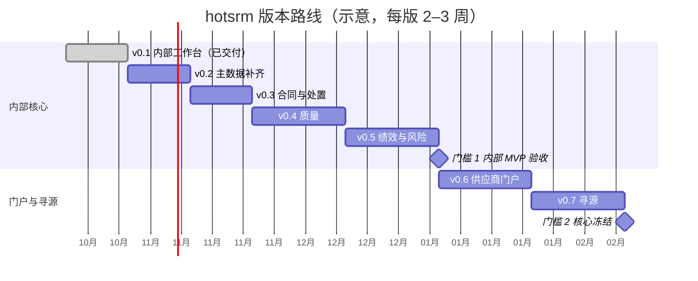

# 07 · 交付计划、风险与待决策事项

> 所属：[SRM 设计总览](./README.md)　·　上一篇：[06 预留集成点与 AI](./06-integration-and-ai.md)

> 版本：2026-10-23 按 [ADR-0008](../adr/0008-order-to-pay-stays-in-erp.md)、[ADR-0009](../adr/0009-core-first-pack-criteria-and-customer-layer.md)
> 重排：先做内部管理核心，再做门户，最后做寻源；ERP 集成与扩展包在 v0.7 之后由客户驱动。
> 旧的「第 0–五期」分期作废。

## 1. 分期路线图

按版本交付，每个版本结束都有一个业务上能独立使用的闭环，对象数累计到核心 28 个（ADR-0008 定为 27 个，v0.4 审核问题项改为子对象后为 28 个）。
工期按 1–2 人加 AI 的开发方式估算，每个版本 2–3 周；两个门槛由田騏确认后才进入下一段。

| 版本 | 范围 | 新增对象（累计） | 本版闭环 | 前置条件 |
|---|---|---|---|---|
| v0.1 内部工作台 | 供应商主数据、两级准入审批、证书到期提醒 | 7：品类、工厂、供应商、联系人、证书、供货品类资格、准入申请 | 供应商从登记到合格；证书到期前有提醒 | 已交付（PR #5） |
| v0.2 主数据补齐 | 银行账户、信息变更申请、法人（业务单元）、物料与存量供应商导入 | +3 = 10：物料、银行账户、信息变更单 | 存量供应商导入后能复核；关键信息变更走审批 | 已交付（PR #13–#18） |
| v0.3 合同与处置 | 合同与合同行、处置单（暂停 / 冻结 / 解除）、供应商自助重新申请 | +3 = 13：合同、合同行、处置单 | 合同到期前提醒；冻结后不能被邀请 | 已交付（PR #29–#33、#41） |
| v0.4 质量 | 交付记录导入、质量问题与整改单、供应商审核与年度审核计划 | +4 = 17：交付记录、质量问题、供应商审核、审核问题项 | 不合格交付能开整改单并闭环；OTD、合格率、PPM 出数 | 客户能按月导出交付数据 |
| v0.5 绩效与风险 | 指标库、按周期考评、风险事件与扫描、黑名单 | +4 = 21：绩效指标、考评单、考评明细、风险事件 | 第一次考评自动生成并发布；D 级进入处置 | 门槛 1：内部 MVP 验收（§2.1） |
| v0.6 供应商门户 | 邀请注册、门户补资料与证书、整改回复、通知 | +1 = 22：供应商邀请 | 供应商自己维护资料并回复整改 | objectstack#25233 修复；V1–V5 实测通过（§6） |
| v0.7 寻源 | 询价 / 竞价、封标、比价、定标审批、价格记录 | +6 = 28：寻源单、寻源明细、寻源邀请、报价单、报价明细、价格记录 | 封标询价到定标，价格记录生效 | 门槛 2：核心 28 个对象冻结（ADR-0009 第 5 条） |
| 之后（客户驱动） | ERP 连接器与门户镜像（订单确认、送货通知、付款进度）、电子签、工商数据、扩展包 | 镜像对象另计 | — | 客户明确型号或需求 |



**上线策略**：v0.5 验收后先选 **2 个品类、20–30 家供应商**在内部试运行 4 周；v0.6 门户
从这批供应商里挑配合度高的 5 家先开；推广按品类分批，而不是按工厂。

## 2. 验收标准

### 2.1 门槛 1：内部 MVP（v0.5 出口）

按下面的剧本在内部工作台完整走一遍，不涉及门户和 ERP。

1. 品类经理为供应商 X 登记准入申请，选择「电子元器件」品类（A 类物资、高风险），上传
   营业执照；系统查重通过；
2. 采购员收齐 ISO9001 证书与银行账户；应付会计核验银行账户；
3. SQE 完成现场审核并上传报告，审核通过；
4. 准入审批按矩阵走品类经理、采购总监两级，A 类加质量经理会签；审批人与发起人为同一人
   时自动改派；通过后 X 变为「合格」；
5. 导入上月交付记录表格两遍，结果一致；其中一条不合格记录开出整改单，X 的整改回复由
   SQE 代录（FR-602），SQE 审核退回一次后通过，验证关闭；
6. 月初考评 flow 为 X 生成本期考评单（A 类按月），OTD、合格率、PPM 与导入数据一致；
   采购总监审定发布；
7. 把 X 的考评改成 D 级并连续两期，处置单自动建议暂停；处置单审批通过后 X 不能再被
   关联新的合同；
8. 将 X 的 ISO9001 证书有效期改为昨天，次日扫描后 X 被标记「资质异常」，列表上有提示；
9. 为 X 新建合同，到期前 30 天提醒到采购员待办。

### 2.2 门槛 2：门户与寻源（v0.7 出口）

在 2.1 的基础上增加：

1. 品类经理邀请 X 的联系人加入门户；X 在门户补齐证书并回复一张整改单；X 看不到其他
   供应商的任何数据（[04 §3.7](./04-security-and-portal.md#37-隔离验收测试)）；
2. 寻源工程师建询价单（3 个物料），邀请 X、Y、Z 三家；截止前内部只能看到「已报价 N 家」；
   Y 在截止后尝试改价被拒绝；
3. 开标，比价矩阵显示三家价格；定标金额 50 万，走两级审批；通过后价格记录生成、旧价格
   被截断，三家收到结果通知。

### 2.3 量化标准

| 项 | 标准 | 门槛 |
|---|---|---|
| 导入幂等 | 物料、存量供应商、交付记录三张样例表格各跑两遍，结果一致 | 1 |
| 数据迁移 | 存量供应商、联系人、证书两轮迁移演练，抽检准确率 ≥ 99% | 1 |
| 审批矩阵 | [03 §12](./03-processes-and-automation.md#12-审批矩阵) 每一行各有一条通过用例，自审被拒一条 | 1 |
| 性能 | 01 §7 的列表视图响应时间达标 | 1 |
| 可用性 | 2 名采购员在无培训的情况下完成「登记申请 → 审批通过」 | 1 |
| 隔离测试 | 04 §3.7 全部用例通过，零例外 | 2 |
| 封标测试 | 截止前经界面、API、导出、仪表盘、AI 助手五个通道均取不到报价内容 | 2 |
| 可用性 | 5 家试点供应商在无培训的情况下完成「接受邀请 → 提交报价」 | 2 |

## 3. 应用包结构与工程规范

### 3.1 目录结构

核心的源码放在仓库的 `src/core/`（`type: app`，命名空间 `srm`）；现阶段只有核心，扩展包
目录和桥接模块在第一个包立项时再建（[ADR-0009](../adr/0009-core-first-pack-criteria-and-customer-layer.md)），
组合方式见仓库根目录的 [README](../../README.md) 与 [ADR-0002](../adr/0002-packs-composed-into-one-app.md)。

```
src/core/
├── index.ts                     # defineStack：manifest（type: app，namespace: srm）
├── objects/                     # 每个对象一个文件：supplier.object.ts …
├── picklists/                   # 共享选项列表，供扩展包追加选项（02 §1 第 13 条）
├── flows/                       # 按流程分目录：admission/、quality/、performance/、sourcing/ …
├── security/
│   ├── positions.ts             # 内部岗位
│   ├── permission-sets.ts       # 内部权限集
│   └── portal.ts                # 门户权限集与 RLS（见 04 §3.4）
├── apps/                        # srm_workbench、srm_portal 两个应用外壳（导航按分组）
├── views/                       # 列表、看板、日历、甘特
├── reports/                     # 比价矩阵等（v0.7）
├── dashboards/
├── forms/                       # 公开注册表单（不收附件，登录后上传）
├── notifications/               # 中英文通知模板
├── translations/
└── data/                        # 种子数据：品类、指标库、演示供应商、导入样例表格

test/                            # 仓库根目录
├── import-idempotency.test.ts   # 样例表格跑两遍（v0.2 起）
├── approval-matrix.test.ts      # 03 §12 每一行（v0.1 起）
├── portal-isolation.test.ts     # 04 §3.7 的交叉越权用例（v0.6）
├── sealed-bid.test.ts           # 封标与截止锁价（v0.7）
└── flows/*.test.ts              # 每条 flow 的正向与异常路径
```

### 3.2 规范

建模规范、分支与 PR、CI 门禁、测试策略、版本与升级，见 [docs/engineering](../engineering/README.md)。
要点：

- **契约优先**：元数据以 `@objectstack/spec` 为唯一契约，发布前跑平台 lint 与构建校验，
  校验报错一律改元数据，不在运行时打补丁；
- **环境**：开发、预发、生产三套环境，配置与元数据通过应用包版本推进，不在生产环境
  手工改元数据；
- **客户个性化放客户层**：参数、体系文件实例、Studio 覆盖层、客户私有包；不改核心源码。

## 4. 风险与应对

| # | 风险 | 可能性 | 影响 | 应对 |
|---|---|---|---|---|
| R1 | 门户用户可见的用户目录范围不满足隔离要求（04 §3.6） | 已确认存在（objectstack#25233） | 中：暴露竞争对手与员工联系方式 | v0.6 以 #25233 修复为前提；不能按期则按 D8 处理 |
| R2 | 同一环境其他应用的默认权限集把数据开放给供应商用户 | 中 | 高 | v0.6 上线前逐个审查环境内所有 `isDefault` 权限集；新应用上线纳入同一审查 |
| R3 | 定时任务延迟或漏跑（objectstack#25442 待平台给出保证） | 中 | 中：提醒延迟 | 追赶式扫描（03 §2.3）；强制规则不依赖计时器 |
| R4 | 每家供应商首次开通门户都要管理员新建岗位定义；flow 写任命也可能不被允许（objectstack#25443） | 高（建岗位必然手工） | 低：效率 | 开通流程写成管理员操作清单；v0.6 前验证 V2/V3；平台提供声明式成员集合后改用方案 B |
| R5 | 供应商不愿用门户，继续用邮件和微信 | 中 | 高：协同价值落空 | 试点选配合度高的供应商；邮件只给链接不给内容；在采购合同中约定门户为正式渠道 |
| R6 | 存量供应商数据质量差（重复、缺信用代码） | 高 | 中 | v0.2 导入前专项清洗；导入时按信用代码（境外按国家 / 地区 + 注册号）匹配，可重复执行；标记「存量导入」进「存量待复核」视图（[导入说明](../implementation/legacy-supplier-import.md)） |
| R7 | ERP 集成推迟后，交付数据靠每月导入，客户不按时导出则绩效断档 | 中 | 中 | 导入模板与操作清单写进实施手册；考评 flow 发现本期无交付记录时标记「数据不全」而不是给零分 |
| R8 | 每版对象与 flow 较多，回归成本上升 | 中 | 中 | 审批矩阵、导入幂等、关键 flow 的自动化测试进 CI（docs/engineering §3） |
| R9 | 考评在 flow 里批量处理，供应商多时运行时间长 | 低 | 中 | 按法人或品类错峰拆分；规模继续增长时评估服务端函数 |
| R10 | 审批人与发起人为同一人（职责分离失效） | 中 | 中 | 岗位分离 + `expression` 审批人改派（04 §6）；平台开关见 objectstack#25446 |
| R11 | 客户落地时要求改核心字段，覆盖层与核心升级冲突（平台目前不检测，objectstack ADR-0005） | 中 | 中 | 客户层规则（ADR-0009 第 4 条）；核心升级前跑「核心 + 客户层」组合构建 |

## 5. 待决策事项（附推荐）

### 5.1 设计决策 D1–D9

「状态」列记录结论和日期；已决的项不再重复讨论，改结论要附 ADR 或更新本表。

| # | 决策 | 推荐 | 理由与其他选项的代价 | 状态 |
|---|---|---|---|---|
| D1 | 部署形态与门户账号模式 | **托管云；供应商用户以受邀组织成员身份登录，按「每家供应商一个门户岗位」隔离** | 本设计全部用元数据实现，托管云今天即可运行，运维成本最低。平台只有托管安装（ADR-0131 D6），自托管不是现实选项 | 已决（2026-10-23，ADR-0002 补充） |
| D2 | 多法人是否隔离 | **单组织 + 业务单元树，不开墙** | 供应商主数据集团共享、门户用户只加入一个组织；开墙会让每个法人各有一份供应商档案，并让门户账号成倍增加（04 §5） | 已决（2026-10-23，ADR-0006 补充） |
| D3 | ERP 集成方式 | **现阶段不集成，用表格导入；立项时有中间件走中间件，没有则 SRM 直连 + 同步状态字段** | 见 ADR-0008；直连的可靠性靠追赶式重推保证（06 §1.1） | 已决（2026-10-23，ADR-0008） |
| D4 | 准入是否都要现场审核 | **按品类风险等级：高风险必须，中低风险免** | 一刀切会把准入周期拉长到 6 周以上，与目标 G3 冲突 | 已决（2026-10-23，03 §3 步骤 5） |
| D5 | 定标审批金额阈值 | **先用 10 万 / 100 万两档，实施时按企业授权手册替换** | 阈值放在参数 `award_approval_tiers` 里，调整不需要改流程 | 已决（v0.7 实现） |
| D6 | 封标强度 | **所有询价默认封标，仅单一来源可关闭；100 万以上的寻源启用监标人开标** | 全量封标的成本几乎为零；监标只在大额启用，避免小额寻源被流程拖慢 | 已决（v0.7 实现） |
| D7 | 电子签 | **v0.3 合同模块先支持上传盖章扫描件，电子签在客户提出时接入** | 合同模块不阻塞在电子签选型上；字段已预留（06 §2） | 已决（2026-10-23，ADR-0008 第 6 条） |
| D8 | 用户目录可见范围（R1）不满足时的处理 | **等 objectstack#25233 修复；若不能按期，业务方书面接受风险并规范门户用户显示名** | 用户目录由平台成员权限决定，应用层无法完全控制，需要明确的责任人 | 待平台（#25233） |
| D9 | 绩效等级与结果应用 | **A ≥ 90 / B 80–89 / C 70–79 / D < 70；C 级改善、连续两期 D 级进入淘汰评审** | 行业常见做法；首年可以只发布不自动处置，跑满两期再启用自动处置；阈值在参数 `perf_grade_min`、`perf_d_exit_periods` | 已决（v0.5 实现） |

### 5.2 计划决策 P-D1–P-D5

开发计划（2026-10-23）提出的决策，按推荐先行；P-D1、P-D2、P-D4 于 2026-10-24 由总监决策线程裁定。

| # | 决策 | 推荐 | 状态 |
|---|---|---|---|
| P-D1 | 审批矩阵的单一来源 | **以 03 §12 为准，体系文件模板（ZC-02、QP-01、GL-02）跟着改** | 已决（2026-10-24；v0.1–v0.4 的审批 flow 均按 03 §12 实现） |
| P-D2 | 物资 A/B/C 分类放在哪里 | **品类上的 `material_class` 字段，共享选项列表 `srm_material_class`；决定质量经理会签、审核频次、考评周期** | 已决（2026-10-24；字段随 v0.4 Q0 合入，选项值为 `class_a` / `class_b` / `class_c`） |
| P-D3 | 寻源在门户之前还是之后 | **门户（v0.6）先于寻源（v0.7）**，寻源依赖供应商在门户报价 | 已决（2026-10-23） |
| P-D4 | 源语言（中文源英文译，还是英文源中文译） | **中文源、英文译** | 已决（2026-10-24，ADR-0007 补充说明） |
| P-D5 | 扩展包何时立项 | **按 ADR-0009 准入标准，第一个客户出现时再定** | 已决（2026-10-23，ADR-0009） |

## 6. 平台依赖与验证结果

本设计依赖的平台能力。✅ 本设计按已有能力使用；⚠️ 使用时有约束，对策见右列；❓ 待实测。
「验证结果」列记录对照平台源码或 ADR 的结论和日期，以及已提交的平台 issue。

### 6.1 能力依赖

| 能力 | 状态 | SRM 中的用法 | 约束 / 对策 | 验证结果（日期） |
|---|---|---|---|---|
| 对象、字段（含 `currency`、`autonumber`、`summary`、`address`、`file`） | ✅ | 全部对象 | — | 2026-10-23 对照平台契约确认 |
| 带条件的汇总字段 | ✅ | 有效报价数、过期证书数 | 在设计时声明 `filter`（对象式条件） | 2026-10-23 确认 |
| `state_machine` 校验（含 `initialStates`） | ✅ ⚠️ | 所有单据状态 | `stageField` 的选项必须内联并带 `kind`，不能用共享选项列表 | 2026-10-23 确认（迁移 `stage-field-option-kind-required`） |
| `script` 校验规则（CEL，含 `now()`） | ✅ ⚠️ | 截止后锁价、开标时限、邀请兜底 | 能读本记录和一跳关联记录；更远或需汇总的依据冗余到本记录，或改走 screen flow | 2026-10-23 确认 |
| 字段谓词（`requiredWhen` 等） | ⚠️ | 条件必填 | 不能经引用字段读关联记录（ADR-0137 D2） | 2026-10-23 确认；规范见 docs/engineering §1 |
| `controlled_by_parent` 子对象 | ✅ ⚠️ | 证书、合同行、报价明细 | 写子记录要求对父记录有编辑权 → 父记录授编辑权 + 字段级权限全部只读 | 2026-10-23 确认 |
| flow：record_change / schedule / time_relative / api / screen | ✅ ⚠️ | 全部自动化 | 定时触发可能延迟或漏跑 → 追赶式扫描（03 §2.3） | 2026-10-23；延迟保证待平台（PF1 objectstack#25442） |
| 审批节点 | ✅ ⚠️ | 全部审批 | 超时按日历小时计算 → 工作日口径的时限存为业务字段，由扫描判断 | 2026-10-23 确认 |
| 公开表单（匿名提交） | ⚠️ | 供应商自助注册 | 不收附件：需要上传的，供应商注册账户、登录后再上传（2026-10-24 决定，PF4 不再是依赖）；防刷由前置网关限流保证（04 §8） | 2026-10-23；FR-201 降为 P2 |
| 岗位、权限集、OWD、字段级权限 | ✅ | 内部角色、门户 | `role` 为保留字（ADR-0090 D3） | 2026-10-23 确认 |
| RLS（CEL 谓词，`current_user.positions`） | ✅ ⚠️ | 门户隔离、封标 | 不能跨对象引用 → 冗余 `portal_position`、`bid_opened` | 2026-10-23 确认 |
| criteria 共享规则（接收方含业务单元） | ✅ | 按工厂共享单据 | — | 2026-10-23 确认 |
| 层级可见范围（`unit_and_below` 等） | ✅（企业版） | 集团 / 工厂逐级可见（可选） | 需企业版许可 | — |
| 唯一约束 | ✅ | 信用代码、`country` + `registration_no` | 空值安全的组合唯一（ADR-0120） | 2026-10-23 确认 |
| 报表（含矩阵） | ✅ | 比价矩阵（v0.7） | — | — |
| 仪表盘 | ✅ ⚠️ | 各类看板 | 求和 / 平均只能落在存储数值字段；多值字段不能做维度 | 2026-10-23 确认 |
| 平台导入（表格） | ✅ ⚠️ | 物料、存量供应商、交付记录 | 按外部编号匹配，可重复执行；只在新建时写入的列（如供应商初始状态）用字段默认值和 `readonlyWhen` 表达（PF8）；一次导入只能一组匹配字段，境内 / 境外供应商分两遍（PF9）；同一批里的跨行规则拦不住（PF10） | 2026-10-23 样例表格在 CI 跑两遍通过；模拟「脏」台账试导结论见[导入说明 §6](../implementation/legacy-supplier-import.md#6-试导结果与清洗清单)（PF11、PF12）；2026-10-24 交付记录月度表格两遍通过，「脏」表格试导见[交付记录导入说明 §5](../implementation/delivery-import.md#5-试导结果与清洗清单) |
| 批量 API `upsert`、`http` 节点、webhook | ✅ ⚠️ | ERP 集成（预留） | 业务字段记同步状态 + 追赶式重推（06 §1.1） | ERP 立项时验证 |
| 通知（`notify`） | ⚠️ | 全部通知 | 只能发给组织内用户，外部联系人的邮件待平台（PF3 objectstack#25444） | 2026-10-23 |
| 字段历史、审批历史 | ✅ | 审计 | — | 2026-10-23 确认 |
| AI 治理（工具调用审计、回答级权限） | ✅（企业版） | AI 用例的审计 | 需企业版许可 | — |
| 应用包代码（钩子、插件、函数） | ⚠️ | 不依赖 | 平台支持 QuickJS 沙箱内的事务型钩子（ADR-0034/0102/0119），可被 `OS_DISABLE_AUTHORED_HOOKS` 关闭；本设计按 ADR-0001 不依赖 | 2026-10-23 更正（原文「托管云不执行代码」有误） |
| 岗位定义 | ⚠️ | 每家供应商一个门户岗位 | 岗位是环境级元数据，由管理员新建，flow 不能创建；运行时建岗位待平台（PF2 objectstack#25443） | 2026-10-23 |
| 审批人与发起人相同的控制 | ⚠️ | 职责分离 | `expression` 审批人改派 + 岗位分离（04 §6）；平台开关待（PF5 objectstack#25446） | 2026-10-23 |

### 6.2 v0.6 前的实测项

| # | 项 | 用法 | 不满足时 | 结果 |
|---|---|---|---|---|
| V1 | 门户用户的用户目录可见范围 | 门户隔离（04 §3.6） | 见 D8 | ❓ 已确认缺陷，待修复（PF6 objectstack#25233） |
| V2 | flow 以系统身份写岗位任命（`sys_user_position`） | 门户开通自动化 | 管理员手工任命，flow 只做回填 | ❓ 待平台（objectstack#25251） |
| V3 | flow 发起组织邀请 | 门户开通自动化 | 管理员在成员页邀请 | ❓ |
| V4 | 门户用户对 `controlled_by_parent` 子记录的写入 | 证书、整改回复 | 父记录授编辑权 + 字段级只读 | ❓ |
| V5 | 环境内其他应用的 `isDefault` 权限集 | R2 | 逐个审查 | ❓ |

### 6.3 已提交的平台 issue

| # | issue | 影响 | 不修复时的做法 |
|---|---|---|---|
| PF1 | objectstack#25442 定时 flow 的延迟与漏跑保证 | 提醒、考评、扫描 | 追赶式扫描 |
| PF2 | objectstack#25443 运行时创建岗位 | 门户开通 | 管理员手工建岗位 |
| PF3 | objectstack#25444 通知组织外联系人 | 供应商邮件通知 | 门户内通知 + 人工邮件 |
| PF4 | objectstack#25445 公开表单附件 | 不再依赖（2026-10-24 决定公开表单不收附件） | 附件在供应商注册账户、登录后上传 |
| PF5 | objectstack#25446 禁止自审开关 | 职责分离 | `expression` 改派；信息变更单每级通过后读审批记录比对，撞人时重开同级审批（03 §5） |
| PF6 | objectstack#25233 门户用户可列出全组织用户 | 门户隔离 | v0.6 阻塞；见 D8 |
| PF7 | objectstack#25447 ADR-0138 D5（多组织环境下公开表单绑定到指定组织） | 多法人客户的自助注册 | 邀请注册；多法人按 ADR-0006 单组织时不受影响 |
| PF8 | objectstack#25475 导入时「只在新建时写入」的列 | 存量导入不回退状态 | `status` 默认值按 `legacy_imported` 计算、`legacy_imported` 用 `readonlyWhen` 锁定（02 §4.1） |
| PF9 | objectstack#25476 导入按多组匹配字段依次匹配 | 境内 / 境外供应商同表导入 | 同一张表导两遍，各自跳过匹配字段为空的行 |
| PF10 | objectstack#25477 条件唯一（每家至多一位主联系人）在批量写入中生效 | 联系人导入 | 汇总字段 + 校验规则守卫单条写入；「主联系人重复」视图兜底同批写入 |
| PF11 | objectstack#25491 导入映射的 `transform`（转大写 / 小写）被忽略 | 信用代码、邮箱归一 | 导入前清洗（[导入说明 §6.2](../implementation/legacy-supplier-import.md#62-清洗清单)） |
| PF12 | objectstack#25493 导入接受 `YYYY.MM.DD` / `YYYYMMDD`、选项别名与大小写、每行报全部错误 | 存量台账导入 | 导入前清洗 |
| PF13 | objectstack#24817 多级审批的后续节点以原发起人为提交人（主干已修，18.0.0 未带上） | 信息变更单第 2 级退回修改 | 第 2 级只能通过或驳回（03 §5） |

---

*本设计的下一步：v0.4 质量 → … → v0.5 门槛 1 验收 → v0.6 门户 → v0.7 寻源与门槛 2。
每个版本出口时更新 §1 的路线表。*
