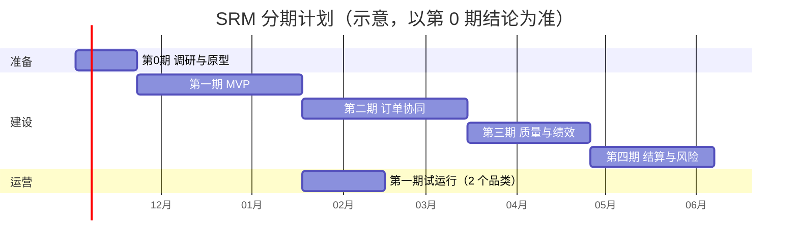

# 07 · 交付计划、风险与待决策事项

> 所属：[SRM 设计总览](./README.md)　·　上一篇：[06 集成与 AI](./06-integration-and-ai.md)

## 1. 分期路线图

按模块分期上线，每期结束都有一个业务上能独立使用的闭环。工期按 2–3 人的开发小组
（含实施）估算，第 0 期结论出来后再细化。

| 期次 | 周期 | 范围 | 新增对象 | 本期闭环 |
|---|---|---|---|---|
| 第 0 期 调研与原型 | 2–3 周 | 确认 §5 的决策；实测基线指标；清洗存量供应商数据；用 AI 搭建做准入模块原型；确认 ERP 接口 | — | 业务方签字确认的范围与决策清单 |
| 第一期 MVP | 8 周 | 供应商主数据、注册与准入、资质到期预警、询价比价定标、价格库、门户基础；集成 I1–I6 | 16 个：品类、物料、工厂、供应商及其 4 个子对象、准入申请、供应商审核、寻源单、寻源明细、寻源邀请、报价单、报价明细、价格记录 | 供应商从注册到合格，再到参与询价、定标、价格进 ERP |
| 第二期 | 8 周 | 合同、订单协同、送货、收货回传、信息变更与处置、采购申请；集成 I7–I12 | 9 个 | PO 下发 → 供应商确认 → 送货 → 收货，交付准时率可出数 |
| 第三期 | 6 周 | 来料检验、质量整改、绩效指标库与季度考评；集成 I13 | 5 个 | 不合格自动开整改单；第一次季度考评自动生成并发布 |
| 第四期 | 6 周 | 对账、发票、付款回写、外部风险监控；集成 I14–I15 | 4 个 | 月度对账线上闭环；风险事件自动发现 |
| 第五期 | 按需 | 反向竞价、邀请招标增强、货源清单与配额、AI 用例深化、高级支出分析 | 1 个（货源清单） | 按业务价值排序选做 |



**上线策略**：第一期先选 **2 个品类、20–30 家供应商**试运行 4 周，跑通准入与至少 5 张
询价单后再全面推广；推广按品类分批，而不是按工厂。

## 2. MVP 验收标准

### 2.1 端到端剧本

验收时按下面的剧本完整走一遍，每一步都要在内部工作台、门户、ERP 三处核对结果。

1. 潜在供应商 X 通过公开表单注册，选择「电子元器件」品类，上传营业执照；
2. 系统自动查重通过，生成「潜在」供应商，品类经理收到待办；
3. 品类经理邀请 X 的联系人加入，开通门户；X 在门户补齐 ISO9001 证书与银行账户；
4. 应付会计核验银行账户；SQE 完成现场审核（电子元器件为高风险品类）；
5. 准入评审两级审批通过，X 变为「合格」，ERP 中出现该供应商并回写编码；
6. 寻源工程师建询价单（3 个物料），通过 screen flow 邀请 X、Y、Z 三家；
7. 截止前内部只能看到「已报价 N 家」，看不到任何价格；三家都在截止前提交了报价；Y 在
   截止后尝试改价被拒绝；
8. 开标，比价矩阵显示三家价格；寻源工程师提交定标，金额 50 万，走两级审批；
9. 定标通过：价格记录生成、旧价格被截断、ERP 价格信息记录更新，三家收到结果通知；
10. 将 X 的 ISO9001 证书有效期改为昨天，次日扫描后 X 被标记「资质异常」，无法被新的
    询价邀请。

### 2.2 量化标准

| 项 | 标准 |
|---|---|
| 隔离测试 | [04 §3.7](./04-security-and-portal.md#37-隔离验收测试) 全部用例通过，零例外 |
| 封标测试 | 截止前经界面、API、导出、仪表盘、AI 助手五个通道均取不到报价内容 |
| 数据迁移 | 存量供应商、联系人、证书、有效价格两轮迁移演练，抽检准确率 ≥ 99% |
| 性能 | 01 §7 的列表与比价视图响应时间达标 |
| 集成 | I1–I6 每类接口：正常、重复消息、失败重推三种情况各验证一次 |
| 可用性 | 5 家试点供应商在无培训的情况下完成「接受邀请 → 提交报价」 |

## 3. 应用包结构与工程规范

### 3.1 目录结构

核心的源码放在仓库的 `src/core/`（`type: app`，命名空间 `srm`）；扩展包和组合方式见
仓库根目录的 [README](../../README.md) 与 [ADR-0002](../adr/0002-packs-composed-into-one-app.md)。

```
src/core/
├── index.ts                     # defineStack：manifest（type: app，namespace: srm）
├── objects/                     # 每个对象一个文件：supplier.object.ts …
├── picklists/                   # 共享选项列表，供扩展包追加选项（02 §1 第 13 条）
├── flows/                       # 按流程分目录：admission/、sourcing/、order/ …
├── security/
│   ├── positions.ts             # 内部岗位
│   ├── permission-sets.ts       # 内部权限集
│   └── portal.ts                # 门户权限集与 RLS（见 04 §3.4）
├── apps/                        # srm_workbench、srm_portal 两个应用外壳（导航按分组，供扩展包挂菜单）
├── views/                       # 列表、看板、日历、甘特
├── reports/                     # 比价矩阵等
├── dashboards/
├── forms/                       # 公开注册表单
├── notifications/               # 中英文通知模板
├── translations/
└── data/                        # 种子数据：品类、指标库、演示供应商

test/                            # 仓库根目录，覆盖核心与各种扩展包组合
├── portal-isolation.test.ts     # 04 §3.7 的交叉越权用例
├── sealed-bid.test.ts           # 封标与截止锁价
├── composition.test.ts          # 每种扩展包组合都能构建、校验通过
└── flows/*.test.ts              # 每条 flow 的正向与异常路径
```

### 3.2 规范

- **契约优先**：元数据以 `@objectstack/spec` 为唯一契约，发布前跑平台 lint 与构建校验，
  校验报错一律改元数据，不在运行时打补丁；
- **测试**：用平台的 verify 工具在进程内启动整个应用包做端到端断言，隔离与封标测试
  进 CI，失败即阻断发布；
- **环境**：开发、预发、生产三套环境，配置与元数据通过应用包版本推进，不在生产环境
  手工改元数据；
- **版本**：应用包按语义化版本发布，每期一个次版本号，破坏性变更（删字段、改选项值）
  必须附数据迁移。

## 4. 风险与应对

| # | 风险 | 可能性 | 影响 | 应对 |
|---|---|---|---|---|
| R1 | 门户用户可见的用户目录范围不满足隔离要求（04 §3.6） | 待第 0 期验证 | 中：暴露竞争对手与员工联系方式 | 第 0 期实测；不满足时在平台层面解决，或书面接受并规范显示名 |
| R2 | 同一环境其他应用的默认权限集把数据开放给供应商用户 | 中 | 高 | 上线前逐个审查环境内所有 `isDefault` 权限集；新应用上线纳入同一审查 |
| R3 | 定时任务延迟或漏跑 | 中 | 中：提醒延迟 | 追赶式扫描 + 关键扫描的外部心跳（03 §2.3）；强制规则不依赖计时器 |
| R4 | 每家供应商首次开通门户都要管理员新建岗位定义；flow 写任命也可能不被允许 | 高（建岗位必然手工） | 低：效率 | 开通流程写成管理员操作清单；第 0 期验证 flow 写任命；平台提供声明式成员集合后改用方案 B，取消逐家建岗位 |
| R5 | 供应商不愿用门户，继续用邮件和微信 | 中 | 高：协同价值落空 | 试点选配合度高的供应商；邮件只给链接不给内容；在采购合同中约定门户为正式渠道 |
| R6 | 存量供应商数据质量差（重复、缺信用代码） | 高 | 中 | 第 0 期专项清洗；导入时按信用代码查重；缺失项在门户里让供应商自行补齐 |
| R7 | ERP 接口改造排期慢 | 中 | 高 | 第 0 期确认接口清单与 ERP 团队排期；一期只依赖 I1–I6，其中 I3 / I5 / I6 可先以导出文件过渡 |
| R8 | 每期对象与 flow 较多，回归成本上升 | 中 | 中 | 隔离、封标、关键 flow 的自动化测试进 CI |
| R9 | 月度对账、季度绩效在 flow 里批量处理，供应商多时运行时间长 | 低 | 中 | 按法人或品类错峰拆分；规模继续增长时评估自托管与服务端函数 |
| R10 | 审批人与发起人为同一人（职责分离失效） | 中 | 中 | 岗位分离 + `expression` 审批人改派（04 §6） |

## 5. 待决策事项（附推荐）

每项都给出推荐和理由；请在第 0 期结束前确认。

| # | 决策 | 推荐 | 理由与其他选项的代价 |
|---|---|---|---|
| D1 | 部署形态与门户账号模式 | **托管云（选择支持定时任务的套餐）；供应商用户以受邀组织成员身份登录，按「每家供应商一个门户岗位」隔离** | 本设计全部用元数据实现，托管云今天即可运行，运维成本最低。自托管可以启用代码增强（membership resolver、服务端函数），代价是许可、运维和升级都要自己承担；只在数据驻留或规模有硬要求时选 |
| D2 | 多法人是否隔离 | **单组织 + 业务单元树，不开墙** | 供应商主数据集团共享、门户用户只加入一个组织；开墙会让每个法人各有一份供应商档案，并让门户账号成倍增加（04 §5） |
| D3 | ERP 集成方式 | **有中间件走中间件；没有则 SRM 直连 + 同步状态字段** | 中间件在映射、重试、监控上更成熟；直连的可靠性靠追赶式重推保证（06 §1.1） |
| D4 | 准入是否都要现场审核 | **按品类风险等级：高风险必须，中低风险免** | 一刀切会把准入周期拉长到 6 周以上，与目标 G3 冲突 |
| D5 | 定标审批金额阈值 | **先用 10 万 / 100 万两档，实施时按企业授权手册替换** | 阈值放在配置常量里，调整不需要改流程 |
| D6 | 封标强度 | **所有询价默认封标，仅单一来源可关闭；100 万以上的寻源启用监标人开标** | 全量封标的成本几乎为零；监标只在大额启用，避免小额寻源被流程拖慢 |
| D7 | 电子签 | **二期合同模块上线时先支持上传盖章扫描件，电子签在二期末或三期接入** | 合同模块不阻塞在电子签选型上；选型可从第一期开始并行 |
| D8 | 用户目录可见范围（R1）不满足时的处理 | **由部署方在平台层面解决；若不能按期，业务方书面接受风险并规范门户用户显示名** | 用户目录由平台成员权限决定，应用层无法完全控制，需要明确的责任人 |
| D9 | 绩效等级与结果应用 | **A ≥ 90 / B 80–89 / C 70–79 / D < 70；C 级改善、连续两期 D 级进入淘汰评审** | 行业常见做法；首年可以只发布不自动处置，跑满两期再启用自动处置 |

## 6. 平台依赖与待验证项

本设计依赖的平台能力，以及第 0 期需要在目标部署上验证的事项。✅ 本设计按已有能力
使用；⚠️ 使用时有约束，对策见右列；❓ 第 0 期验证。

| 能力 | 状态 | SRM 中的用法 | 约束 / 对策 |
|---|---|---|---|
| 对象、字段（含 `currency`、`autonumber`、`summary`、`address`、`file`） | ✅ | 全部对象 | — |
| 带条件的汇总字段 | ✅ | 有效报价数、过期证书数、已收货数量 | 在设计时声明 `filter`（对象式条件） |
| `state_machine` 校验（含 `initialStates`） | ✅ | 所有单据状态 | — |
| `script` 校验规则（CEL，含 `now()`） | ✅ ⚠️ | 截止后锁价、开标时限、邀请兜底 | 能读本记录和一跳关联记录；更远或需汇总的依据冗余到本记录，或改走 screen flow |
| `controlled_by_parent` 子对象 | ✅ ⚠️ | 订单行、证书、报价明细 | 写子记录要求对父记录有编辑权 → 父记录授编辑权 + 字段级权限全部只读 |
| flow：record_change / schedule / time_relative / api / screen | ✅ ⚠️ | 全部自动化 | 定时触发可能延迟或漏跑 → 追赶式扫描 + 外部心跳（03 §2.3）；确认所选套餐支持定时任务 |
| 审批节点 | ✅ ⚠️ | 全部审批 | 超时按日历小时计算 → 工作日口径的时限存为业务字段，由扫描判断 |
| 公开表单（匿名提交） | ✅ ⚠️ | 供应商注册 | 防刷由前置网关限流保证（04 §8） |
| 岗位、权限集、OWD、字段级权限 | ✅ | 内部角色、门户 | — |
| RLS（CEL 谓词，`current_user.positions`） | ✅ ⚠️ | 门户隔离、封标 | 不能跨对象引用 → 冗余 `portal_position`、`bid_opened` |
| criteria 共享规则（接收方含业务单元） | ✅ | 按工厂共享单据 | — |
| 层级可见范围（`unit_and_below` 等） | ✅（企业版） | 集团 / 工厂逐级可见（可选） | 需企业版许可 |
| 报表（含矩阵） | ✅ | 比价矩阵 | — |
| 仪表盘 | ✅ ⚠️ | 各类看板 | 求和 / 平均只能落在存储数值字段；多值字段不能做维度 |
| 批量 API `upsert`（外部编号匹配） | ✅ | ERP 入站 | — |
| `http` 节点、webhook | ✅ ⚠️ | ERP 出站、外部服务 | 业务字段记同步状态 + 追赶式重推（06 §1.1） |
| 字段历史、审批历史 | ✅ | 审计 | — |
| AI 治理（工具调用审计、回答级权限） | ✅（企业版） | AI 用例的审计 | 需企业版许可 |
| 应用包代码（钩子、插件、函数） | ⚠️ | — | 托管云上安装的应用包不执行代码 → 本设计不依赖；自托管时可启用 membership resolver 等增强（04 §3.5） |
| 岗位定义 | ⚠️ | 每家供应商一个门户岗位 | 岗位是环境级元数据，由管理员新建，flow 不能创建；数量随供应商增长 |
| flow 以系统身份写岗位任命 | ❓ | 门户开通自动化 | 不行则管理员手工任命，flow 只做回填 |
| flow 发起组织邀请 | ❓ | 门户开通自动化 | 不行则管理员在成员页邀请 |
| 门户用户的用户目录可见范围 | ❓ | 门户隔离 | 按 04 §3.6 实测；不满足时见 D8 |
| 审批人与发起人相同的控制 | ⚠️ | 职责分离 | `expression` 审批人改派 + 岗位分离（04 §6） |

---

*本设计的下一步：确认 §5 的 D1–D9 → 第 0 期调研与原型 → 按第一期范围在应用包中实现。*
