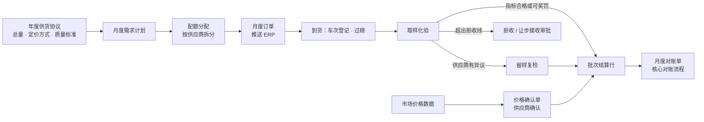

# 大宗物料包

> 状态：设计草案 v0.1（2026-10-22）
> 包前缀：`srm_bulk_`　·　上位文档：[扩展包总览](./README.md)

## 1. 适用场景

大宗物料的采购方式和离散制造的零部件采购很不一样：量大、品种少、价格随市场
波动、质量要按批次化验才知道、结算重量和单价都要在到货之后才确定。核心设计里
「询价定标 → 价格库 → 按订单行收货 → 按收货行对账」的链路不够用。

| 特点 | 核心的默认做法 | 大宗物料的做法 |
|---|---|---|
| 合同 | 单次合同或价格协议 | 年度供货协议：年度总量、数量容差、定价方式、质量标准、损耗与结算口径 |
| 下单 | ERP 下发订单，逐行确认 | 按月做需求计划，在多家供应商之间分配配额，生成月度订单 |
| 价格 | 定标后写入价格库，有效期内不变 | 与市场价联动：基准价（指数、公开报价或挂牌价）± 升贴水，按约定周期确定，双方确认 |
| 收货 | 按数量收货 | 按车次 / 批次过磅，比较原发与实收，计算运输损耗 |
| 质量 | 来料检验合格或不合格 | 每批取样化验多个指标，按指标偏离程度奖罚，超出拒收线拒收或让步接收，可申请复检 |
| 结算 | 收货数量 × 订单单价 | 结算重量 × 结算单价 ± 质量奖罚 − 超损扣款，按批次计算、按月汇总对账 |

典型行业：液体化工原料、焦化与炭材料、钢铁（铁矿石、废钢、合金）、电力热力（燃煤）、
建材（熟料、石膏）、粮油（原粮、油料）。

## 2. 业务流程

| 步骤 | 说明 |
|---|---|
| 1 年度协议 | 采购部与主要供应商签订年度供货协议，约定年度总量与容差、定价方式与价格参照、质量标准、合理损耗率、结算口径。协议审批走核心合同流程，协议条款存于本包的 `srm_bulk_supply_agreement` |
| 2 月度计划与配额 | 生产部门提出下月需求；采购部按协议量、上月执行情况和绩效在供应商之间分配配额，审批后生成月度订单。偏离协议量超过容差时须说明原因 |
| 3 价格确认 | 按协议的定价周期，由 flow 从价格数据计算基准价，加上升贴水生成价格确认单，推送供应商在门户确认；双方确认后锁定，作为该周期到货的结算单价 |
| 4 到货与计量 | 每车次登记车牌、原发重量，过磅得到毛重、皮重、实收净重（来自地磅系统或手工录入）；计算运输损耗与超损量 |
| 5 取样化验 | 按批次取样并留样；化验结果来自化验系统或手工录入；flow 按质量标准逐项判定：合格、奖罚、拒收 |
| 6 异议与复检 | 供应商在约定时限内对化验结果提出异议，用留样送第三方复检，以复检结果为准；复检费用按协议由责任方承担 |
| 7 拒收与让步 | 超出拒收线的批次默认拒收；生产确需使用的，走让步接收审批（质量、生产、采购会签），按协议让步扣款 |
| 8 批次结算 | 化验结果与价格确定后，自动生成批次结算行 |
| 9 月度对账 | 月度对账单的明细由批次结算行生成（替代核心按收货行生成的规则），后续确认、开票、付款沿用核心流程 |

## 3. 计算规则（示例）

以下公式是行业常见口径，具体以协议约定为准，全部做成参数或协议字段，不写死在流程里。

| 项目 | 示例口径 |
|---|---|
| 运输损耗 | 原发净重 − 实收净重 |
| 超损量 | max(0，运输损耗 − 原发净重 × 合理损耗率) |
| 结算重量 | 按协议选择：实收净重 / 原发净重 / 两者取小；扣除超损量 |
| 干基折算（可选） | 结算重量 × (1 − 实测水分) ÷ (1 − 基准水分)，用于煤、矿等按干基计价的物料 |
| 结算单价 | 价格确认单的单价 = 基准价 ± 升贴水；基准价可取某价格参照在定价周期内的均价、到货日价格或装运日价格 |
| 单项质量奖罚 | 指标每偏离基准一个步长，奖或罚若干元 / 吨，可设封顶；超出拒收线不再奖罚，转拒收或让步 |
| 批次金额 | 结算重量 × 结算单价 + Σ 单项质量奖罚 × 结算重量 − 让步扣款 |

示例：某液体原料协议约定水分基准 ≤ 1.0%，每超 0.1% 扣 5 元 / 吨，超过 3.0% 拒收。
某车实测水分 1.35%，超出 0.35%，按 4 个步长（不足一个步长按一个计，示例规则）扣
20 元 / 吨。

## 4. 对象设计

| 对象 | 中文名 | 关键字段 | 门户 |
|---|---|---|---|
| `srm_bulk_quality_spec` | 质量标准 | 物料、版本、生效日期、状态 | 读（本公司协议引用的） |
| `srm_bulk_spec_item` | 质量指标项（master_detail → 质量标准） | 指标、单位、检测方法、基准值、上下限、拒收线、奖罚方式（无 / 按步长 / 分档）、步长、每步金额、封顶 | 读 |
| `srm_bulk_supply_agreement` | 年度供货协议 | 合同（lookup 核心合同）、供应商、物料、收货地点、年度总量、数量容差、定价方式（指数联动 / 公式 / 固定 / 月度议价）、价格参照、升贴水、定价周期、质量标准、合理损耗率、结算重量口径、是否干基、`portal_position` | 读（本公司） |
| `srm_bulk_monthly_plan` | 月度采购计划 | 期间、物料、收货地点、需求量、状态（草稿 / 审批中 / 已下达） | — |
| `srm_bulk_allocation` | 配额行（master_detail → 月度计划） | 供应商、协议、分配量、比例、偏离说明、生成的订单 | 读（本公司，计划下达后） |
| `srm_bulk_price_index` | 价格参照 | 名称、来源（资讯平台 / 交易所 / 内部挂牌价）、单位、频率 | — |
| `srm_bulk_price_quote` | 价格数据（master_detail → 价格参照） | 日期、价格 | — |
| `srm_bulk_price_confirmation` | 价格确认单 | 协议、定价周期、基准价、升贴水、结算单价、状态（待确认 / 已确认 / 有异议）、供应商确认时间、`portal_position` | 读、确认 |
| `srm_bulk_delivery` | 到货车次 | 订单行、协议、供应商、车牌、原发重量、毛重、皮重、实收净重、运输损耗、超损量、样品编号、状态（在途 / 已到厂 / 已取样 / 已过磅 / 已卸货 / 拒收 / 已结算）、`portal_position` | 读；在途信息可填报 |
| `srm_bulk_assay` | 化验结果 | 车次或批次、样品编号、化验时间、总体判定（合格 / 奖罚 / 拒收）、是否有异议、复检结果、`portal_position` | 读、提出异议 |
| `srm_bulk_assay_item` | 化验指标值（master_detail → 化验结果） | 指标项、实测值、判定、每吨奖罚金额 | 读 |
| `srm_bulk_settlement_line` | 批次结算行 | 车次、结算重量、结算单价、质量奖罚、超损扣款、让步扣款、金额、所属对账单、`portal_position` | 读 |

与核心对象的关系：

- 月度订单使用核心的 `srm_purchase_order`。本包需要在订单上标记来源（ERP 下发 /
  SRM 生成），用平台对象扩展机制加一个 `origin` 字段；不能扩展时，在配额行上记录
  订单号作为替代。
- 拒收与让步接收复用核心的检验与整改：拒收批次生成核心的 `srm_inspection`（结论为
  不合格）并按核心规则触发整改单。
- 月度对账使用核心的 `srm_statement`，对账明细类型为「大宗结算」，来源为批次结算行。
- 供应商绩效增加三项指标：质量符合度（化验合格批次占比）、计划完成率（实际到货量 ÷
  配额）、超损率，写入核心考评单的评分明细。

## 5. 自动化

| flow | 触发 | 动作 |
|---|---|---|
| `srm_bulk_allocation_issue` | 月度计划审批通过 | 按配额行生成月度订单并推送 ERP；通知供应商 |
| `srm_bulk_price_confirm_generate` | 定时：每个定价周期结束后（追赶式） | 按协议计算基准价，生成价格确认单，通知供应商确认 |
| `srm_bulk_delivery_weigh` | 车次过磅数据写入 | 计算运输损耗、超损量、结算重量 |
| `srm_bulk_assay_judge` | 化验结果写入 | 逐项对照质量标准判定，计算奖罚；超出拒收线时生成不合格检验记录，发起拒收 / 让步流程 |
| `srm_bulk_assay_dispute` | 门户「对化验结果提出异议」screen flow | 校验在异议时限内，标记有异议，通知质量部门安排留样复检 |
| `srm_bulk_concession_approval` | 拒收批次申请让步 | 质量、生产、采购会签；通过后按协议计算让步扣款 |
| `srm_bulk_settle` | 化验最终结果与价格都已确定 | 生成或更新批次结算行 |

## 6. 参数（示例默认值）

| 参数 | 示例默认值 | 说明 |
|---|---|---|
| 数量容差 | ±10% | 月度配额合计偏离协议月均量的允许范围 |
| 合理损耗率 | 0.3% | 也可在协议上逐个约定 |
| 化验异议时限 | 化验结果发布后 24 小时 | 超时视为认可 |
| 留样保存期 | 30 天 | 用于复检 |
| 价格确认时限 | 生成后 2 个工作日 | 超时由采购部跟进，不自动视为确认 |
| 让步接收审批 | 质量负责人 + 生产负责人 + 采购负责人 | |

## 7. 集成

| 外部系统 | 数据 | 方式 |
|---|---|---|
| 地磅 / 一卡通 / 物流园区系统 | 车次、毛重、皮重、过磅时间 | 外部系统调用批量 API 按车次号 upsert |
| 化验室信息系统（LIMS） | 样品编号、指标实测值 | 同上，按样品编号 upsert |
| 价格资讯数据源 | 价格参照的日度数据 | 手工导入或接口获取；注意数据源的使用许可 |
| ERP | 月度订单下推；收货按结算重量过账 | 沿用核心集成方式 |

## 8. 体系文件模板

| 模板 | 主要内容 |
|---|---|
| 《大宗原料采购管理办法》 | 年度计划与供应商配额、年度供货协议、定价规则与价格参照、到货计量、取样化验、质量奖罚、拒收与让步、结算 |
| 《大宗原料取样化验与质量异议处理规定》 | 取样与留样、化验方法、结果发布、异议时限、第三方复检、费用承担 |
| 《计量与运输损耗管理规定》 | 计量器具管理、过磅程序、损耗计算、超损扣款 |
| 表单 | 年度采购计划与配额表、月度采购计划、价格确认单、到货验收记录、化验报告与奖罚计算表、质量异议复检申请、让步接收审批表、批次结算单 |
