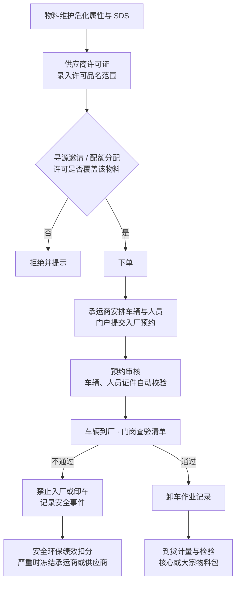

# 危化品包

> 状态：设计草案 v0.1（2026-10-22）
> 包前缀：`srm_hz_`　·　上位文档：[扩展包总览](./README.md)

## 1. 适用场景

采购物料中有危险化学品时，供应商管理除了质量、价格、交付，还要管住两件事：
**供应商有没有资格卖这种东西**，**运进厂的车和人有没有资格运、能不能安全卸**。
核心设计只管到「证书是否在有效期内」，不知道证书的许可范围是否覆盖所买的品名，
也不管承运商、车辆和人员。

| 需要管的事 | 本包的做法 |
|---|---|
| 物料是否属于危险化学品、属于哪一类 | 物料危化属性：是否危化品、危险类别、UN 编号、CAS 号、是否属于特别管控类别，安全技术说明书（SDS）及版本 |
| 供应商的许可范围是否覆盖该物料 | 许可证上记录许可品名范围；邀请报价、分配配额时校验「供应商 × 物料」的许可覆盖 |
| 承运商、车辆、驾驶员和押运员的资质 | 承运商、车辆、人员三类档案及其证件有效期监控，过期自动禁用 |
| 车辆入厂与卸车安全 | 入厂预约、门岗查验清单、卸车作业记录；查验不通过禁止卸车 |
| 安全事件的追溯与考核 | 安全事件记录，计入供应商与承运商的安全环保绩效，严重的触发冻结或黑名单 |

适用法规（以现行版本为准）：《危险化学品安全管理条例》《危险货物道路运输安全管理
办法》《危险化学品目录》及危险化学品安全技术说明书与标签相关国家标准；特别管控类
物质（如易制毒、易制爆化学品）的购买、运输另有备案或许可要求。本包也是 ISO 14001
与 ISO 45001 中「相关方管理」要求在采购侧的落地。

## 2. 业务流程

| 步骤 | 说明 |
|---|---|
| 1 物料属性 | 安全环保部维护危化品物料的属性和 SDS；SDS 版本更新时通知使用部门 |
| 2 许可范围 | 供应商的安全生产许可证或经营许可证除有效期外，还要录入许可范围：覆盖哪些危化品采购品类（可细到具体物料）。安全环保部经「核验许可证」screen flow 核验 |
| 3 许可覆盖控制 | 本包不改核心或其他扩展包的流程，而是维护它们已经在用的数据：供应商在某个危化品品类下没有有效、已核验且覆盖该品类的许可证时，本包的 flow 把该供应商在这个品类的供货资格（核心 `srm_supplier_category`）置为 `suspended`，并标记暂停原因是许可；许可恢复后，只撤销由本包造成的暂停。核心的「品类资格暂停不能邀请」（BR-03）和大宗物料包的配额分配都直接沿用这一状态 |
| 4 承运商备案 | 承运商（可以是供应商自己的车队，也可以是第三方）在门户维护车辆和人员档案，上传道路运输证、罐体检验报告、从业资格证等；安全环保部核验后可用 |
| 5 入厂预约 | 送货前由供应商或承运商在门户提交预约：车辆、驾驶员、押运员、预计到达时间、对应订单。系统自动校验三者证件均在有效期内且已核验，任何一项不满足即不能提交 |
| 6 门岗查验 | 车辆到厂后，门岗按查验清单逐项确认（证件与预约一致、车辆状况、安全设施、静电接地条件等），在手机端记录；不通过的禁止入厂并自动生成安全事件 |
| 7 卸车作业 | 卸车由收货单位按作业规程执行，记录开始与结束时间、作业人员、异常情况；危险作业审批（作业票）通常在企业的安全管理系统中办理，本包只记录关联编号 |
| 8 安全事件与考核 | 泄漏、证件不符、超载、违规驾驶等事件记录到 `srm_hz_incident`，计入供应商和承运商的安全环保绩效；按严重程度触发核心的冻结或黑名单流程 |

## 3. 对象设计

| 对象 | 中文名 | 关键字段 | 门户 |
|---|---|---|---|
| `srm_hz_material_profile` | 物料危化属性 | 物料（lookup 核心物料）、是否危化品、危险类别、UN 编号、CAS 号、特别管控类别（无 / 易制毒 / 易制爆 / 剧毒等）、SDS 文件、SDS 版本日期 | 读（本公司供应的物料） |
| `srm_hz_license_scope` | 许可范围 | 证书（lookup 核心资质证书）、采购品类（lookup 核心品类）、具体物料（可空）、核验状态 | 读；随证书维护 |
| `srm_hz_carrier` | 承运商 | 供应商（lookup，承运商在核心中是 `supplier_type = logistics` 的供应商）、道路运输经营许可证号与有效期、危险货物运输范围、承运人责任保险有效期、状态、`portal_position` | 读、维护 |
| `srm_hz_vehicle` | 车辆（master_detail → 承运商） | 车牌、车辆类型、道路运输证有效期、罐体检验有效期、卫星定位是否在线、核验状态 | 读、维护 |
| `srm_hz_person` | 驾驶员 / 押运员（master_detail → 承运商） | 姓名、岗位（驾驶员 / 押运员）、从业资格证号与有效期、核验状态 | 读、维护 |
| `srm_hz_appointment` | 入厂预约 | 订单行、车辆、驾驶员、押运员、预计到达时间、卸货地点、状态（已提交 / 已确认 / 已到厂 / 已卸车 / 已拒绝 / 已取消）、`portal_position` | 提交、读 |
| `srm_hz_gate_check` | 门岗查验记录 | 预约、查验时间、查验人、逐项结果（repeater：查验项、结果、照片）、总体结论、拒绝原因 | 读（本公司） |
| `srm_hz_unloading` | 卸车作业记录 | 预约、开始与结束时间、作业人员、作业票编号、异常情况 | — |
| `srm_hz_incident` | 安全事件 | 供应商、承运商、车辆、人员、事件类型、严重程度、经过、处理措施、绩效扣分、是否触发处置、`portal_position` | 读（本公司） |

与核心的衔接（只用 [扩展包 §3.2](./README.md#32-扩展包怎么接入核心) 的三种方式，不修改核心）：

| 方式 | 内容 |
|---|---|
| `objectExtensions` | 给核心 `srm_category` 加 `hz_is_hazardous`（危化品品类）；给核心 `srm_supplier_category` 加 `hz_license_block`（因许可不足而暂停） |
| `picklistExtensions` | 证书类型加安全生产许可证、危险化学品经营许可证、道路运输经营许可证；风险类型加 `safety_incident`；绩效维度加 `safety_env`（安全环保） |
| 导航贡献 | 在核心工作台的「供应商」分组下挂「承运商」「危化属性」，新增「入厂与卸车」分组挂「入厂预约」「门岗查验」「卸车记录」「安全事件」；在门户挂「车辆与人员」「入厂预约」 |

数据上的衔接：

- 许可证就是核心的 `srm_supplier_certificate`，本包只增加「许可范围」子对象；证件到期
  监控沿用核心机制，车辆和人员证件用同样的追赶式扫描。
- 安全事件的绩效扣分写入核心考评单「安全环保」维度的评分明细。
- 与大宗物料包同时组合时，到货车次与入厂预约之间的关联放在桥接模块
  `src/bridges/bulk-hazmat/`（见[扩展包 §3.3](./README.md#33-扩展包之间的联动桥接模块)），本包本身不引用大宗物料包的对象。

## 4. 自动化

| flow | 触发 | 动作 |
|---|---|---|
| `srm_hz_license_coverage_sync` | 许可证、许可范围或供货品类资格写入时，以及每日扫描（追赶式） | 按危化品品类重新计算供应商的许可覆盖；不覆盖时暂停该品类资格并置 `hz_license_block`，恢复覆盖时只撤销本包造成的暂停 |
| `srm_hz_document_expiry_sweep` | 定时：每日（追赶式） | 车辆、人员、承运商证件到期前提醒，到期后置为不可用 |
| `srm_hz_appointment_submit` | 门户「提交入厂预约」screen flow | 校验车辆、人员证件有效且已核验，校验订单属于本公司；通过后建预约并通知收货单位 |
| `srm_hz_gate_check_result` | 门岗查验记录提交 | 不通过时更新预约为已拒绝、生成安全事件、通知采购和安全环保部 |
| `srm_hz_incident_apply` | 安全事件确认 | 计算绩效扣分；达到阈值时生成核心的处置单草稿（冻结 / 黑名单） |

## 5. 权限补充

| 角色 | 权限 |
|---|---|
| 安全环保部 | 危化属性、许可范围、承运商档案的核验；安全事件的增改 |
| 门岗 / 安保 | 只读当天的入厂预约，填写门岗查验记录；看不到价格、订单金额等商务信息 |
| 收货单位 | 读预约与查验结果，填写卸车作业记录 |
| 承运商门户用户 | 维护本承运商的车辆与人员，提交预约；隔离方式与供应商门户相同 |

## 6. 参数（示例默认值）

| 参数 | 示例默认值 |
|---|---|
| 证件到期提醒 | 到期前 30 / 15 / 7 天 |
| 预约最晚提交时间 | 预计到达前 4 小时 |
| 可卸车时段 | 按收货单位规定，示例 08:00–18:00 |
| 一般事件绩效扣分 | 每次 5 分 |
| 严重事件处置 | 承运商冻结；同一年度两次严重事件进入黑名单评审 |

## 7. 体系文件模板

| 模板 | 主要内容 |
|---|---|
| 《危险化学品采购安全管理规定》 | 危化品物料识别与 SDS 管理、供应商许可范围核验、特别管控类物质的采购要求 |
| 《危险化学品承运商管理办法》 | 承运商准入、车辆与人员资质、运输过程要求、考核与退出 |
| 《危险化学品入厂与卸车安全管理规定》 | 预约、门岗查验、卸车作业、异常处置、事件报告 |
| 表单 | 危化品物料属性表、许可范围核验记录、承运商资质审查表、车辆与人员备案表、入厂预约单、门岗查验记录、卸车作业记录、安全事件报告 |
