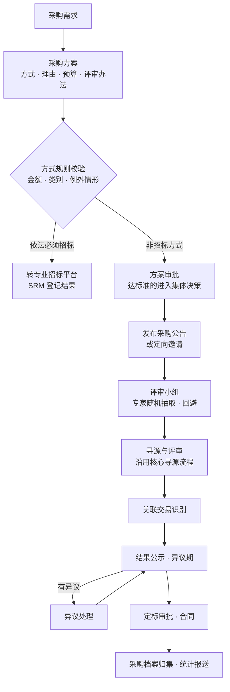

# 国企采购合规包

> 状态：设计草案 v0.1（2026-10-22）；**设计保留，未排期**（2026-10-23，[ADR-0009](../adr/0009-core-first-pack-criteria-and-customer-layer.md)，立项条件见[扩展包总览 §3.5](./README.md#35-准入标准与依赖顺序)）
> 包前缀：`srm_soe_`　·　上位文档：[扩展包总览](./README.md)

## 1. 适用场景

国有企业（含国有控股的上市公司）的采购，除了「买得好」，还要「买得合规、经得起
查」：采购方式要按金额和性质选择并留下理由，竞争性采购要有足够的参与者和独立的
评审，过程和结果要公开，重大事项要集体决策，关联交易要识别和披露，全过程要留档，
数据要能按要求统计报送。核心设计覆盖了寻源、封标、审批和留痕，本包补上方式选择、
评审专家、信息公开、集体决策、关联交易和采购档案。

参考依据（以现行版本和企业自身制度为准）：

- 《中华人民共和国招标投标法》及其实施条例、《必须招标的工程项目规定》——依法必须
  招标的工程建设项目及与之相关的货物、服务，按法定程序在专业电子招标平台上进行，
  SRM 只登记结果；
- T/CFLP 0016—2019《国有企业采购操作规范》——非依法必须招标项目的采购方式和程序
  可参照其中的招标、谈判、询比、竞价、直接采购等方式；
- 企业的「三重一大」决策制度、采购管理制度和授权文件；
- 上市公司的关联交易审议与信息披露规则。

## 2. 业务流程

| 步骤 | 说明 |
|---|---|
| 1 采购方案 | 需求部门或采购部编制采购方案：采购内容、预算、拟用方式及理由、供应商来源、评审办法。本包给核心寻源单加「采购方案」字段和一条校验规则：寻源单进入 `published` 时一跳读取方案状态，未批准则拒绝 |
| 2 方式规则校验 | flow 按方式规则表（金额区间 × 采购类别 → 允许的方式）校验所选方式；选择单一来源、直接采购等非竞争方式，或低于规则要求的竞争方式时，必须填写例外理由并上升一级审批 |
| 3 集体决策 | 金额或事项达到企业「三重一大」标准的，采购方案审批中增加「集体决策」环节：上传会议纪要并记录会议类型与日期，审批人确认后才能继续 |
| 4 公告与邀请 | 公开方式自动生成采购公告，发布到企业采购门户的公开页面；邀请方式记录邀请理由和被邀请名单 |
| 5 评审小组 | 评审人数为单数且不少于规定人数；外部或内部专家从专家库按专业随机抽取，系统记录抽取过程，与投标供应商存在关联关系的自动回避 |
| 6 寻源与评审 | 沿用核心的封标、开标、评分、多轮议价；本包增加「评审报告」，评审小组成员逐一确认 |
| 7 定标前合规审议 | 提交定标前，寻源工程师运行本包的「定标前合规审议」screen flow：把拟中标供应商与关联方名单比对，命中时标记为关联交易，按金额走董事会办公室或董事会审议；达到「三重一大」标准的，记录集体决策；按企业规定需要先公示的，等公示期满且无未决异议。全部完成后在寻源单上置 `soe_award_ready = true`。本包同时给寻源单加一条校验规则：`soe_award_ready` 不为 true 时不能进入 `award_review`，核心的定标审批因此无需修改 |
| 8 结果公示与异议 | 结果在采购门户公示，公示期内供应商可在线提出异议；异议在规定时限内答复，答复前暂停定标 |
| 9 采购档案 | 寻源结束后，系统把方案、公告、报价、评审报告、公示、异议处理、审批记录、合同归集为一份采购档案，可导出，供审计与巡视检查 |
| 10 统计报送 | 按期统计采购总额、各方式占比、公开采购率、竞争性采购率、单一来源占比、关联交易金额，生成报送报表 |

## 3. 对象设计

| 对象 | 中文名 | 关键字段 | 门户 / 公开 |
|---|---|---|---|
| `srm_soe_method_rule` | 采购方式规则 | 采购类别（货物 / 工程 / 服务）、金额下限与上限、允许的方式、最少参与供应商数、是否须公开公告、是否须集体决策 | — |
| `srm_soe_plan` | 采购方案 | 需求说明、采购类别、预算金额、拟用方式、方式理由、是否例外、评审办法、是否依法必须招标、集体决策记录（会议类型、日期、纪要文件）、状态 | — |
| `srm_soe_expert` | 评审专家 | 姓名（关联用户或外部专家）、专业领域、来源（内部 / 外部）、状态、回避关系（关联供应商） | — |
| `srm_soe_expert_draw` | 专家抽取记录 | 寻源单、抽取条件、抽取时间、抽取结果、回避与替补、经办人与监督人 | — |
| `srm_soe_evaluation_report` | 评审报告 | 寻源单、评审方法、评审结论、推荐排序、成员确认情况 | — |
| `srm_soe_notice` | 采购公告与公示 | 类型（采购公告 / 结果公示 / 单一来源公示 / 终止公告）、寻源单、发布时间、截止时间、正文、是否已公开 | 公开（发布后匿名可读） |
| `srm_soe_objection` | 异议 | 公示、提出供应商、事由、提出时间、答复、答复时间、结论、`portal_position` | 提出、读（本公司） |
| `srm_soe_related_party` | 关联方名单 | 名称、统一社会信用代码、关联关系类型、有效期间 | — |
| `srm_soe_archive` | 采购档案 | 寻源单、归集时间、档案清单（自动生成）、导出文件、归档人 | — |

与核心的衔接（只用 [扩展包 §3.2](./README.md#32-扩展包怎么接入核心) 的三种方式，不修改核心）：

| 方式 | 内容 |
|---|---|
| `objectExtensions` | 给核心 `srm_sourcing_event` 加 `soe_plan`（lookup 采购方案）、`soe_award_ready`（boolean）、`soe_related_party`（boolean），以及两条校验规则：进入 `published` 时采购方案须已批准；进入 `award_review` 时 `soe_award_ready` 须为 true |
| `picklistExtensions` | 寻源方式（核心 `sourcing_type`）加「竞争性谈判」「竞价」「直接采购」等国企规范中的方式；风险类型加 `related_party` |
| 导航贡献 | 在核心工作台新增「采购合规」分组：采购方案、方式规则、评审专家、公告与公示、异议、采购档案、统计报表 |

数据上的衔接：

- 核心的定标审批矩阵不变；国企要求的关联交易审议、集体决策、公示期由本包在定标前
  完成，用校验规则把关（见步骤 7）。
- 采购公告与结果公示是匿名可读的公开内容，通过平台的公开页面或公开表单能力发布，
  只暴露公告正文，不暴露寻源单本身。

## 4. 自动化

| flow | 触发 | 动作 |
|---|---|---|
| `srm_soe_plan_check` | 采购方案提交 | 按方式规则表校验方式与金额，判断是否须公开、是否须集体决策；不符合时要求填写例外理由并上升审批 |
| `srm_soe_plan_approval` | 方案校验通过 | 按金额分级审批；达到标准时插入集体决策环节 |
| `srm_soe_expert_draw_run` | 「抽取评审专家」screen flow | 按专业随机抽取，自动排除与参与供应商有关联关系的专家，记录全过程 |
| `srm_soe_award_readiness` | 「定标前合规审议」screen flow | 比对关联方名单并按金额发起关联交易审议；需要时记录集体决策；需要先公示的，检查公示期满且无未决异议；全部完成后置 `soe_award_ready = true` |
| `srm_soe_notice_publish` | 公告或公示审批通过 | 发布到公开页面，记录发布时间；公示期满且无未决异议时允许定标 |
| `srm_soe_objection_submit` | 门户「提出异议」screen flow | 校验在公示期内，建异议记录，暂停定标，通知采购部与监督部门 |
| `srm_soe_archive_build` | 寻源单定标或终止 | 归集采购档案并生成导出文件 |

## 5. 权限补充

| 角色 | 权限 |
|---|---|
| 纪检监察、审计 | 全部采购方案、评审、公示、异议、档案只读（报价仍受核心封标约束）；可查看专家抽取记录 |
| 监督人 | 参与专家抽取与开标监督，在记录上签认 |
| 评审专家 | 只能看到分配给自己的寻源单的评审材料，评审结束后权限自动收回 |
| 董事会办公室 | 关联交易审议环节的审批 |

## 6. 参数（示例默认值）

以下为示例，实施时按企业制度和授权文件赋值。前三项是通用概念，参数定义在核心的 `params/core.yaml`
（`open_tender_threshold`、`min_bidders`、`panel_min_size`），本包的采购方式规则表直接引用。

| 参数 | 示例默认值 |
|---|---|
| 公开采购的金额下限（货物 / 服务） | 50 万元 / 30 万元 |
| 询比、竞价方式的最少参与供应商数 | 3 家 |
| 评审小组人数 | 不少于 3 人且为单数 |
| 结果公示期 | 3 个日历日 |
| 异议答复时限 | 收到异议后 3 个工作日 |
| 集体决策的金额标准 | 按企业「三重一大」制度规定 |

## 7. 统计口径

| 指标 | 口径 |
|---|---|
| 公开采购率 | 以公开公告方式完成的采购金额 ÷ 采购总金额 |
| 竞争性采购率 | 以招标、谈判、询比、竞价方式完成的采购金额 ÷ 采购总金额 |
| 单一来源占比 | 单一来源与直接采购金额 ÷ 采购总金额 |
| 关联交易金额 | 标记为关联交易的定标金额合计 |

## 8. 体系文件模板

| 模板 | 主要内容 |
|---|---|
| 《采购管理办法（国有企业适用）》 | 采购方式及适用条件、金额标准、采购方案、集体决策、关联交易、监督 |
| 《评审专家管理办法》 | 专家入库、分类、抽取、回避、考核、出库 |
| 《采购信息公开管理规定》 | 公告与公示的范围、内容、时限、发布渠道 |
| 《采购异议处理规定》 | 异议的提出、受理、答复、处理结果的运用 |
| 《采购档案管理规定》 | 档案范围、归集、保管期限、查阅 |
| 表单 | 采购方案审批表、例外采购说明、专家抽取记录、评审报告、结果公示、异议处理记录、关联交易识别记录、采购档案目录 |
